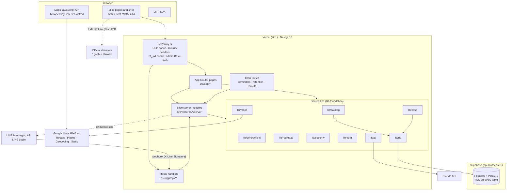
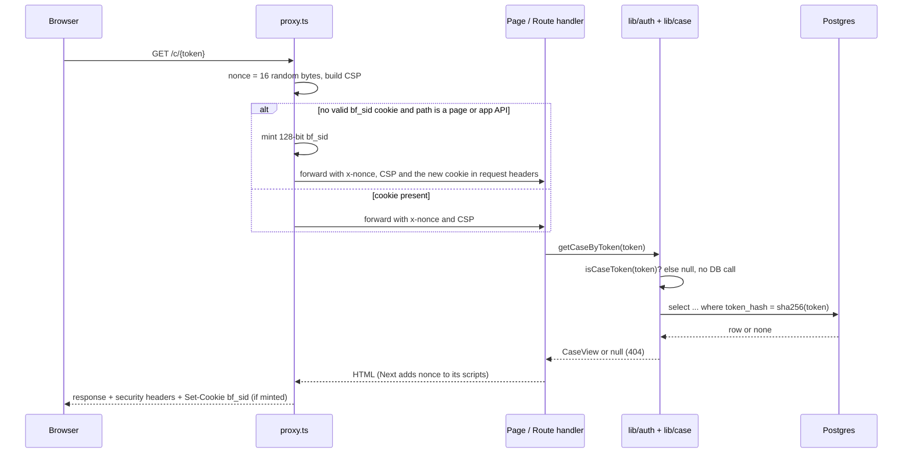
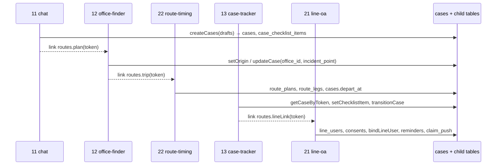
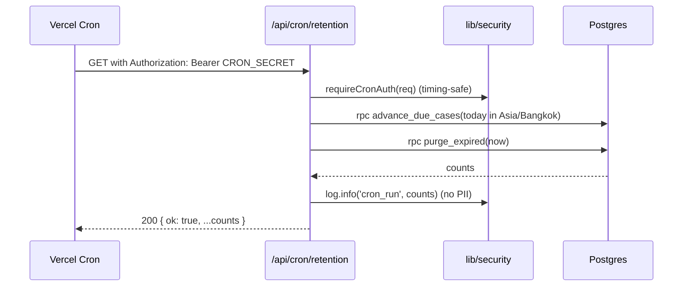
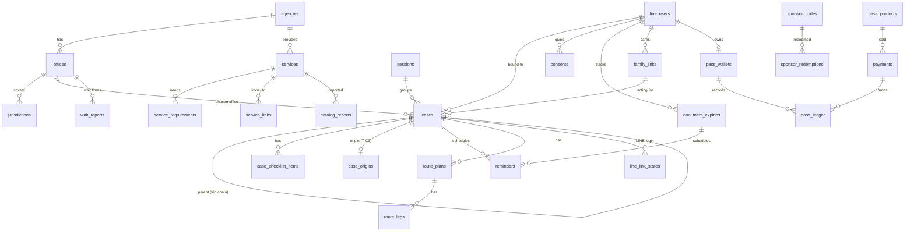

# Design Document: 00-foundation

Spec 00-foundation · Wave 0 · executor machine-a (lead) · Jira KAN-4

## Overview

00-foundation turns an empty repository into a codebase that every other spec can build on without touching a shared file. It creates the scaffold, the full folder tree, the complete database schema for every spec in `spec-map.md` (MVP and Phase 2), one fixture seed, the shared types in `src/lib/contracts.ts`, the shared libraries, the app shell, the auth stub, the security proxy, the cron and environment declarations, and one placeholder page plus one empty server module per slice. After wave 0, machine-b, machine-c and the kiro-cloud sessions only edit the folders they own.

The foundation ships no slice features. Shared libraries get working bodies only where a slice needs them to run on day one: Supabase clients, the session cookie, route constants, catalog reads, case create/read by token, the link allowlist, PII masking, rate limiting, safe errors and the logger. Everything else is a signature with a minimal body.

Part 1 is the high-level design: scaffold, architecture, folder tree, shell, auth, proxy, placeholders, crons, env, README and the per-slice contract. Part 2 is the low-level design: migrations, seed, `contracts.ts`, library signatures with formal specifications, algorithms and correctness properties.

### Decisions at a glance

| Topic | Decision | Reason |
| --- | --- | --- |
| Request interceptor | `src/proxy.ts` exporting `proxy()` | Next.js 16 deprecated `middleware.ts` and renamed the convention to `proxy.ts`; Proxy runs on the Node.js runtime ([Next.js docs](https://nextjs.org/docs/messages/middleware-to-proxy)). `structure.md` still says `src/middleware.ts` and needs the same rename |
| TypeScript | 6.0.3, not 7.0.2 | TS 7 is the Go port and ships no JavaScript compiler API. `next build` type-checks through that API by default, and typescript-eslint needs it too |
| Data access | Catalog reads use the publishable key under RLS. Everything private goes through the server-only secret-key client inside `lib/*` and slice server modules | Least privilege for public data, and one reviewed path for private data (A01, A02) |
| Case access | 128-bit random `caseToken` in the URL, only `sha256(token)` stored | No IDOR by guessing, and a DB leak does not leak live links (A01, A04) |
| Citizen identity | Anonymous `bf_sid` cookie, no login | W-12 and A07: no home-made password system |
| Admin identity | HTTP Basic Auth in the proxy for `/admin` and `/api/admin`, one demo user, password from env | Nothing in the requirements asks for a real login; production adds MFA (A07) |
| Event names | `events.name` is text with a regex check, the known names are a union in `contracts.ts` | Slices can never add migrations, so a new event name must not need one |
| Fixtures vs. real content | `00_fixtures.sql` is placeholder data. 91-demo-catalog upserts real rows in `10_demo_*.sql` with the same canonical IDs | Every slice can run before 91 lands |

---

# Part 1: High-Level Design

## Scaffold and Version Pins

Versions were read from the npm registry on 2026-11-26. Exact pins, no `^`, and a committed `package-lock.json` (A03).

| Package | Pin | Kind | Used by |
| --- | --- | --- | --- |
| `next` | 16.4.6 | dep | all (App Router, Turbopack default) |
| `react`, `react-dom` | 19.3.1 | dep | all |
| `@supabase/supabase-js` | 2.119.2 | dep | `lib/db` |
| `@anthropic-ai/sdk` | 1.14.0 | dep | `lib/ai` only (server) |
| `@line/bot-sdk` | 11.4.0 | dep | 21-line-oa (installed now so 21 never edits `package.json`) |
| `@vis.gl/react-google-maps` | 1.10.2 | dep | 12-office-finder, 22-route-timing (Maps JavaScript API, T-05) |
| `qrcode` | 1.5.4 | dep | 21-line-oa (W-11 QR) |
| `zod` | 4.6.7 | dep | `lib/security`, all slices |
| `server-only` | 0.0.1 | dep | every server module |
| `typescript` | 6.0.3 | dev | strict mode |
| `@types/node` | 24.19.4 | dev | Node 24 runtime on Vercel |
| `@types/react`, `@types/react-dom` | 19.3.3, 19.3.0 | dev | |
| `@types/qrcode` | 1.5.6 | dev | |
| `supabase` (CLI) | 3.4.0 | dev | `npx supabase start/db reset/gen types` |
| `vitest` | 5.1.2 | dev | configured, no tests in this spec |
| `vite` | 8.3.8 | dev | vitest peer |
| `fast-check` | 4.11.0 | dev | property tests written by slices |
| `@playwright/test` | 1.65.1 | dev | 20-journeys-e2e |
| `eslint` | 9.39.5 | dev | ESLint 10 is out, but the Next plugin set is verified on 9 |
| `eslint-config-next` | 16.4.6 | dev | flat config |
| `prettier` | 3.10.1 | dev | |
| `tailwindcss`, `@tailwindcss/postcss` | 4.3.5, 4.3.5 | dev | UI kit styling |

Runtime: Node 24 (`.nvmrc` = `24`, `engines.node` = `>=24 <27`). Vercel region `sin1` and Supabase region `ap-southeast-1` (Singapore), the closest pair to Bangkok (N-06).

`package.json` scripts:

| Script | Command |
| --- | --- |
| `dev` | `next dev` |
| `build` | `next build` |
| `start` | `next start` |
| `lint` | `eslint .` (Next 16 removed `next lint`) |
| `typecheck` | `tsc --noEmit` |
| `test` | `vitest run` |
| `e2e` | `playwright test` |
| `db:start` | `supabase start` |
| `db:reset` | `supabase db reset` (applies migrations, then `./seed/*.sql`) |
| `db:types` | `supabase gen types typescript --local > src/lib/db/database.types.ts` |
| `audit` | `npm audit --omit=dev` (A03) |

Config files:
- `tsconfig.json`: `strict`, `noUncheckedIndexedAccess`, `noImplicitOverride`, `moduleResolution: "bundler"`, `paths: { "@/*": ["./src/*"] }`.
- `next.config.ts`: `poweredByHeader: false`, `reactStrictMode: true`. No headers here; the proxy owns them.
- `vitest.config.ts`: `environment: 'node'`, `include: ['src/**/*.test.ts']`, alias `@` → `src`, `server-only` aliased to an empty module so server code can be unit-tested.
- `playwright.config.ts`: `testDir: 'e2e'`, `baseURL` from `NEXT_PUBLIC_SITE_URL`, `webServer: npm run dev`. Created as a stub and handed to 20-journeys-e2e.
- `eslint.config.mjs`: `eslint-config-next` core-web-vitals + typescript, plus `no-restricted-imports` that blocks `@/features/*` outside its own folder (the slice isolation rule) and blocks `@/lib/db/server` from client components.
- `postcss.config.mjs`, `.prettierrc`, `.gitignore` (includes `.env*.local`, `supabase/.temp`).

## Architecture



Slices meet only through DB tables, `lib/routes.ts` URLs and the shared libs. A slice never imports another slice's `src/features/**`; the ESLint rule enforces it.

### Request pipeline



### Cross-slice handoff through tables and URLs



### Cron flow



## Folder Tree

Owner in brackets. `[F]` is 00-foundation. A slice tag marks a stub file that the foundation creates in wave 0 and then hands over (Stub handoff rule).

```
.
├── .env.example                         [F] every env var, server-only vs NEXT_PUBLIC
├── .gitignore  .nvmrc  .prettierrc      [F]
├── eslint.config.mjs  postcss.config.mjs  vitest.config.ts   [F]
├── next.config.ts  tsconfig.json  package.json  package-lock.json   [F]
├── vercel.json                          [F] all crons
├── playwright.config.ts                 [20] stub
├── README.md                            [F] "Start here" section · [93] the rest
├── data/catalog/README.md               [91] stub
├── docs/
│   ├── requirements.md                  [lead]
│   └── README.md                        [93] stub
├── e2e/journeys.spec.ts                 [20] stub (test.fixme titles only)
├── public/
│   ├── favicon.ico                      [F]
│   └── og/.gitkeep                      [90] stub
├── supabase/
│   ├── config.toml                      [F] seed sql_paths = ['./seed/*.sql']
│   ├── migrations/                      [F]
│   │   ├── 20261126000100_extensions_types.sql
│   │   ├── 20261126000200_catalog.sql
│   │   ├── 20261126000300_identities.sql
│   │   ├── 20261126000400_cases.sql
│   │   ├── 20261126000500_line.sql
│   │   ├── 20261126000600_routes.sql
│   │   ├── 20261126000700_admin_kpi.sql
│   │   ├── 20261126000800_phase2.sql
│   │   ├── 20261126000900_functions.sql
│   │   └── 20261126001000_rls.sql
│   └── seed/
│       ├── 00_fixtures.sql              [F] placeholder rows
│       └── 10_demo_00_placeholder.sql   [91] stub (comments only)
└── src/
    ├── proxy.ts                         [F] (structure.md: src/middleware.ts → rename)
    ├── app/
    │   ├── layout.tsx  globals.css      [F] shell
    │   ├── dev/page.tsx                 [F] spec status page (needs adding to structure.md)
    │   ├── api/health/route.ts          [F]
    │   ├── api/cron/retention/route.ts  [F]
    │   ├── (marketing)/page.tsx         [90] stub  → "/"
    │   ├── not-found.tsx  robots.ts  sitemap.ts   [90] stubs
    │   ├── chat/page.tsx                [11] stub
    │   ├── api/chat/route.ts            [11] stub
    │   ├── plan/[token]/page.tsx        [12] stub
    │   ├── api/plan/route.ts            [12] stub
    │   ├── c/[token]/page.tsx           [13] stub
    │   ├── api/case/route.ts            [13] stub
    │   ├── line/page.tsx                [21] stub
    │   ├── api/line/webhook/route.ts    [21] stub (signature check only)
    │   ├── api/line/cron/reminders/route.ts   [21] stub (cron auth only)
    │   ├── trip/[token]/page.tsx        [22] stub
    │   ├── api/trip/route.ts            [22] stub
    │   ├── pass/page.tsx                [30] stub
    │   ├── api/pass/cron/reroute/route.ts     [30] stub (cron auth only)
    │   ├── wallet/page.tsx              [31] stub
    │   ├── api/wallet/route.ts          [31] stub
    │   ├── admin/page.tsx               [92] stub
    │   ├── api/admin/route.ts           [92] stub
    │   ├── api/report/route.ts          [92] stub (public report POST, no Basic Auth)
    │   └── report/page.tsx              [92] stub
    ├── components/
    │   ├── ui/                          [F] Button, LinkButton, Card, Chip, ChoiceButtons, Checkbox,
    │   │                                    Alert, Spinner, SourceBadge, StaleBadge, ExternalLink, HotlineLink
    │   └── shell/                       [F] Header, Nav, Footer, TrustBanner, EmergencyBar,
    │                                        FontSizeControl, SlicePlaceholder
    ├── features/
    │   ├── chat/server/index.ts         [11] stub
    │   ├── office-finder/server/index.ts [12] stub
    │   ├── case-tracker/server/index.ts [13] stub
    │   ├── line/server/index.ts         [21] stub
    │   ├── route-timing/server/index.ts [22] stub
    │   ├── smart-pass/server/index.ts   [30] stub
    │   ├── phase2/server/index.ts       [31] stub
    │   └── admin/server/index.ts        [92] stub
    └── lib/
        ├── contracts.ts                 [F] the only hand-written shared types file
        ├── routes.ts                    [F] routes, api paths, hotlines, SPECS, DEMO_TOKENS
        ├── db/        server.ts  browser.ts  database.types.ts (generated)
        ├── catalog/   index.ts (server)  pure.ts  queries.ts  staleness.ts  conditions.ts  hours.ts
        ├── case/      index.ts (server)  token.ts  status.ts  queries.ts
        ├── ai/        index.ts (server)  client.ts  guard.ts  pii.ts  tools.ts  prompt.ts  cache.ts
        │              emergency.ts (isomorphic)  disclaimers.ts (isomorphic)
        ├── maps/      server.ts  urls.ts (isomorphic)  fieldMasks.ts
        ├── security/  schemas.ts  links.ts  rateLimit.ts  hash.ts  errors.ts  log.ts
        │              signature.ts  cron.ts  headers.ts
        ├── auth/      session.ts  admin.ts  line.ts
        └── line/      index.ts (server)  push.ts
```

Import rule: files without `server-only` (`catalog/pure.ts`, `case/status.ts`, `ai/pii.ts`, `ai/emergency.ts`, `ai/disclaimers.ts`, `maps/urls.ts`, `security/schemas.ts`, `security/links.ts`, `routes.ts`, `contracts.ts`) are isomorphic and safe in client components. Every other `lib` file starts with `import 'server-only'`.

## App Shell

`src/app/layout.tsx` renders, in order:

1. `<html lang="th" data-font-scale={cookie bf_fs ?? '100'}>` with `Noto_Sans_Thai` from `next/font/google` (self-hosted at build, so the CSP needs no font host).
2. `TrustBanner`: a full-width strip that always shows `NOT_GOV_SITE_TH` ("เว็บไซต์นี้ไม่ใช่เว็บไซต์ของหน่วยงานราชการ"), `NOT_POLICE_CHANNEL_TH` ("ระบบนี้ไม่ใช่ช่องทางรับแจ้งความ") and `NO_MONEY_NO_PASSWORD_TH` ("เราไม่ขอเงิน รหัสผ่าน หรือเลขบัญชีของคุณ"). N-05, X-01, RK-04.
3. `Header`: product name, `FontSizeControl`, and `Nav`.
4. `Nav`: a `<details>` disclosure (works without JS) listing `NAV_ITEMS` from `lib/routes.ts`. It links to every slice placeholder, grouped by wave, plus `/dev`. Token pages use `DEMO_TOKENS.planned`.
5. `<main id="main">` with a skip link before the header.
6. `EmergencyBar`: sticky bottom bar with two large `tel:` buttons, 191 (เหตุด่วนเหตุร้าย) and 1669 (เจ็บป่วยฉุกเฉิน). It accepts `variant: 'bar' | 'inline'` so chat and LINE pages can render it inside a message (W-14, resolves 11's gap G7).
7. `Footer`: links to about, privacy, terms (90), "ข้อมูลนี้ไม่ตรง" (`routes.report()`, 92), the hotline list, and the not-a-government-site sentence again.

Accessibility rules (N-07): base font size 18px and all sizes in `rem`; `FontSizeControl` switches `data-font-scale` between 100, 125 and 150 and stores the choice in the `bf_fs` cookie (not HttpOnly, no PII) so the server renders the right size without a flash; tap targets at least 48×48 px; text contrast at least 4.5:1; visible focus rings; one `h1` per page; `ChoiceButtons` is a radio group with arrow-key support.

UI kit prop contracts (published here so slices do not guess, gap G7):

```typescript
type ButtonProps = React.ButtonHTMLAttributes<HTMLButtonElement> & { variant?: 'primary' | 'secondary' | 'danger'; size?: 'md' | 'lg' }
type LinkButtonProps = { href: string; variant?: ButtonProps['variant']; children: React.ReactNode }
type CardProps = { title?: string; children: React.ReactNode; as?: 'section' | 'article' | 'div' }
type ChipProps = { tone?: 'neutral' | 'info' | 'warn' | 'danger'; children: React.ReactNode }
type ChoiceButtonsProps<V extends string | boolean> = {
  name: string; legendTh: string
  options: readonly { value: V; labelTh: string }[]
  value?: V | null; onChange: (v: V) => void; allowSkip?: boolean
}
type CheckboxProps = { checked: boolean; onChange: (checked: boolean) => void; labelTh: string; disabled?: boolean }
type AlertProps = { tone: 'info' | 'warn' | 'danger'; titleTh?: string; children: React.ReactNode }
type SpinnerProps = { labelTh?: string }
type SourceBadgeProps = { sourceUrl: string; lastVerified: IsoDate }
type StaleBadgeProps = { lastVerified: IsoDate; now?: Date }
type ExternalLinkProps = { href: string | null | undefined; children: React.ReactNode }
type HotlineLinkProps = { number: Hotline; labelTh: string }
type EmergencyBarProps = { variant?: 'bar' | 'inline' }
type SlicePlaceholderProps = { spec: SpecId; probe?: React.ReactNode }
```

`SourceBadge` shows the source host and "ตรวจสอบเมื่อ {date in Thai}". `StaleBadge` renders "ควรโทรยืนยัน" only when `staleness(lastVerified, now).isStale` (N-01). `ExternalLink` renders `safeHref(href)` with `target="_blank" rel="noopener noreferrer"`, or plain text when the link is not allowlisted (N-05, LLM05).

## Auth Stub

Citizens (W-12, A07):
- Cookie `bf_sid`: 128-bit value from `crypto.getRandomValues`, base64url, 22 characters.
- Flags: `HttpOnly; Secure; SameSite=Lax; Path=/; Max-Age=2592000` (30 days). Lax keeps the session when a user opens a case link from LINE. Secure is always set; Chrome and Firefox accept Secure cookies on `http://localhost`.
- The proxy mints the cookie when it is missing or malformed, on page requests and app API requests. It skips webhooks, cron routes and `/api/health`.
- The DB never stores the raw value. `getSessionId()` hashes it and calls `touch_session(hash)`, which upserts `sessions` and returns the session UUID. Sessions are created lazily, so crawlers cost no rows.
- The case token is the access key to a case. The session only groups a browser's cases for "Case ของฉัน".

Admin (N-08 stub for 92):
- The proxy checks `Authorization: Basic` on `/admin/**` and `/api/admin/**`. User is `ADMIN_DEMO_USER` (default `admin`), password is `ADMIN_DEMO_PASSWORD`. Both are compared with `timingSafeEqual` on SHA-256 digests.
- If `ADMIN_DEMO_PASSWORD` is unset or shorter than 24 characters, admin paths return 503 (fail closed, A10).
- `requireAdmin()` repeats the check inside route handlers, server actions and pages (defense in depth if the matcher is wrong).
- The public report form `/report` is outside the admin paths and submits through a server action owned by 92.
- Production adds MFA or SSO (A07 production column).

LINE identity: `verifyLineIdToken()` in `lib/auth/line.ts` posts the ID token to `https://api.line.me/oauth2/v2.1/verify` with `client_id = LINE_LOGIN_CHANNEL_ID` and the expected nonce. 21-line-oa uses it; the foundation only provides it (A07).

## Proxy: Security Headers and CSP

`src/proxy.ts` runs on every request except static assets (`matcher: '/((?!_next/static|_next/image|favicon.ico|og/).*)'`).

Headers on every response (A02):

| Header | Value |
| --- | --- |
| `Content-Security-Policy` | see below, per-request nonce |
| `Strict-Transport-Security` | `max-age=63072000; includeSubDomains; preload` (production only) |
| `X-Frame-Options` | `DENY` |
| `X-Content-Type-Options` | `nosniff` |
| `Referrer-Policy` | `strict-origin-when-cross-origin` |
| `Permissions-Policy` | `geolocation=(self), camera=(), microphone=(), payment=(), usb=()` |
| `Cross-Origin-Opener-Policy` | `same-origin` |

CSP (built by `buildCsp(nonce, env)` in `lib/security/headers.ts`):

```
default-src 'self';
script-src 'self' 'nonce-{nonce}' 'strict-dynamic' https://maps.googleapis.com https://static.line-scdn.net {dev: 'unsafe-eval'};
style-src 'self' 'unsafe-inline';
img-src 'self' data: blob: https://*.googleapis.com https://*.gstatic.com https://*.google.com https://*.ggpht.com https://*.line-scdn.net;
font-src 'self';
connect-src 'self' {NEXT_PUBLIC_SUPABASE_URL} https://*.googleapis.com https://*.google.com https://*.gstatic.com https://api.line.me https://access.line.me https://liffsdk.line-scdn.net https://*.line-scdn.net;
frame-src https://*.google.com;
worker-src 'self' blob:;
object-src 'none';
base-uri 'self';
form-action 'self' https://access.line.me;
frame-ancestors 'none';
upgrade-insecure-requests
```

Notes:
- Next.js reads the nonce from the request's CSP header and adds it to its own scripts. Scripts loaded by those scripts (the Maps JS loader, the LIFF SDK) are trusted through `'strict-dynamic'`. The host entries are a fallback for older browsers.
- Google Maps injects inline styles, so `style-src` needs `'unsafe-inline'`. This is Google's documented requirement and does not allow scripts.
- A nonce makes every page dynamically rendered. That is acceptable for a hackathon app with no static marketing traffic at scale.
- `frame-ancestors 'none'` is fine for LIFF: LIFF opens the page in LINE's in-app browser, not in an iframe.

## Slice Placeholders and `/dev`

Each placeholder page renders `<SlicePlaceholder spec="…" probe={…} />`, which shows the spec name, Jira key, wave, executor and owned folders from `SPECS`. The probe is one call to a shared lib against the fixtures, proving the wiring. Every empty server module is `import 'server-only'` plus `export {}`. Every stub API route returns `501 { error: 'not_implemented' }` through `toSafeResponse`, except the noted ones.

| Spec | Jira | Wave · executor | Placeholder (URL → file) | Probe | Server module and stub routes |
| --- | --- | --- | --- | --- | --- |
| 11-chat-triage | KAN-6 | 1 · machine-b | `/chat` → `src/app/chat/page.tsx` | `listServices().length` | `src/features/chat/server/index.ts`, `src/app/api/chat/route.ts` |
| 12-office-finder | KAN-7 | 1 · machine-c | `/plan/[token]` → `src/app/plan/[token]/page.tsx` | `getCaseByToken(token)` status + office name | `src/features/office-finder/server/index.ts`, `src/app/api/plan/route.ts` |
| 13-case-tracker | KAN-5 | 1 · machine-a | `/c/[token]` → `src/app/c/[token]/page.tsx` | status label + checklist count | `src/features/case-tracker/server/index.ts`, `src/app/api/case/route.ts` |
| 20-journeys-e2e | KAN-11 | 3 · machine-a | no page: `e2e/journeys.spec.ts` with `test.fixme` titles for J1, J1b, J2, J3; `playwright.config.ts`; listed on `/dev` | none | none |
| 21-line-oa | KAN-12 | 2 · machine-b | `/line` → `src/app/line/page.tsx` | LINE env configured yes/no | `src/features/line/server/index.ts`, `api/line/webhook` (verifies `X-Line-Signature`, returns 200 `{}`), `api/line/cron/reminders` (cron auth, returns `{ skipped: true }`) |
| 22-route-timing | KAN-13 | 2 · machine-c | `/trip/[token]` → `src/app/trip/[token]/page.tsx` | `departAt` or "—" | `src/features/route-timing/server/index.ts`, `src/app/api/trip/route.ts` |
| 30-smart-pass | KAN-15 | 4 · unassigned | `/pass` → `src/app/pass/page.tsx` | none | `src/features/smart-pass/server/index.ts`, `api/pass/cron/reroute` (cron auth, returns `{ skipped: true }`) |
| 31-phase2-extras | KAN-16 | 4 · unassigned | `/wallet` → `src/app/wallet/page.tsx` | none | `src/features/phase2/server/index.ts`, `src/app/api/wallet/route.ts` |
| 90-landing-seo | KAN-8 | 1 · kiro-cloud | `/` → `src/app/(marketing)/page.tsx`; `not-found.tsx`, `robots.ts` (allow all, disallow `/admin`, `/dev`, `/c/`, `/plan/`, `/trip/`), `sitemap.ts` (`/`, `/chat`), `public/og/.gitkeep` | none | none |
| 91-demo-catalog | KAN-9 | 1 · kiro-cloud | no page: `supabase/seed/10_demo_00_placeholder.sql` (comments only), `data/catalog/README.md`; listed on `/dev` | none | none |
| 92-admin-catalog | KAN-10 | 1 · kiro-cloud | `/admin` → `src/app/admin/page.tsx` (calls `requireAdmin`), `/report` → `src/app/report/page.tsx` | `/admin`: services with `staleness` | `src/features/admin/server/index.ts`, `src/app/api/admin/route.ts`, `src/app/api/report/route.ts` (public, 501) |
| 93-docs-pitch | KAN-14 | 2 · kiro-cloud | no page: `docs/README.md`, and a `## Project docs` heading after "Start here" in `README.md`; listed on `/dev` | none | none |

`/dev` (`src/app/dev/page.tsx`, foundation-owned) lists every row of `SPECS` including 00-foundation (KAN-4): spec, Jira key, wave, executor, owned folders and a link to the placeholder. It also links `/api/health`. It sets `robots: { index: false }`.

After wave 0 every file in this table belongs to its slice. The foundation never edits them again.

## Crons (`vercel.json`)

```json
{
  "$schema": "https://openapi.vercel.sh/vercel.json",
  "regions": ["sin1"],
  "crons": [
    { "path": "/api/line/cron/reminders", "schedule": "*/5 * * * *" },
    { "path": "/api/cron/retention", "schedule": "5 17 * * *" },
    { "path": "/api/pass/cron/reroute", "schedule": "*/10 22,23,0,1,2 * * *" }
  ]
}
```

| Cron | Owner | Schedule (UTC) | Bangkok time | Requirement |
| --- | --- | --- | --- | --- |
| reminders | 21-line-oa | every 5 min | always | L-02, L-03, N-06 (≤ 5 min drift) |
| retention | 00-foundation | 17:05 daily | 00:05 | N-03, T-C3, D-10 (`booked → due`) |
| reroute | 30-smart-pass | every 10 min, 22:00–02:59 | 05:00–09:59 | T-08, L-08 (Phase 2) |

Vercel plan limits ([Vercel docs](https://vercel.com/docs/cron-jobs/usage-and-pricing)): Hobby allows only daily crons with ±59 minutes precision, and a deploy with a more frequent expression fails. Pro allows once per minute with per-minute precision. This file needs Pro. On Hobby, the lead changes the reminders schedule to `0 0 * * *` (07:00 Bangkok) and reroute to `0 23 * * *` (06:00 Bangkok), and N-06's 5-minute target is not met. For the demo, the D-1 reminder can be triggered by calling the route with the `CRON_SECRET` bearer token. Vercel also calls Cron Jobs a legacy feature that will move to Schedules; the paths and the bearer check stay the same.

Every cron route starts with `requireCronAuth(req)`, which compares `Authorization: Bearer ${CRON_SECRET}` in constant time and returns 401 otherwise.

## Environment (`.env.example`)

`[server]` values must never be read in client code; `lib/*` files that read them import `server-only`. `[public]` values are inlined into the browser bundle.

```bash
# --- App ---
NEXT_PUBLIC_SITE_URL=http://localhost:3000          # [public] canonical origin for absolute links, OG, LINE callbacks
APP_ENV=local                                       # [server] local | preview | production; turns on HSTS in production

# --- Supabase ---
NEXT_PUBLIC_SUPABASE_URL=http://127.0.0.1:54321     # [public] API URL from `supabase status`
NEXT_PUBLIC_SUPABASE_PUBLISHABLE_KEY=               # [public] publishable key; RLS limits it to published catalog rows
SUPABASE_SECRET_KEY=                                # [server] secret key, bypasses RLS; read only in src/lib/db/server.ts

# --- Security ---
IP_HASH_SALT=                                       # [server] 32+ random bytes; HMAC key for hashed IPs in rate limits and logs
CRON_SECRET=                                        # [server] 32+ random chars; Vercel sends it as a Bearer token to cron routes
ADMIN_DEMO_USER=admin                               # [server] demo admin username for /admin Basic Auth
ADMIN_DEMO_PASSWORD=                                # [server] 24+ random chars; admin paths return 503 when unset

# --- Claude (lib/ai only) ---
ANTHROPIC_API_KEY=                                  # [server] Claude API key
ANTHROPIC_MODEL=                                    # [server] a current model ID from the Claude models overview
LLM_MAX_TOKENS=600                                  # [server] hard cap on max_tokens per call (LLM10, N-09)
LLM_TIMEOUT_MS=8000                                 # [server] abort a Claude call after this many ms (A10)
LLM_DAILY_CALL_CAP=2000                             # [server] global Claude calls per day before fallback (LLM10)

# --- Google Maps Platform ---
GOOGLE_MAPS_SERVER_KEY=                             # [server] API-restricted to Routes, Places (New), Geocoding, Maps Static
GOOGLE_MAPS_STATIC_SIGNING_SECRET=                  # [server] signs Maps Static URLs used in LINE Flex (T-09)
MAPS_TIMEOUT_MS=4000                                # [server] per-request timeout before the T-10 fallback
NEXT_PUBLIC_GOOGLE_MAPS_BROWSER_KEY=                # [public] HTTP-referrer restricted; Maps JavaScript API + Places only
NEXT_PUBLIC_GOOGLE_MAPS_MAP_ID=                     # [public] map ID for Advanced Markers (T-05)

# --- LINE ---
LINE_CHANNEL_SECRET=                                # [server] Messaging API secret; verifies X-Line-Signature (A08)
LINE_CHANNEL_ACCESS_TOKEN=                          # [server] Messaging API token for reply and push
LINE_LOGIN_CHANNEL_ID=                              # [server] LINE Login channel ID; ID-token audience (A07)
LINE_LOGIN_CHANNEL_SECRET=                          # [server] LINE Login secret for the code exchange
LINE_MONTHLY_PUSH_BUDGET=300                        # [server] OA plan push quota; claim_push refuses above it (L-C1)
NEXT_PUBLIC_LIFF_ID=                                # [public] LIFF app ID for "เริ่มเรื่องใหม่" (L-04)
NEXT_PUBLIC_LINE_OA_BASIC_ID=                       # [public] @basic-id for the add-friend link (L-C2)
PRIVACY_POLICY_VERSION=2026-11-26                   # [server] stored in consents when a user binds LINE (N-03)

# --- Phase 2 (30, 31) ---
FEATURE_SMART_PASS=false                            # [server] gates Smart Pass routes and the reroute cron (M-05)
FEATURE_PHASE2_EXTRAS=false                         # [server] gates wallet, family, OCR, i18n (M-05)
PAYMENT_PROVIDER=                                   # [server] payment gateway name, e.g. omise (B-02)
PAYMENT_SECRET_KEY=                                 # [server] gateway secret key (B-02)
PAYMENT_WEBHOOK_SECRET=                             # [server] verifies gateway webhook signatures (A08)
NEXT_PUBLIC_PAYMENT_PUBLIC_KEY=                     # [public] gateway public key for PromptPay QR / card tokenization
```

Vercel sets `VERCEL_ENV` and `VERCEL_GIT_COMMIT_SHA` itself; `/api/health` reports the short SHA.

## README.md "Start here" Section

The foundation writes exactly this section at the top of `README.md`. 93-docs-pitch may add content below `## Project docs` but must leave this section unchanged.

```markdown
## Start here

1. Clone and install
   git clone <repo> && cd <repo>
   nvm use            # Node 24
   npm ci
2. Env
   cp .env.example .env.local
   Fill Supabase keys after step 3. Ask the lead for Claude, Maps and LINE keys. Never commit .env.local.
3. Database (Docker must be running)
   npm run db:start   # prints API URL, publishable key and secret key → paste into .env.local
   npm run db:reset   # applies supabase/migrations, then loads supabase/seed/*.sql
4. Run
   npm run dev        # http://localhost:3000 — open /dev to see every spec and its placeholder
5. Find your slice
   Open .kiro/steering/spec-map.md: your spec, wave, executor and Jira key.
   Open .kiro/steering/structure.md: the folders you own. Edit only those.
6. Ownership rule
   Every path has one owning spec. Shared paths (package.json, configs, src/proxy.ts, src/app/layout.tsx,
   src/components/**, src/lib/**, supabase/migrations/**, vercel.json, .env.example) belong to 00-foundation.
   Never edit them from a slice branch.
7. Need a shared change? (new column, dependency, env var, route constant, cron, event name)
   Open a Jira sub-task under KAN-4 titled "KAN-4 request: <what>" with: the spec asking, the exact change,
   and the requirement ID. The lead (machine-a) makes the change on main; rebase after it merges.
8. Pull requests
   Branch: <jira-key>-<short-name>. The PR title must contain your Jira key, e.g. "KAN-6 chat triage buttons".
   Before pushing: npm run lint && npm run typecheck && npm run build.
```

## Contracts for Slices

What each spec relies on. Everything listed exists after wave 0, so no slice needs a shared edit. R = read, W = write.

| Spec | Tables | Lib functions | Routes, types, env, events |
| --- | --- | --- | --- |
| 11-chat-triage | R `services`, `service_requirements`, `service_links`, `agencies`. W `cases`, `case_checklist_items` (through `lib/case`). W `events` | `listServices`, `getServicesByIds`, `getRequirements`, `getServiceLinks`, `listAgencies`, `getAgency`, `evaluateCondition`, `evaluateCondition3`, `staleness`; `guardInput`, `wrapUserText`, `sanitizeLlmText`, `catalogTools`, `parseSelectServices`, `streamClaude`, `cachedAnswer`, `detectEmergency`, `SYSTEM_PROMPT_BASE`, `MAX_USER_CHARS`; `createCases`, `listChecklist`, `setChecklistItem`; `getSessionId`; `rateLimit('chat'/'chat_ip')`, `hashIp`, `clientIp`, `safeHref`, `AppError`, `toSafeResponse`, `log`, `trackEvent` | `routes.chat`, `routes.plan(t)`, `routes.case(t)`, `routes.report({serviceId, requirementId})`, `api.chat`, `api.chatChecklist`, `hotlines`; types `Service`, `ServiceRequirement`, `ServiceLink`, `TriageQuestion`, `Condition`, `SlotAnswers`, `CaseDraft`, `CreatedCase`, `ChecklistItem`; constants `NOT_POLICE_CHANNEL_TH`, `OFFICIAL_POLICE_CHANNEL`; env `ANTHROPIC_*`, `LLM_*` (inside `lib/ai`); events `chat_started`, `services_selected`, `low_confidence`, `emergency_shown`, `online_resolved`, `plan_ready`, `case_created` |
| 12-office-finder | R `offices`, `jurisdictions`, `holidays`, `services`, `cases`. W `cases.office_id`, `incident_point`, `incident_confirmed`, `slot_answers`; W `case_origins` | `findJurisdictions`, `nearestOffices`, `listOffices`, `getOffice`, `listHolidays`, `openSlots`, `isOpenAt`, `getService`; `getCaseByToken`, `updateCase`, `setOrigin`, `getOrigin`; `autocomplete`, `placeDetails`, `geocode`, `computeRouteMatrix`, `computeRoutes` (`TRAFFIC_UNAWARE`, selected office only, for the T-05 polyline; 22 still owns `route_plans` and leave-home time), `directionsUrl`, `FIELD_MASKS`; `rateLimit('plan'/'maps')`, `LatLngSchema` | `routes.plan(t)`, `routes.trip(t)`, `api.plan`; types `Office`, `JurisdictionMatch`, `NearbyOffice`, `OpeningHours`, `LatLng`, `MapsResult`; env `GOOGLE_MAPS_SERVER_KEY`, `NEXT_PUBLIC_GOOGLE_MAPS_*`, `MAPS_TIMEOUT_MS`; events `office_selected`, `jurisdiction_shown`, `maps_fallback` |
| 13-case-tracker | R `cases`, `case_checklist_items`, `services`, `offices`. W `case_checklist_items.checked`, `cases.status`, `appointment_at`, `time_saved_min` | `getCaseByToken`, `listCasesForSession`, `listChecklist`, `setChecklistItem`, `transitionCase`, `updateCase`, `canTransition`; `getService`, `getOffice`, `staleness`; `getSessionId`; `directionsUrl`; `rateLimit('case_read'/'case_write')` | `routes.case(t)`, `routes.lineLink(t)`, `routes.trip(t)`, `api.case`; types `CaseView`, `CaseSummary`, `CaseStatus`, `CASE_TRANSITIONS`, `CASE_STATUS_LABEL_TH`; events `case_viewed`, `checklist_ticked`, `calendar_added` |
| 20-journeys-e2e | R fixtures through the UI only | none (black box) | every `routes.*`, `DEMO_TOKENS`, fixture IDs in Seed Fixtures; owns `e2e/**`, `playwright.config.ts`; reads `events` for K-01 via a local SQL query |
| 21-line-oa | R/W `line_users`, `consents`, `line_link_states`, `line_webhook_events`, `reminders`, `document_expiries`, `line_push_usage`; R/W `cases.line_user_id`, `status`, `appointment_at`, `reminders_muted`, `push_count` | `verifyLineSignature`, `verifyLineIdToken`, `getCaseByToken`, `getCaseById`, `bindLineUser`, `listCasesForLineUser`, `transitionCase`, `updateCase`, `claimPush`, `deleteLineUserData`, `requireCronAuth`, `rateLimit('line_login'/'line_webhook')`, `directionsUrl`, `staticMapUrl`, `guardInput`, `wrapUserText`, `sanitizeLlmText`, `callClaude`, `streamClaude`, `catalogTools`, `parseSelectServices`, `SYSTEM_PROMPT_BASE`, `detectEmergency`, `listServices`, `getServicesByIds`, `getRequirements`, `getServiceLinks`, `createCases` (L-06 next case), `pushToLineUser`. L-07 builds its own LINE intake from these `lib/ai` parts; it never imports `src/features/chat` | `routes.line`, `routes.lineLink(t)`, `routes.liff`, `api.lineWebhook`, `api.lineLoginCallback`, `api.lineCronReminders`; constants `NOT_POLICE_CHANNEL_TH` (L-C3); env `LINE_*`, `NEXT_PUBLIC_LIFF_ID`, `NEXT_PUBLIC_LINE_OA_BASIC_ID`, `PRIVACY_POLICY_VERSION`; deps `@line/bot-sdk`, `qrcode`; events `line_linked`, `push_sent`, `reminder_failed`, `line_data_deleted`, `signature_failed` |
| 22-route-timing | R `cases`, `offices`, `case_origins`, `holidays`. W `route_plans`, `route_legs`, `cases.depart_at` | `getCaseByToken`, `getOrigin`, `updateCase`, `getOffice`, `isOpenAt`, `computeRoutes`, `directionsUrl`, `FIELD_MASKS`; service client from `lib/db/server` for `route_plans` | `routes.trip(t)`, `api.trip`; types `RoutePlan`, `RouteLeg`, `TravelMode`; events `route_computed`, `maps_fallback`, `maps_call` |
| 30-smart-pass | R/W `pass_products`, `payments`, `payment_webhook_events`, `pass_wallets`, `pass_ledger`, `sponsor_codes`, `sponsor_redemptions`, `line_users.free_smart_used_at`, `cases.mode`, `smart_activated_at`, `push_cap`; R `route_plans` | `getCaseByToken`, `updateCase`, `claimPush`, `computeRoutes`, `pushToLineUser` (T-08, L-08), `verifyHmacSignature`, `requireCronAuth`, `rateLimit('pass')` | `routes.pass`, `routes.passUpgrade(t)`, `api.passWebhook`, `api.passCronReroute`; env `PAYMENT_*`, `FEATURE_SMART_PASS`; events `pass_purchased`, `pass_spent`, `pass_refunded` |
| 31-phase2-extras | R/W `document_expiries`, `family_links`, `wait_reports`, `office_queue_slots` (P2-04, service client), `survey_responses`, `cases.family_link_id`, `locale`; R `*.i18n` | `getCaseByToken`, `updateCase`, `callClaude` (OCR, no image stored), `maskPii`, `rateLimit`, `pushToLineUser` (K-05 survey) | `routes.wallet`, `api.wallet`; types `DocumentExpiry`, `FamilyLink`, `WaitReport`, `Locale`, `I18nMap`; env `FEATURE_PHASE2_EXTRAS`; events `survey_answered` |
| 90-landing-seo | none | `safeHref`, `hotlines` | `routes.home`, `routes.about`, `routes.privacy`, `routes.terms`; constants `PLANNER_ONLY_TH` (X-02), `NOT_GOV_SITE_TH`; env `NEXT_PUBLIC_SITE_URL` |
| 91-demo-catalog | W (seed) all catalog tables and `catalog_sources` (D-11) | may import `src/lib/security/schemas.ts` in a validation script | upsert by `id` for slug tables, `(date, name_th)` for holidays; may delete and reinsert `service_requirements`/`service_links` rows of its own services; keep the 5 canonical service IDs; Bangkok coordinates only (M-01) |
| 92-admin-catalog | R/W all catalog tables, `catalog_sources`, `catalog_reports`, `catalog_review_log`; R `events`, `cases` aggregates (K-02, K-04) | `requireAdmin`, `createServiceClient`, `*InputSchema`, `OfficialUrlSchema`, `maskPii`, `staleness`, `rateLimit('report'/'admin')`, `trackEvent` | `routes.admin`, `routes.report(q)`, `api.admin`, `api.report` (public `POST /api/report`, outside Basic Auth, `rateLimit('report')`); owns `src/app/api/report/**`; events `report_submitted`, `catalog_edited` |
| 93-docs-pitch | none | none | `README.md` below "Start here", `docs/**` except `docs/requirements.md` |

KPI sources: K-01 = time between `chat_started` and `plan_ready` events of a session. K-02 = share of `case_created` events with `props.online_only = true`. K-03 = 12's jurisdiction test set. K-04 = `line_linked` events over `case_created` events. K-05 = `survey_responses.trips_saved`. Events outlive cases (their `case_id` becomes null), so KPIs survive retention.

## Production Deploy

1. Supabase: create a project in `ap-southeast-1`. Run `npx supabase link --project-ref <ref>`, then `npx supabase db push --include-seed`. This applies all migrations and loads `00_fixtures.sql` and 91's `10_demo_*.sql`. Check in the dashboard that the security advisor reports no table without RLS.
2. Vercel: import the repo, framework Next.js, Node 24, region `sin1`, Pro plan for the 5-minute cron (see Crons). Add every variable from `.env.example` to Production and Preview. Set `NEXT_PUBLIC_SITE_URL` to the production origin and `APP_ENV=production`. Generate `CRON_SECRET`, `IP_HASH_SALT` and `ADMIN_DEMO_PASSWORD` with `openssl rand -base64 32`.
3. Google Cloud: browser key restricted by HTTP referrer to `https://<prod-domain>/*` and `https://<project>-*.vercel.app/*`, APIs limited to Maps JavaScript API and Places API (New). Use a separate key for `http://localhost:3000/*`. Server key restricted by API to Routes, Places (New), Geocoding and Maps Static. Vercel has no fixed egress IP, so the server key relies on API restriction, quotas and secrecy. Set per-API daily quotas and a budget alert (T-C2).
4. LINE: in the Developers console set the webhook URL to `https://<prod-domain>/api/line/webhook`, the LINE Login callback to `https://<prod-domain>/api/line/login/callback` and the LIFF endpoint to `https://<prod-domain>/line`. 21 owns these routes.
5. Deploy `main`. Verify:
   - `GET https://<prod-domain>/api/health` returns 200 `{ "ok": true, "db": "ok", "commit": "<sha7>" }`.
   - `curl -I https://<prod-domain>/` shows CSP, HSTS, X-Frame-Options, nosniff, Referrer-Policy and `Set-Cookie: bf_sid=…; HttpOnly; Secure; SameSite=Lax`.
   - `/admin` asks for Basic Auth; `/dev` lists all 13 specs.
   - Vercel → Settings → Cron Jobs lists the three crons.

---

# Part 2: Low-Level Design

## Data Models

The data model is the Postgres schema below, mirrored in TypeScript by `src/lib/contracts.ts` (see Shared Types).

### Database schema

Ten ordered migrations in `supabase/migrations/`. Slices never add migrations. Every table has RLS enabled (migration 10). Catalog IDs are slugs so seeds and URLs stay readable. Everything else uses UUIDs. Time columns are `timestamptz`. Calendar dates are Bangkok dates.

### Entity overview



### Migration 1: `20261126000100_extensions_types.sql`

```sql
create extension if not exists postgis with schema extensions;
create extension if not exists pgcrypto with schema extensions;

create domain public.slug as text
  check (value ~ '^[a-z0-9]+(-[a-z0-9]+)*$' and length(value) <= 64);
create domain public.hotline as text
  check (value ~ '^[0-9]{3,10}$');
create domain public.https_url as text
  check (value ~ '^https://[^\s/@]+(/\S*)?$' and length(value) <= 2048);
create domain public.i18n_map as jsonb
  default '{}'::jsonb not null
  check (jsonb_typeof(value) = 'object');

create type public.agency_kind as enum ('district','police','dlt','gov_app','city_report',
  'land','social_security','consular','revenue','utility','other');
create type public.office_rule as enum ('incident_location','house_registration','any_office','online');
create type public.jurisdiction_kind as enum ('police_area','district_admin');
create type public.requirement_kind as enum ('before_go','document','step','remember');
create type public.copy_type as enum ('original','copy','original_and_copy','not_applicable');
create type public.condition_status as enum ('always','met','unknown');
create type public.case_status as enum ('planned','booked','due','done','postponed','cancelled');
create type public.case_mode as enum ('free','smart');
create type public.origin_source as enum ('gps','pin','search');
create type public.reminder_kind as enum ('d_minus_1','morning_of','unticked_docs','expiry',
  'next_step','reroute','route_event','survey');
create type public.reminder_status as enum ('pending','sent','cancelled','failed');
create type public.reminder_frequency as enum ('all','important_only','off');
create type public.consent_purpose as enum ('line_link','reminders','survey');
create type public.travel_mode as enum ('TRANSIT','DRIVE','TWO_WHEELER','WALK');
create type public.report_status as enum ('open','accepted','rejected','fixed');
create type public.review_action as enum ('create','update','verify','publish','unpublish','delete');
create type public.payment_status as enum ('pending','paid','failed','refunded');
create type public.ledger_reason as enum ('purchase','spend','refund','transfer_in','transfer_out',
  'sponsor','free_first','expire');
create type public.family_status as enum ('pending','active','revoked');
create type public.doc_type as enum ('id_card','driving_licence','vehicle_tax','passport');
create type public.day_part as enum ('morning','midday','afternoon');
```

Enum notes: `agency_kind` covers D-01 (เขต, สน., ขนส่ง, อื่น ๆ), the two MVP online agencies (ทางรัฐ = `gov_app`, Traffy Fondue = `city_report`) and AG-06 Phase 2 agencies, so Phase 2 needs no enum migration. `office_rule` is D-04's branch rule plus `online` for services with no office. `case_status` is D-10.

### Migration 2: `20261126000200_catalog.sql` (D-01 to D-06, D-09)

```sql
create table public.agencies (
  id           public.slug primary key,
  name_th      text not null check (length(name_th) between 1 and 200),
  kind         public.agency_kind not null,
  hotline      public.hotline,
  website_url  public.https_url,
  published    boolean not null default true,
  i18n         public.i18n_map,
  created_at   timestamptz not null default now(),
  updated_at   timestamptz not null default now()
);

create table public.offices (
  id                 public.slug primary key,
  agency_id          public.slug not null references public.agencies(id) on delete restrict,
  name_th            text not null check (length(name_th) between 1 and 200),
  location           extensions.geography(Point, 4326) not null,
  address_th         text not null check (length(address_th) between 1 and 500),
  phone              text check (phone ~ '^[0-9+][0-9 -]{2,19}$'),
  opening_hours      jsonb not null check (jsonb_typeof(opening_hours) = 'object'),
  nearest_station_th text check (length(nearest_station_th) <= 120),
  booking_url        public.https_url,
  google_place_id    text check (length(google_place_id) <= 256),
  source_url         public.https_url not null,
  last_verified      date not null,
  published          boolean not null default true,
  i18n               public.i18n_map,
  created_at         timestamptz not null default now(),
  updated_at         timestamptz not null default now()
);
create index offices_agency_idx on public.offices (agency_id);
create index offices_location_gix on public.offices using gist (location);

create table public.jurisdictions (
  id            uuid primary key default gen_random_uuid(),
  office_id     public.slug not null references public.offices(id) on delete cascade,
  kind          public.jurisdiction_kind not null,
  area          extensions.geometry(MultiPolygon, 4326) not null check (extensions.st_isvalid(area)),
  is_proxy      boolean not null default false,
  source_url    public.https_url not null,
  last_verified date not null,
  created_at    timestamptz not null default now(),
  updated_at    timestamptz not null default now()
);
create index jurisdictions_area_gix on public.jurisdictions using gist (area);
create index jurisdictions_office_idx on public.jurisdictions (office_id, kind);

create table public.services (
  id                     public.slug primary key,
  agency_id              public.slug not null references public.agencies(id) on delete restrict,
  name_th                text not null check (length(name_th) between 1 and 200),
  synonyms               text[] not null default '{}' check (cardinality(synonyms) <= 50),
  example_phrases        text[] not null default '{}' check (cardinality(example_phrases) <= 50),
  office_rule            public.office_rule not null,
  can_complete_online    boolean not null default false,
  online_channel_name_th text check (length(online_channel_name_th) <= 200),
  online_channel_url     public.https_url,
  fee_thb                numeric(10,2) check (fee_thb >= 0),
  fee_note_th            text check (length(fee_note_th) <= 300),
  duration_min           integer check (duration_min between 0 and 1440),
  hotline                public.hotline,
  triage_questions       jsonb not null default '[]'
                         check (jsonb_typeof(triage_questions) = 'array' and jsonb_array_length(triage_questions) <= 8),
  source_url             public.https_url not null,
  last_verified          date not null,
  published              boolean not null default false,
  i18n                   public.i18n_map,
  created_at             timestamptz not null default now(),
  updated_at             timestamptz not null default now(),
  constraint services_online_channel_ck check (not can_complete_online or online_channel_url is not null)
);
create index services_agency_idx on public.services (agency_id);

create table public.service_requirements (
  id                 uuid primary key default gen_random_uuid(),
  service_id         public.slug not null references public.services(id) on delete cascade,
  kind               public.requirement_kind not null,
  text_th            text not null check (length(text_th) between 1 and 500),
  condition          jsonb check (condition is null or jsonb_typeof(condition) = 'object'),
  condition_label_th text check (length(condition_label_th) <= 120),
  copy_type          public.copy_type not null default 'not_applicable',
  copies             smallint check (copies between 1 and 10),
  sort_order         smallint not null default 0,
  active             boolean not null default true,
  i18n               public.i18n_map,
  created_at         timestamptz not null default now(),
  updated_at         timestamptz not null default now()
);
create index service_requirements_service_idx on public.service_requirements (service_id, sort_order);

create table public.service_links (
  id                 uuid primary key default gen_random_uuid(),
  from_service_id    public.slug not null references public.services(id) on delete cascade,
  to_service_id      public.slug not null references public.services(id) on delete cascade,
  condition          jsonb check (condition is null or jsonb_typeof(condition) = 'object'),
  condition_label_th text check (length(condition_label_th) <= 120),
  sort_order         smallint not null default 0,
  active             boolean not null default true,
  i18n               public.i18n_map,
  created_at         timestamptz not null default now(),
  updated_at         timestamptz not null default now(),
  constraint service_links_unique unique (from_service_id, to_service_id),
  constraint service_links_no_self check (from_service_id <> to_service_id)
);
create index service_links_to_idx on public.service_links (to_service_id);

create table public.holidays (
  id                  uuid primary key default gen_random_uuid(),
  date                date not null,
  name_th             text not null check (length(name_th) between 1 and 200),
  closed_agency_kinds public.agency_kind[],
  closed_office_ids   public.slug[],
  source_url          public.https_url,
  created_at          timestamptz not null default now(),
  constraint holidays_unique unique (date, name_th)
);
create index holidays_date_idx on public.holidays (date);
```

Column notes:
- `opening_hours` follows `OpeningHoursSchema`: per weekday a list of `{open, close}` ranges in `HH:MM`, so a lunch break is two ranges and Saturday opening is a non-empty `sat` (D-02).
- `jurisdictions.is_proxy` marks a sub-district polygon standing in for a missing police polygon (D-14); the UI must ask the user to phone and confirm.
- `google_place_id` may be stored long-term under the Maps terms; route results are a separate question owned by 12 (T-C4).
- `holidays.closed_agency_kinds` and `closed_office_ids` both null means every government office is closed. A single office closure (L-08 "หน่วยงานปิดกรณีพิเศษ") is a row with `closed_office_ids`.
- `services.triage_questions` follows `TriageQuestionSchema`; `condition` columns follow `ConditionSchema`. The DB checks only the JSON type; zod validates shape on write (91 script, 92 admin).

### Migration 3: `20261126000300_identities.sql` (W-12, N-03, P2-02)

```sql
create table public.sessions (
  id           uuid primary key default gen_random_uuid(),
  token_hash   bytea not null unique check (octet_length(token_hash) = 32),
  created_at   timestamptz not null default now(),
  last_seen_at timestamptz not null default now()
);
create index sessions_last_seen_idx on public.sessions (last_seen_at);

create table public.line_users (
  id                 uuid primary key default gen_random_uuid(),
  line_uid           text not null unique check (line_uid ~ '^U[0-9a-f]{32}$'),
  is_friend          boolean not null default false,
  reminder_frequency public.reminder_frequency not null default 'all',
  locale             text not null default 'th' check (locale in ('th','en','my','km')),
  free_smart_used_at timestamptz,
  created_at         timestamptz not null default now(),
  last_seen_at       timestamptz not null default now(),
  blocked_at         timestamptz
);

create table public.consents (
  id             uuid primary key default gen_random_uuid(),
  line_user_id   uuid not null references public.line_users(id) on delete cascade,
  purpose        public.consent_purpose not null,
  policy_version text not null check (length(policy_version) between 1 and 32),
  granted_at     timestamptz not null default now(),
  revoked_at     timestamptz,
  constraint consents_unique unique (line_user_id, purpose, policy_version)
);

create table public.family_links (
  id                  uuid primary key default gen_random_uuid(),
  carer_line_user_id  uuid not null references public.line_users(id) on delete cascade,
  member_line_user_id uuid references public.line_users(id) on delete set null,
  member_label_th     text not null check (length(member_label_th) between 1 and 40),
  status              public.family_status not null default 'pending',
  invite_token_hash   bytea unique check (octet_length(invite_token_hash) = 32),
  created_at          timestamptz not null default now(),
  updated_at          timestamptz not null default now(),
  constraint family_links_not_self check (member_line_user_id is null or member_line_user_id <> carer_line_user_id)
);
create index family_links_carer_idx on public.family_links (carer_line_user_id);
```

`line_users` stores no display name or picture (N-03). `free_smart_used_at` implements BP-04. `reminder_frequency` lets a user choose fewer pushes (RK-05). `member_label_th` is a relation label such as "แม่", not a name.

### Migration 4: `20261126000400_cases.sql` (D-07, D-10, W-03, W-06, W-10, T-C3)

```sql
create table public.cases (
  id                 uuid primary key default gen_random_uuid(),
  token_hash         bytea not null unique check (octet_length(token_hash) = 32),
  session_id         uuid references public.sessions(id) on delete set null,
  line_user_id       uuid references public.line_users(id) on delete cascade,
  family_link_id     uuid references public.family_links(id) on delete set null,
  parent_case_id     uuid references public.cases(id) on delete set null,
  service_ids        public.slug[] not null check (cardinality(service_ids) between 1 and 5),
  slot_answers       jsonb not null default '{}' check (jsonb_typeof(slot_answers) = 'object'),
  online_only        boolean not null default false,
  office_id          public.slug references public.offices(id) on delete set null,
  incident_point     extensions.geography(Point, 4326),
  incident_confirmed boolean not null default false,
  appointment_at     timestamptz,
  depart_at          timestamptz,
  status             public.case_status not null default 'planned',
  mode               public.case_mode not null default 'free',
  smart_activated_at timestamptz,
  push_count         smallint not null default 0 check (push_count >= 0),
  push_cap           smallint not null default 3 check (push_cap between 0 and 50),
  reminders_muted    boolean not null default false,
  time_saved_min     integer check (time_saved_min between 0 and 10000),
  locale             text not null default 'th' check (locale in ('th','en','my','km')),
  created_at         timestamptz not null default now(),
  updated_at         timestamptz not null default now(),
  closed_at          timestamptz,
  expires_at         timestamptz not null default now() + interval '30 days',
  constraint cases_not_own_parent check (parent_case_id is null or parent_case_id <> id),
  constraint cases_appointment_ck check (status not in ('booked','due') or appointment_at is not null),
  constraint cases_push_ck check (push_count <= push_cap),
  constraint cases_closed_ck check ((status in ('done','cancelled')) = (closed_at is not null)),
  constraint cases_smart_ck check (mode = 'free' or smart_activated_at is not null)
);
create index cases_session_idx on public.cases (session_id);
create index cases_line_user_idx on public.cases (line_user_id);
create index cases_parent_idx on public.cases (parent_case_id);
create index cases_expires_idx on public.cases (expires_at);
create index cases_booked_idx on public.cases (appointment_at) where status in ('booked','due');

create table public.case_checklist_items (
  id                 uuid primary key default gen_random_uuid(),
  case_id            uuid not null references public.cases(id) on delete cascade,
  requirement_id     uuid references public.service_requirements(id) on delete set null,
  service_id         public.slug not null,
  kind               public.requirement_kind not null,
  text_th            text not null check (length(text_th) between 1 and 500),
  condition_label_th text check (length(condition_label_th) <= 120),
  condition_status   public.condition_status not null default 'always',
  source_url         public.https_url not null,
  last_verified      date not null,
  sort_order         smallint not null default 0,
  checked            boolean not null default false,
  checked_at         timestamptz,
  created_at         timestamptz not null default now(),
  constraint checklist_unique unique (case_id, requirement_id)
);
create index checklist_case_idx on public.case_checklist_items (case_id, sort_order);

create table public.case_origins (
  case_id    uuid primary key references public.cases(id) on delete cascade,
  point      extensions.geography(Point, 4326) not null,
  source     public.origin_source not null,
  created_at timestamptz not null default now(),
  updated_at timestamptz not null default now()
);
```

Column notes:
- `token_hash` is `sha256(caseToken)`. The raw token exists only in URLs given to the user (A01, A04).
- `online_only` is set by 11 when W-04 says the matter finishes online. It is the only way `planned → done` is allowed, which closes online-only cases (J1b) without a fake appointment.
- `case_checklist_items` snapshots the requirement text, source and `last_verified` at creation, so the case shows what the user saw. `requirement_id` stays as a link for the "ข้อมูลนี้ไม่ตรง" report.
- `case_origins` holds the start point, usually the user's home (T-C3). It has no address text, is deleted with the case and is never readable by the browser key. `incident_point` on `cases` is the confirmed incident location (W-05, W-06).
- `push_cap` defaults to 3 per free case (L-C1, N-09). 30-smart-pass raises it for Smart cases.
- `expires_at` is maintained by the `cases_before_write` trigger (migration 9).

### Migration 5: `20261126000500_line.sql` (D-08, L-01 to L-09, L-C1)

```sql
create table public.document_expiries (
  id             uuid primary key default gen_random_uuid(),
  line_user_id   uuid not null references public.line_users(id) on delete cascade,
  family_link_id uuid references public.family_links(id) on delete cascade,
  doc_type       public.doc_type not null,
  expires_on     date not null,
  created_at     timestamptz not null default now(),
  updated_at     timestamptz not null default now(),
  constraint document_expiries_unique unique nulls not distinct (line_user_id, family_link_id, doc_type)
);

create table public.reminders (
  id                 uuid primary key default gen_random_uuid(),
  case_id            uuid references public.cases(id) on delete cascade,
  document_expiry_id uuid references public.document_expiries(id) on delete cascade,
  kind               public.reminder_kind not null,
  send_at            timestamptz not null,
  status             public.reminder_status not null default 'pending',
  attempts           smallint not null default 0 check (attempts between 0 and 10),
  sent_at            timestamptz,
  last_error         text check (length(last_error) <= 200),
  dedupe_key         text not null unique check (length(dedupe_key) between 1 and 200),
  created_at         timestamptz not null default now(),
  updated_at         timestamptz not null default now(),
  constraint reminders_target_ck check (num_nonnulls(case_id, document_expiry_id) = 1),
  constraint reminders_sent_ck check ((status = 'sent') = (sent_at is not null))
);
create index reminders_due_idx on public.reminders (send_at) where status = 'pending';
create index reminders_case_idx on public.reminders (case_id);
create index reminders_expiry_idx on public.reminders (document_expiry_id);

create table public.line_push_usage (
  month      date primary key check (extract(day from month) = 1),
  push_count integer not null default 0 check (push_count >= 0)
);

create table public.line_webhook_events (
  event_id    text primary key check (length(event_id) between 1 and 64),
  received_at timestamptz not null default now()
);

create table public.line_link_states (
  state_hash bytea primary key check (octet_length(state_hash) = 32),
  nonce_hash bytea not null check (octet_length(nonce_hash) = 32),
  case_id    uuid not null references public.cases(id) on delete cascade,
  expires_at timestamptz not null default now() + interval '10 minutes'
);
```

Notes: `document_expiries` stores only the document type and date, never a number (L-03, P2-01). It is MVP for L-03 and becomes the Phase 2 document wallet. `dedupe_key` (for example `case:{id}:d_minus_1:{yyyy-mm-dd}`) makes reminder scheduling idempotent. `line_webhook_events` deduplicates LINE redeliveries. `line_link_states` binds the LINE Login `state` and `nonce` to one case for 10 minutes (A07, CSRF).

### Migration 6: `20261126000600_routes.sql` (W-08, W-09, T-02, T-03, T-07, T-08)

```sql
create table public.route_plans (
  id                  uuid primary key default gen_random_uuid(),
  case_id             uuid not null references public.cases(id) on delete cascade,
  office_id           public.slug references public.offices(id) on delete set null,
  travel_mode         public.travel_mode not null,
  traffic_aware       boolean not null default false,
  is_chain            boolean not null default false,
  arrive_by           timestamptz,
  depart_at           timestamptz,
  duration_s          integer check (duration_s >= 0),
  distance_m          integer check (distance_m >= 0),
  buffer_min          smallint not null default 0 check (buffer_min between 0 and 180),
  baseline_duration_s integer check (baseline_duration_s >= 0),
  is_fallback         boolean not null default false,
  summary_th          text check (length(summary_th) <= 300),
  encoded_polyline    text check (length(encoded_polyline) <= 20000),
  computed_at         timestamptz not null default now(),
  rerouted_at         timestamptz,
  constraint route_plans_unique unique (case_id, travel_mode, is_chain)
);

create table public.route_legs (
  id            uuid primary key default gen_random_uuid(),
  route_plan_id uuid not null references public.route_plans(id) on delete cascade,
  seq           smallint not null check (seq between 0 and 9),
  to_office_id  public.slug references public.offices(id) on delete set null,
  travel_mode   public.travel_mode not null,
  duration_s    integer check (duration_s >= 0),
  distance_m    integer check (distance_m >= 0),
  arrive_at     timestamptz,
  within_hours  boolean,
  steps         jsonb not null default '[]' check (jsonb_typeof(steps) = 'array'),
  constraint route_legs_unique unique (route_plan_id, seq)
);
```

Notes: no origin coordinates here; the origin lives only in `case_origins` (T-C3). `is_fallback` marks a DRIVE/TWO_WHEELER plan shown because TRANSIT found nothing (T-C5). `baseline_duration_s` is the value the morning re-route compares against (T-08, +15 min). `encoded_polyline` is nullable: 12/22 decide whether storing it is allowed under the Maps terms (T-C4); it is deleted with the case either way. `within_hours` records the T-07 opening-hours check per stop.

### Migration 7: `20261126000700_admin_kpi.sql` (N-08, RK-02, K-01 to K-05, A06, A09, N-09)

```sql
create table public.catalog_reports (
  id             uuid primary key default gen_random_uuid(),
  service_id     public.slug references public.services(id) on delete set null,
  requirement_id uuid references public.service_requirements(id) on delete set null,
  office_id      public.slug references public.offices(id) on delete set null,
  message_th     text not null check (length(message_th) between 1 and 1000),
  status         public.report_status not null default 'open',
  admin_note     text check (length(admin_note) <= 1000),
  created_at     timestamptz not null default now(),
  resolved_at    timestamptz,
  constraint catalog_reports_resolved_ck check ((status in ('open','accepted')) = (resolved_at is null))
);
create index catalog_reports_status_idx on public.catalog_reports (status, created_at desc);

create table public.catalog_review_log (
  id             bigint generated always as identity primary key,
  entity_table   text not null check (entity_table in ('agencies','offices','jurisdictions','services',
                   'service_requirements','service_links','holidays')),
  entity_id      text not null check (length(entity_id) between 1 and 64),
  action         public.review_action not null,
  changed_fields text[] not null default '{}',
  note           text check (length(note) <= 500),
  reviewed_by    text not null check (length(reviewed_by) between 1 and 64),
  reviewed_at    timestamptz not null default now()
);
create index catalog_review_log_entity_idx on public.catalog_review_log (entity_table, entity_id, reviewed_at desc);

create table public.events (
  id         bigint generated always as identity primary key,
  name       text not null check (name ~ '^[a-z][a-z0-9_]{1,47}$'),
  session_id uuid references public.sessions(id) on delete set null,
  case_id    uuid references public.cases(id) on delete set null,
  props      jsonb not null default '{}' check (jsonb_typeof(props) = 'object' and pg_column_size(props) <= 2048),
  created_at timestamptz not null default now()
);
create index events_name_time_idx on public.events (name, created_at);
create index events_session_idx on public.events (session_id, created_at);
create index events_case_idx on public.events (case_id);

create table public.survey_responses (
  id          uuid primary key default gen_random_uuid(),
  case_id     uuid references public.cases(id) on delete set null,
  service_id  public.slug,
  trips_saved smallint not null check (trips_saved between 0 and 10),
  created_at  timestamptz not null default now()
);

create table public.rate_limits (
  key          text primary key check (length(key) between 1 and 200),
  window_start timestamptz not null,
  hits         integer not null check (hits >= 0)
);

create table public.cache_entries (
  key        text primary key check (length(key) between 1 and 200),
  value      jsonb not null,
  expires_at timestamptz not null
);
create index cache_entries_expires_idx on public.cache_entries (expires_at);
```

`catalog_reports.message_th` is stored only after `maskPii`. `events.props` holds only primitives without PII; `trackEvent` enforces this. `cache_entries` backs `cachedAnswer` for popular-service answers (N-09); keys are service-based, never user text.

### Migration 8: `20261126000800_phase2.sql` (B-01 to B-06, BP-04, P2-03, W-16)

```sql
create table public.pass_products (
  id           public.slug primary key,
  name_th      text not null check (length(name_th) between 1 and 120),
  passes       smallint not null check (passes between 1 and 20),
  price_satang integer not null check (price_satang >= 0),
  valid_months smallint not null default 12 check (valid_months between 1 and 36),
  active       boolean not null default true,
  created_at   timestamptz not null default now()
);

create table public.payments (
  id            uuid primary key default gen_random_uuid(),
  line_user_id  uuid references public.line_users(id) on delete set null,
  product_id    public.slug not null references public.pass_products(id) on delete restrict,
  provider      text not null check (provider ~ '^[a-z0-9_]{2,32}$'),
  provider_ref  text not null unique check (length(provider_ref) between 1 and 128),
  amount_satang integer not null check (amount_satang >= 0),
  currency      char(3) not null default 'THB',
  status        public.payment_status not null default 'pending',
  receipt_url   public.https_url,
  created_at    timestamptz not null default now(),
  paid_at       timestamptz,
  refunded_at   timestamptz
);
create index payments_user_idx on public.payments (line_user_id);

create table public.payment_webhook_events (
  event_id    text primary key check (length(event_id) between 1 and 128),
  provider    text not null,
  received_at timestamptz not null default now()
);

create table public.pass_wallets (
  id           uuid primary key default gen_random_uuid(),
  line_user_id uuid not null unique references public.line_users(id) on delete cascade,
  created_at   timestamptz not null default now()
);

create table public.sponsor_codes (
  code_hash       bytea primary key check (octet_length(code_hash) = 32),
  sponsor_name    text not null check (length(sponsor_name) between 1 and 120),
  passes_per_code smallint not null check (passes_per_code between 1 and 10),
  max_redemptions integer not null check (max_redemptions > 0),
  redeemed_count  integer not null default 0,
  expires_at      timestamptz not null,
  created_at      timestamptz not null default now(),
  constraint sponsor_codes_cap check (redeemed_count between 0 and max_redemptions)
);

create table public.pass_ledger (
  id                    bigint generated always as identity primary key,
  wallet_id             uuid not null references public.pass_wallets(id) on delete cascade,
  delta                 smallint not null check (delta <> 0),
  reason                public.ledger_reason not null,
  case_id               uuid references public.cases(id) on delete set null,
  payment_id            uuid references public.payments(id) on delete set null,
  counterpart_wallet_id uuid references public.pass_wallets(id) on delete set null,
  sponsor_code_hash     bytea references public.sponsor_codes(code_hash) on delete set null,
  expires_at            timestamptz,
  created_at            timestamptz not null default now(),
  constraint pass_ledger_sign_ck check ((delta > 0) = (reason in ('purchase','refund','transfer_in','sponsor','free_first'))),
  constraint pass_ledger_expiry_ck check (delta < 0 or expires_at is not null)
);
create index pass_ledger_wallet_idx on public.pass_ledger (wallet_id, created_at);

create table public.sponsor_redemptions (
  id          uuid primary key default gen_random_uuid(),
  code_hash   bytea not null references public.sponsor_codes(code_hash) on delete cascade,
  wallet_id   uuid references public.pass_wallets(id) on delete set null,
  redeemed_at timestamptz not null default now()
);
create index sponsor_redemptions_code_idx on public.sponsor_redemptions (code_hash);

create table public.wait_reports (
  id         uuid primary key default gen_random_uuid(),
  office_id  public.slug not null references public.offices(id) on delete cascade,
  service_id public.slug references public.services(id) on delete set null,
  visited_on date not null,
  day_part   public.day_part not null,
  wait_min   smallint not null check (wait_min between 0 and 600),
  created_at timestamptz not null default now()
);
create index wait_reports_office_idx on public.wait_reports (office_id, visited_on);
```

Notes: no card data is stored, only the gateway reference and receipt URL (B-02). Positive ledger entries carry `expires_at` (12 months, B-03). B-04 refunds are `refund` entries. B-05 transfers are a `transfer_out`/`transfer_in` pair. B-06 sponsor reports count `sponsor_redemptions` per code without touching cases. `payments.line_user_id` is set null, not deleted, when a user erases their data, because receipts must be kept for accounting. `wait_reports` has no case or user link (P2-03). The i18n columns for W-16 are the `i18n` columns on the catalog tables plus `locale` on `cases` and `line_users`.

### Migration 9: `20261126000900_functions.sql`

```sql
create function public.set_updated_at() returns trigger
language plpgsql set search_path = '' as $$
begin
  new.updated_at := now();
  return new;
end $$;

do $$
declare t text;
begin
  foreach t in array array['agencies','offices','jurisdictions','services','service_requirements',
    'service_links','family_links','cases','case_origins','document_expiries','reminders'] loop
    execute format('create trigger %I before update on public.%I for each row execute function public.set_updated_at()',
                   t || '_updated_at', t);
  end loop;
end $$;

create function public.case_transition_allowed(p_from public.case_status, p_to public.case_status, p_online_only boolean)
returns boolean language sql immutable set search_path = '' as $$
  select case
    when p_from = p_to then false
    when p_from in ('done','cancelled') then false
    when p_to = 'cancelled' then true
    when p_from = 'planned'   then p_to = 'booked' or (p_to = 'done' and p_online_only)
    when p_from = 'booked'    then p_to in ('due','postponed','done')
    when p_from = 'due'       then p_to in ('done','postponed')
    when p_from = 'postponed' then p_to = 'booked'
    else false
  end
$$;

create function public.cases_before_write() returns trigger
language plpgsql set search_path = '' as $$
begin
  if tg_op = 'UPDATE' and new.status is distinct from old.status then
    if not public.case_transition_allowed(old.status, new.status, new.online_only) then
      raise exception 'invalid case transition % -> %', old.status, new.status using errcode = '23514';
    end if;
  end if;
  if new.status in ('done','cancelled') then
    if tg_op = 'INSERT' or old.status not in ('done','cancelled') then
      new.closed_at := coalesce(new.closed_at, now());
      new.expires_at := now() + interval '30 days';
    end if;
  else
    new.closed_at := null;
    new.expires_at := greatest(
      coalesce(new.expires_at, now()),
      now() + interval '30 days',
      coalesce(new.appointment_at + interval '30 days', '-infinity'::timestamptz));
  end if;
  return new;
end $$;
create trigger cases_before_write before insert or update on public.cases
  for each row execute function public.cases_before_write();

create function public.cases_after_status() returns trigger
language plpgsql set search_path = '' as $$
begin
  if new.status in ('done','cancelled','postponed') then
    update public.reminders set status = 'cancelled'
     where case_id = new.id and status = 'pending';
  end if;
  return null;
end $$;
create trigger cases_after_status after update of status on public.cases
  for each row when (old.status is distinct from new.status)
  execute function public.cases_after_status();

create function public.touch_session(p_token_hash bytea) returns uuid
language sql set search_path = '' as $$
  insert into public.sessions (token_hash) values (p_token_hash)
  on conflict (token_hash) do update set last_seen_at = now()
  returning id
$$;

create function public.create_case_chain(p_session_id uuid, p_cases jsonb)
returns table (r_index integer, r_case_id uuid)
language plpgsql set search_path = '' as $$
declare
  v_ids uuid[] := '{}';
  v_case jsonb;
  v_parent integer;
  v_id uuid;
  v_i integer := 0;
begin
  if jsonb_typeof(p_cases) <> 'array' or jsonb_array_length(p_cases) not between 1 and 5 then
    raise exception 'p_cases must hold 1 to 5 drafts' using errcode = '22023';
  end if;
  for v_case in select value from jsonb_array_elements(p_cases) loop
    v_parent := (v_case->>'parent_index')::integer;
    if v_parent is not null and (v_parent < 0 or v_parent >= v_i) then
      raise exception 'parent_index must point to an earlier draft' using errcode = '22023';
    end if;
    insert into public.cases (token_hash, session_id, service_ids, slot_answers, online_only, parent_case_id)
    values (decode(v_case->>'token_hash_hex', 'hex'),
            p_session_id,
            array(select jsonb_array_elements_text(v_case->'service_ids'))::public.slug[],
            coalesce(v_case->'slot_answers', '{}'::jsonb),
            coalesce((v_case->>'online_only')::boolean, false),
            case when v_parent is null then null else v_ids[v_parent + 1] end)
    returning id into v_id;
    insert into public.case_checklist_items (case_id, requirement_id, service_id, kind, text_th,
      condition_label_th, condition_status, source_url, last_verified, sort_order)
    select v_id, (i->>'requirement_id')::uuid, i->>'service_id', (i->>'kind')::public.requirement_kind,
           i->>'text_th', i->>'condition_label_th', (i->>'condition_status')::public.condition_status,
           i->>'source_url', (i->>'last_verified')::date, coalesce((i->>'sort_order')::smallint, 0)
    from jsonb_array_elements(coalesce(v_case->'checklist', '[]'::jsonb)) as i;
    v_ids := v_ids || v_id;
    r_index := v_i;
    r_case_id := v_id;
    return next;
    v_i := v_i + 1;
  end loop;
end $$;

create function public.find_jurisdictions(p_lat double precision, p_lng double precision,
  p_kind public.jurisdiction_kind, p_border_m integer default 150)
returns table (office_id public.slug, jurisdiction_id uuid, covers boolean,
               edge_distance_m double precision, is_proxy boolean)
language sql stable set search_path = '' as $$
  with p as (select extensions.st_setsrid(extensions.st_makepoint(p_lng, p_lat), 4326) as g)
  select j.office_id,
         j.id,
         extensions.st_covers(j.area, p.g),
         extensions.st_distance(extensions.st_boundary(j.area)::extensions.geography, p.g::extensions.geography),
         j.is_proxy
  from public.jurisdictions j
  join public.offices o on o.id = j.office_id and o.published
  cross join p
  where j.kind = p_kind
    and extensions.st_dwithin(j.area::extensions.geography, p.g::extensions.geography, p_border_m)
  order by 3 desc, 4 asc
  limit 3
$$;

create function public.nearest_offices(p_lat double precision, p_lng double precision,
  p_agency_kind public.agency_kind, p_limit integer default 5)
returns table (office_id public.slug, straight_m double precision)
language sql stable set search_path = '' as $$
  select o.id,
         extensions.st_distance(o.location, extensions.st_setsrid(extensions.st_makepoint(p_lng, p_lat), 4326)::extensions.geography)
  from public.offices o
  join public.agencies a on a.id = o.agency_id and a.published
  where o.published and a.kind = p_agency_kind
  order by o.location operator(extensions.<->) extensions.st_setsrid(extensions.st_makepoint(p_lng, p_lat), 4326)::extensions.geography
  limit least(greatest(p_limit, 1), 20)
$$;

create function public.rate_limit_hit(p_key text, p_window_sec integer, p_max integer)
returns table (allowed boolean, retry_after_sec integer)
language plpgsql set search_path = '' as $$
declare
  v_start timestamptz;
  v_hits integer;
begin
  insert into public.rate_limits as r (key, window_start, hits) values (p_key, now(), 1)
  on conflict (key) do update set
    window_start = case when r.window_start <= now() - make_interval(secs => p_window_sec) then now() else r.window_start end,
    hits         = case when r.window_start <= now() - make_interval(secs => p_window_sec) then 1 else r.hits + 1 end
  returning r.window_start, r.hits into v_start, v_hits;
  allowed := v_hits <= p_max;
  retry_after_sec := case when allowed then 0
    else greatest(1, ceil(extract(epoch from (v_start + make_interval(secs => p_window_sec) - now())))::integer) end;
  return next;
end $$;

create function public.claim_push(p_monthly_budget integer, p_case_id uuid default null)
returns boolean language plpgsql set search_path = '' as $$
declare
  v_month date := date_trunc('month', now() at time zone 'Asia/Bangkok')::date;
  v_used integer;
begin
  insert into public.line_push_usage (month) values (v_month) on conflict (month) do nothing;
  select push_count into v_used from public.line_push_usage where month = v_month for update;
  if v_used >= p_monthly_budget then
    return false;
  end if;
  if p_case_id is not null then
    update public.cases set push_count = push_count + 1
     where id = p_case_id and push_count < push_cap and not reminders_muted;
    if not found then
      return false;
    end if;
  end if;
  update public.line_push_usage set push_count = push_count + 1 where month = v_month;
  return true;
end $$;

create function public.delete_line_user_data(p_line_user_id uuid) returns void
language sql set search_path = '' as $$
  delete from public.line_users where id = p_line_user_id
$$;

create function public.advance_due_cases(p_today date) returns integer
language sql set search_path = '' as $$
  with u as (
    update public.cases set status = 'due'
     where status = 'booked' and (appointment_at at time zone 'Asia/Bangkok')::date <= p_today
    returning 1)
  select count(*)::integer from u
$$;

create function public.purge_expired(p_now timestamptz) returns jsonb
language plpgsql set search_path = '' as $$
declare
  v_cases integer;
  v_sessions integer;
begin
  delete from public.cases where expires_at < p_now;
  get diagnostics v_cases = row_count;
  delete from public.sessions s
   where s.last_seen_at < p_now - interval '30 days'
     and not exists (select 1 from public.cases c where c.session_id = s.id);
  get diagnostics v_sessions = row_count;
  delete from public.rate_limits where window_start < p_now - interval '1 day';
  delete from public.cache_entries where expires_at < p_now;
  delete from public.line_link_states where expires_at < p_now;
  delete from public.line_webhook_events where received_at < p_now - interval '7 days';
  delete from public.payment_webhook_events where received_at < p_now - interval '30 days';
  delete from public.events where created_at < p_now - interval '365 days';
  return jsonb_build_object('cases', v_cases, 'sessions', v_sessions);
end $$;
```

Function notes:
- `case_transition_allowed` is the single D-10 rule; `canTransition` in `lib/case/status.ts` mirrors it and Property 3 keeps them equal.
- `cases_before_write` keeps N-03 retention: a closed case expires 30 days after closing; an open case lives at least 30 days after its last write and 30 days after its appointment. The 30-day value answers OQ-05 provisionally; changing it is a lead-only migration.
- Deleting a case cascades to checklist items, origins, reminders, route plans and link states, and nulls `events.case_id` and children's `parent_case_id` (N-03, T-C3).
- `delete_line_user_data` relies on cascades: bound cases, consents, document expiries, family links and the wallet go; payments keep the row with `line_user_id = null` (L-09).
- `find_jurisdictions` returns up to 3 polygons within `p_border_m` of the point, covering ones first. Two rows with a small `edge_distance_m` mean "near a border, show 2 สน." (RK-01). The geography cast skips the GiST index; with 5–10 pilot polygons this costs nothing.
- `nearest_offices` is a straight-line prefilter so 12 sends at most a few destinations to Route Matrix, which bills per element (T-C2).

### Migration 10: `20261126001000_rls.sql` (A01, A02)

```sql
do $$
declare t text;
begin
  foreach t in array array['agencies','offices','jurisdictions','services','service_requirements',
    'service_links','holidays','pass_products'] loop
    execute format('alter table public.%I enable row level security', t);
    execute format('revoke insert, update, delete, truncate on public.%I from anon, authenticated', t);
  end loop;
end $$;

create policy agencies_public_read on public.agencies for select to anon, authenticated using (published);
create policy offices_public_read on public.offices for select to anon, authenticated using (published);
create policy jurisdictions_public_read on public.jurisdictions for select to anon, authenticated
  using (exists (select 1 from public.offices o where o.id = office_id and o.published));
create policy services_public_read on public.services for select to anon, authenticated using (published);
create policy service_requirements_public_read on public.service_requirements for select to anon, authenticated
  using (active and exists (select 1 from public.services s where s.id = service_id and s.published));
create policy service_links_public_read on public.service_links for select to anon, authenticated
  using (active
    and exists (select 1 from public.services s where s.id = from_service_id and s.published)
    and exists (select 1 from public.services s where s.id = to_service_id and s.published));
create policy holidays_public_read on public.holidays for select to anon, authenticated using (true);
create policy pass_products_public_read on public.pass_products for select to anon, authenticated using (active);

do $$
declare t text;
begin
  foreach t in array array['sessions','line_users','consents','family_links','cases','case_checklist_items',
    'case_origins','document_expiries','reminders','line_push_usage','line_webhook_events','line_link_states',
    'route_plans','route_legs','catalog_reports','catalog_review_log','events','survey_responses',
    'rate_limits','cache_entries','payments','payment_webhook_events','pass_wallets','pass_ledger',
    'sponsor_codes','sponsor_redemptions','wait_reports'] loop
    execute format('alter table public.%I enable row level security', t);
    execute format('create policy %I on public.%I as restrictive for all to anon, authenticated using (false) with check (false)',
                   t || '_deny_clients', t);
    execute format('revoke all on public.%I from anon, authenticated', t);
  end loop;
end $$;

revoke execute on all functions in schema public from public, anon, authenticated;
alter default privileges in schema public revoke execute on functions from public, anon, authenticated;
grant execute on function public.find_jurisdictions(double precision, double precision, public.jurisdiction_kind, integer)
  to anon, authenticated;
grant execute on function public.nearest_offices(double precision, double precision, public.agency_kind, integer)
  to anon, authenticated;
grant execute on function public.case_transition_allowed(public.case_status, public.case_status, boolean)
  to anon, authenticated;
```

Access model:

| Role | Reaches | How |
| --- | --- | --- |
| `anon` / `authenticated` (publishable key) | Published catalog rows, holidays, active pass products, the 3 public functions | RLS select policies; no write privileges |
| `service_role` (secret key) | Everything | Bypasses RLS. Used only by `src/lib/db/server.ts` callers: `lib/*` and slice `server/` modules |
| Browser | Never holds the secret key; with the publishable key it sees only public catalog data | A02 |

Rule for slices using the service client: look a case up with `getCaseByToken(token)` first and filter every private query by that `case.id` (or by a LINE user resolved from a verified webhook). Never accept a raw case UUID from a request (A01).

### Migration 12: `20261126001200_catalog_sources_queue_slots.sql` (D-11, P2-04)

- `catalog_sources`: source excerpts behind the verified catalog (คู่มือประชาชน, agency pages): `service_id`, `agency_id`, `title_th`, `source_url`, `excerpt_th` (≤ 20,000 chars), `retrieved_on`. No embeddings; a vector column is a later lead decision. The LLM never reads it (N-02); 91 seeds it, 92 reviews it.
- `office_queue_slots`: reserved for partner queue data (BMA Q / DLT, OQ-02): `office_id`, `service_id`, `starts_at`, `ends_at`, `available` (null = unknown), `source`, `fetched_at`; unique per office, service, start and source. 31 fills and reads it.
- Both: RLS with the restrictive deny policy, `revoke all` from `anon` and `authenticated`, `grant all` to `service_role`. Access only through `createServiceClient`.

## Supabase Config (`supabase/config.toml`)

Generated by `supabase init`, then edited:

```toml
project_id = "bangkok-flow"

[db]
major_version = 17

[db.seed]
enabled = true
sql_paths = ["./seed/*.sql"]

[auth]
enabled = false
```

The glob loads files in lexical order: `00_fixtures.sql` first, then 91's `10_demo_*.sql`, which upsert over the fixtures.

## Seed Fixtures (`supabase/seed/00_fixtures.sql`)

The file opens with this banner:

```sql
-- PLACEHOLDER FIXTURES. Not verified government data. Do not show in the demo.
-- Real, human-verified content is owned by 91-demo-catalog in supabase/seed/10_demo_*.sql,
-- which upserts over these rows using the same canonical IDs.
```

Rows (all coordinates in Bangkok, M-01; all `source_url` values `https://www.bangkok.go.th` or the agency site; all `last_verified = current_date - 10` unless noted):

| Table | Rows |
| --- | --- |
| `agencies` (one per MVP kind) | `bma-district` (district, 1555, https://www.bangkok.go.th) · `mpb-police` (police, 191, https://www.metro.police.go.th) · `dlt` (dlt, 1584, https://www.dlt.go.th) · `dga-tangrat` (gov_app, 1111, https://www.dga.or.th) · `traffy-fondue` (city_report, 1555, https://www.traffy.in.th) |
| `offices` | `pathumwan-police` สน.ปทุมวัน (13.7437, 100.5299) · `lumpini-police` สน.ลุมพินี (13.7300, 100.5440) · `pathumwan-district` สำนักงานเขตปทุมวัน (13.7449, 100.5216, BTS สนามกีฬาแห่งชาติ, booking https://bmaq.bangkok.go.th) · `ratchathewi-district` สำนักงานเขตราชเทวี (13.7593, 100.5341, BTS ราชเทวี) · `dlt-chatuchak` กรมการขนส่งทางบก จตุจักร (13.8127, 100.5617, MRT กำแพงเพชร, booking https://gecc.dlt.go.th). Hours: Mon–Fri 08:30–12:00 and 13:00–16:30; the district offices also Sat 08:30–12:00; police stations 00:00–23:59 daily |
| `jurisdictions` (2 tiny pilot polygons near Siam, `is_proxy = true`, kind `police_area`) | `pathumwan-police`: rectangle lng 100.5280–100.5380, lat 13.7420–13.7500 (covers Siam Paragon / Siam Square) · `lumpini-police`: rectangle lng 100.5380–100.5480, lat 13.7380–13.7500. They share the edge at lng 100.5380 so the RK-01 border case can be exercised |
| `services` (the 5 canonical M-02 IDs, `published = true`) | `police-report-property` (mpb-police, incident_location) · `online-fraud-report` (mpb-police, online, `can_complete_online`, https://www.thaipoliceonline.go.th, hotline 1441) · `driving-licence-renewal` (dlt, any_office, online channel https://gecc.dlt.go.th for training/booking) · `id-card-new` (bma-district, any_office) · `change-of-address` (bma-district, house_registration, `last_verified = current_date - 120` so `StaleBadge` shows) |
| `services.triage_questions` | `police-report-property`: `loss_type` (single: lost/stolen), `incident_location` (location), `bank_card_lost` (boolean), `id_card_lost` (boolean). `driving-licence-renewal`: `licence_type` (single), `expired_over_years` (single). `id-card-new`: `police_record` (boolean), `proxy` (boolean) |
| `service_requirements` (2–3 per service, one conditional) | e.g. `police-report-property`: before_go "อายัดบัตร ATM/บัตรเครดิต" with condition `{"slot":"bank_card_lost","op":"eq","value":true}`; document "บัตรประจำตัวประชาชน (ถ้ามี)"; remember "เวลา สถานที่ และรายการของที่หาย". `id-card-new`: document "ใบแจ้งความ" with condition `{"slot":"police_record","op":"eq","value":true}`; document "หนังสือมอบอำนาจ" with condition `{"slot":"proxy","op":"eq","value":true}` and label "เฉพาะกรณีมอบอำนาจ". Fixed UUIDs `00000000-0000-4000-8000-0000000000NN` |
| `service_links` | `police-report-property → id-card-new` with condition `{"slot":"id_card_lost","op":"eq","value":true}`, label "ถ้าบัตรประชาชนหายด้วย" (J1 → J3) |
| `holidays` | 2026-12-05 วันพ่อแห่งชาติ · 2026-12-10 วันรัฐธรรมนูญ · 2026-12-31 วันสิ้นปี · 2027-01-01 วันขึ้นปีใหม่ (all offices). One single-office closure for `ratchathewi-district` on `current_date + 7` "ปิดปรับปรุงระบบ (ตัวอย่าง)" |
| `sessions` | one: token hash of `demoSession0000000000A` |
| `line_users` | one: `line_uid = 'U00000000000000000000000000000000'`, `is_friend = true`; consent `line_link` with policy `2026-11-26` |
| `cases` (one per status, tokens below) | planned: `police-report-property`, office `pathumwan-police`, incident Siam (13.7462, 100.5347), origin row · booked: `driving-licence-renewal`, `dlt-chatuchak`, appointment tomorrow 09:00 Bangkok, bound to the fixture LINE user, `depart_at` 07:45 · due: `id-card-new`, `pathumwan-district`, appointment today 10:00, `parent_case_id` = planned case · done: `change-of-address` · postponed: `id-card-new` · cancelled: `driving-licence-renewal` · online-only done: `online-fraud-report`, `online_only = true` |
| `case_checklist_items` | snapshots of the requirements for the planned and booked cases; one item checked |
| `reminders` | booked case: `d_minus_1` at today 18:00 Bangkok, `morning_of` at tomorrow 07:15, both pending. One `expiry` reminder for the document expiry below |
| `document_expiries` | fixture LINE user, `driving_licence`, `current_date + 30` |
| `route_plans` | booked case: TRANSIT, 45 min, `arrive_by` 09:00, `depart_at` 07:45, `buffer_min = 15` |
| `events` | `chat_started` and `plan_ready` 90 s apart for the fixture session; `case_created` for each case |
| `pass_products` | `pass-1` (1 pass, 4900 satang) · `pass-3` (3 passes, 12900 satang) |
| `pass_wallets`, `pass_ledger` | wallet for the fixture LINE user with one `free_first` +1 entry (BP-04) |

Demo case tokens (22 characters, base64url alphabet, public by design, no PII in their cases), exported as `DEMO_TOKENS` in `lib/routes.ts` and stored as `extensions.digest(token, 'sha256')`:

| Status | Token |
| --- | --- |
| planned | `demoPlanned0000000000A` |
| booked | `demoBooked00000000000A` |
| due | `demoDue00000000000000A` |
| done | `demoDone0000000000000A` |
| postponed | `demoPostponed00000000A` |
| cancelled | `demoCancelled00000000A` |
| online-only done | `demoOnline00000000000A` |

Relative dates use `current_date` and `now()` in Asia/Bangkok, so `supabase db reset` always yields a D-1 reminder for the J2 demo.

## Shared Types (`src/lib/contracts.ts`)

The only hand-written shared types file. It is isomorphic, imports nothing but types, and mirrors the schema in camelCase. `lib/*` functions map snake_case rows to these types. `src/lib/db/database.types.ts` is generated by `npm run db:types` and is used only to type the Supabase clients.

```typescript
// MARK: primitives
export type Brand<T, B extends string> = T & { readonly __brand: B }
export type Slug = string
export type AgencyId = Slug
export type OfficeId = Slug
export type ServiceId = Slug
export type PassProductId = Slug
export type Uuid = string
export type IsoDate = string
export type IsoDateTime = string
export type HhMm = string
export type Hotline = string
export type CaseToken = Brand<string, 'CaseToken'>
export type LatLng = { lat: number; lng: number }
export const LOCALES = ['th', 'en', 'my', 'km'] as const
export type Locale = (typeof LOCALES)[number]
export type I18nMap = Partial<Record<Exclude<Locale, 'th'>, Record<string, string>>>

// MARK: enums (mirror migration 1)
export const AGENCY_KINDS = ['district', 'police', 'dlt', 'gov_app', 'city_report',
  'land', 'social_security', 'consular', 'revenue', 'utility', 'other'] as const
export type AgencyKind = (typeof AGENCY_KINDS)[number]
export const OFFICE_RULES = ['incident_location', 'house_registration', 'any_office', 'online'] as const
export type OfficeRule = (typeof OFFICE_RULES)[number]
export const JURISDICTION_KINDS = ['police_area', 'district_admin'] as const
export type JurisdictionKind = (typeof JURISDICTION_KINDS)[number]
export const REQUIREMENT_KINDS = ['before_go', 'document', 'step', 'remember'] as const
export type RequirementKind = (typeof REQUIREMENT_KINDS)[number]
export const COPY_TYPES = ['original', 'copy', 'original_and_copy', 'not_applicable'] as const
export type CopyType = (typeof COPY_TYPES)[number]
export const CONDITION_STATUSES = ['always', 'met', 'unknown'] as const
export type ConditionStatus = (typeof CONDITION_STATUSES)[number]
export const CASE_STATUSES = ['planned', 'booked', 'due', 'done', 'postponed', 'cancelled'] as const
export type CaseStatus = (typeof CASE_STATUSES)[number]
export const CASE_MODES = ['free', 'smart'] as const
export type CaseMode = (typeof CASE_MODES)[number]
export const ORIGIN_SOURCES = ['gps', 'pin', 'search'] as const
export type OriginSource = (typeof ORIGIN_SOURCES)[number]
export const REMINDER_KINDS = ['d_minus_1', 'morning_of', 'unticked_docs', 'expiry',
  'next_step', 'reroute', 'route_event', 'survey'] as const
export type ReminderKind = (typeof REMINDER_KINDS)[number]
export const REMINDER_STATUSES = ['pending', 'sent', 'cancelled', 'failed'] as const
export type ReminderStatus = (typeof REMINDER_STATUSES)[number]
export const REMINDER_FREQUENCIES = ['all', 'important_only', 'off'] as const
export type ReminderFrequency = (typeof REMINDER_FREQUENCIES)[number]
export const CONSENT_PURPOSES = ['line_link', 'reminders', 'survey'] as const
export type ConsentPurpose = (typeof CONSENT_PURPOSES)[number]
export const TRAVEL_MODES = ['TRANSIT', 'DRIVE', 'TWO_WHEELER', 'WALK'] as const
export type TravelMode = (typeof TRAVEL_MODES)[number]
export const REPORT_STATUSES = ['open', 'accepted', 'rejected', 'fixed'] as const
export type ReportStatus = (typeof REPORT_STATUSES)[number]
export const REVIEW_ACTIONS = ['create', 'update', 'verify', 'publish', 'unpublish', 'delete'] as const
export type ReviewAction = (typeof REVIEW_ACTIONS)[number]
export const PAYMENT_STATUSES = ['pending', 'paid', 'failed', 'refunded'] as const
export type PaymentStatus = (typeof PAYMENT_STATUSES)[number]
export const LEDGER_REASONS = ['purchase', 'spend', 'refund', 'transfer_in', 'transfer_out',
  'sponsor', 'free_first', 'expire'] as const
export type LedgerReason = (typeof LEDGER_REASONS)[number]
export const FAMILY_STATUSES = ['pending', 'active', 'revoked'] as const
export type FamilyStatus = (typeof FAMILY_STATUSES)[number]
export const DOC_TYPES = ['id_card', 'driving_licence', 'vehicle_tax', 'passport'] as const
export type DocType = (typeof DOC_TYPES)[number]
export const DAY_PARTS = ['morning', 'midday', 'afternoon'] as const
export type DayPart = (typeof DAY_PARTS)[number]

// MARK: catalog JSON shapes
export type SlotKey = string
export type SlotValue = string | boolean | null
export type SlotAnswers = Record<SlotKey, SlotValue>
export type Condition =
  | { slot: SlotKey; op: 'eq' | 'neq'; value: string | boolean }
  | { slot: SlotKey; op: 'in'; value: readonly string[] }
  | { slot: SlotKey; op: 'exists' }
  | { all: readonly Condition[] }
  | { any: readonly Condition[] }
  | { not: Condition }
export type TriageOption = { value: string; labelTh: string; i18n?: I18nMap }
export type TriageQuestion = {
  id: SlotKey
  labelTh: string
  kind: 'single' | 'boolean' | 'date' | 'location'
  options?: readonly TriageOption[]
  askIf?: Condition
  i18n?: I18nMap
}
export type TimeRange = { open: HhMm; close: HhMm }
export type Weekday = 'mon' | 'tue' | 'wed' | 'thu' | 'fri' | 'sat' | 'sun'
export type OpeningHours = Record<Weekday, readonly TimeRange[]> & { noteTh?: string }

// MARK: catalog rows (D-01 to D-06, D-09)
export type Agency = { id: AgencyId; nameTh: string; kind: AgencyKind; hotline: Hotline | null;
  websiteUrl: string | null; published: boolean; i18n: I18nMap }
export type Office = { id: OfficeId; agencyId: AgencyId; nameTh: string; location: LatLng; addressTh: string;
  phone: string | null; openingHours: OpeningHours; nearestStationTh: string | null; bookingUrl: string | null;
  googlePlaceId: string | null; sourceUrl: string; lastVerified: IsoDate; published: boolean; i18n: I18nMap }
export type JurisdictionMatch = { officeId: OfficeId; jurisdictionId: Uuid; covers: boolean;
  edgeDistanceM: number; isProxy: boolean }
export type NearbyOffice = { officeId: OfficeId; straightM: number }
export type Service = { id: ServiceId; agencyId: AgencyId; nameTh: string; synonyms: readonly string[];
  examplePhrases: readonly string[]; officeRule: OfficeRule; canCompleteOnline: boolean;
  onlineChannelNameTh: string | null; onlineChannelUrl: string | null; feeThb: number | null;
  feeNoteTh: string | null; durationMin: number | null; hotline: Hotline | null;
  triageQuestions: readonly TriageQuestion[]; sourceUrl: string; lastVerified: IsoDate;
  published: boolean; i18n: I18nMap }
export type ServiceRequirement = { id: Uuid; serviceId: ServiceId; kind: RequirementKind; textTh: string;
  condition: Condition | null; conditionLabelTh: string | null; copyType: CopyType; copies: number | null;
  sortOrder: number; active: boolean; i18n: I18nMap }
export type ServiceLink = { id: Uuid; fromServiceId: ServiceId; toServiceId: ServiceId;
  condition: Condition | null; conditionLabelTh: string | null; sortOrder: number; active: boolean; i18n: I18nMap }
export type Holiday = { id: Uuid; date: IsoDate; nameTh: string; closedAgencyKinds: readonly AgencyKind[] | null;
  closedOfficeIds: readonly OfficeId[] | null; sourceUrl: string | null }

// MARK: case rows (D-07, D-10)
export type Case = { id: Uuid; sessionId: Uuid | null; lineUserId: Uuid | null; familyLinkId: Uuid | null;
  parentCaseId: Uuid | null; serviceIds: readonly ServiceId[]; slotAnswers: SlotAnswers; onlineOnly: boolean;
  officeId: OfficeId | null; incidentPoint: LatLng | null; incidentConfirmed: boolean;
  appointmentAt: IsoDateTime | null; departAt: IsoDateTime | null; status: CaseStatus; mode: CaseMode;
  smartActivatedAt: IsoDateTime | null; pushCount: number; pushCap: number; remindersMuted: boolean;
  timeSavedMin: number | null; locale: Locale; createdAt: IsoDateTime; updatedAt: IsoDateTime;
  closedAt: IsoDateTime | null; expiresAt: IsoDateTime }
export type ChecklistItem = { id: Uuid; caseId: Uuid; requirementId: Uuid | null; serviceId: ServiceId;
  kind: RequirementKind; textTh: string; conditionLabelTh: string | null; conditionStatus: ConditionStatus;
  sourceUrl: string; lastVerified: IsoDate; sortOrder: number; checked: boolean; checkedAt: IsoDateTime | null }
export type CaseOrigin = { caseId: Uuid; point: LatLng; source: OriginSource }

// MARK: LINE, routes, admin, KPI, Phase 2 rows
export type LineUser = { id: Uuid; isFriend: boolean; reminderFrequency: ReminderFrequency; locale: Locale;
  freeSmartUsedAt: IsoDateTime | null; blockedAt: IsoDateTime | null }
export type Consent = { id: Uuid; lineUserId: Uuid; purpose: ConsentPurpose; policyVersion: string;
  grantedAt: IsoDateTime; revokedAt: IsoDateTime | null }
export type Reminder = { id: Uuid; caseId: Uuid | null; documentExpiryId: Uuid | null; kind: ReminderKind;
  sendAt: IsoDateTime; status: ReminderStatus; attempts: number; sentAt: IsoDateTime | null; dedupeKey: string }
export type DocumentExpiry = { id: Uuid; lineUserId: Uuid; familyLinkId: Uuid | null; docType: DocType; expiresOn: IsoDate }
export type FamilyLink = { id: Uuid; carerLineUserId: Uuid; memberLineUserId: Uuid | null; memberLabelTh: string; status: FamilyStatus }
export type RoutePlan = { id: Uuid; caseId: Uuid; officeId: OfficeId | null; travelMode: TravelMode; trafficAware: boolean;
  isChain: boolean; arriveBy: IsoDateTime | null; departAt: IsoDateTime | null; durationS: number | null;
  distanceM: number | null; bufferMin: number; baselineDurationS: number | null; isFallback: boolean;
  summaryTh: string | null; encodedPolyline: string | null; computedAt: IsoDateTime; reroutedAt: IsoDateTime | null }
export type RouteLeg = { id: Uuid; routePlanId: Uuid; seq: number; toOfficeId: OfficeId | null; travelMode: TravelMode;
  durationS: number | null; distanceM: number | null; arriveAt: IsoDateTime | null; withinHours: boolean | null;
  steps: readonly RouteStep[] }
export type RouteStep = { mode: TravelMode | 'BTS' | 'MRT' | 'BUS' | 'BOAT'; lineNameTh?: string;
  fromStopTh?: string; toStopTh?: string; durationS: number }
export type CatalogReport = { id: Uuid; serviceId: ServiceId | null; requirementId: Uuid | null; officeId: OfficeId | null;
  messageTh: string; status: ReportStatus; adminNote: string | null; createdAt: IsoDateTime; resolvedAt: IsoDateTime | null }
export type CatalogReviewEntry = { id: number; entityTable: CatalogTable; entityId: string; action: ReviewAction;
  changedFields: readonly string[]; note: string | null; reviewedBy: string; reviewedAt: IsoDateTime }
export type CatalogTable = 'agencies' | 'offices' | 'jurisdictions' | 'services' | 'service_requirements' | 'service_links' | 'holidays'
export type SurveyResponse = { id: Uuid; caseId: Uuid | null; serviceId: ServiceId | null; tripsSaved: number }
export type PassProduct = { id: PassProductId; nameTh: string; passes: number; priceSatang: number; validMonths: number; active: boolean }
export type Payment = { id: Uuid; lineUserId: Uuid | null; productId: PassProductId; provider: string; providerRef: string;
  amountSatang: number; currency: 'THB'; status: PaymentStatus; receiptUrl: string | null; paidAt: IsoDateTime | null }
export type PassWallet = { id: Uuid; lineUserId: Uuid }
export type PassLedgerEntry = { id: number; walletId: Uuid; delta: number; reason: LedgerReason; caseId: Uuid | null;
  paymentId: Uuid | null; counterpartWalletId: Uuid | null; expiresAt: IsoDateTime | null; createdAt: IsoDateTime }
export type SponsorCode = { sponsorName: string; passesPerCode: number; maxRedemptions: number; redeemedCount: number; expiresAt: IsoDateTime }
export type WaitReport = { id: Uuid; officeId: OfficeId; serviceId: ServiceId | null; visitedOn: IsoDate; dayPart: DayPart; waitMin: number }

// MARK: case status machine (D-10)
export const CASE_TRANSITIONS: Readonly<Record<CaseStatus, readonly CaseStatus[]>> = {
  planned: ['booked', 'done', 'cancelled'],
  booked: ['due', 'postponed', 'done', 'cancelled'],
  due: ['done', 'postponed', 'cancelled'],
  postponed: ['booked', 'cancelled'],
  done: [],
  cancelled: [],
}
export const ONLINE_ONLY_EDGE = { from: 'planned', to: 'done' } as const
export const OPEN_CASE_STATUSES = ['planned', 'booked', 'due', 'postponed'] as const satisfies readonly CaseStatus[]
export const CASE_STATUS_LABEL_TH: Readonly<Record<CaseStatus, string>> = {
  planned: 'วางแผนแล้ว', booked: 'นัดแล้ว', due: 'ถึงวันนัด', done: 'เสร็จ', postponed: 'เลื่อน', cancelled: 'ยกเลิก',
}

// MARK: cross-slice DTOs
export type ChecklistDraft = { requirementId: Uuid; serviceId: ServiceId; kind: RequirementKind; textTh: string;
  conditionLabelTh: string | null; conditionStatus: ConditionStatus; sourceUrl: string; lastVerified: IsoDate; sortOrder: number }
export type CaseDraft = { serviceIds: readonly ServiceId[]; slotAnswers: SlotAnswers; onlineOnly: boolean;
  parentIndex: number | null; checklist: readonly ChecklistDraft[] }
export type CreatedCase = { index: number; caseId: Uuid; token: CaseToken }
export type CasePatch = Partial<{
  officeId: OfficeId | null; incidentPoint: LatLng | null; incidentConfirmed: boolean; slotAnswers: SlotAnswers;
  appointmentAt: IsoDateTime | null; departAt: IsoDateTime | null; onlineOnly: boolean; remindersMuted: boolean;
  timeSavedMin: number | null; locale: Locale; mode: CaseMode; smartActivatedAt: IsoDateTime | null; pushCap: number;
  familyLinkId: Uuid | null }>
export type CaseView = Case & { services: readonly Pick<Service, 'id' | 'nameTh' | 'agencyId' | 'canCompleteOnline' |
  'onlineChannelNameTh' | 'onlineChannelUrl' | 'hotline' | 'sourceUrl' | 'lastVerified'>[];
  office: Office | null; checklist: readonly ChecklistItem[]; hasOrigin: boolean }
export type CaseSummary = Pick<Case, 'id' | 'serviceIds' | 'status' | 'appointmentAt' | 'createdAt'> & { titleTh: string }
export type TransitionResult = { ok: true; case: Case } | { ok: false; reason: 'not_found' | 'invalid_transition' | 'missing_appointment' }
export type Staleness = { days: number; isStale: boolean }
export type EmergencyResult = { emergency: false } | { emergency: true; matchedTerm: string }
export type MapsFailure = 'timeout' | 'quota' | 'upstream' | 'bad_request' | 'not_configured'
export type MapsResult<T> = { ok: true; data: T } | { ok: false; reason: MapsFailure }

// MARK: errors, events, health
export const SAFE_ERROR_CODES = ['bad_request', 'unauthorized', 'forbidden', 'not_found', 'conflict',
  'rate_limited', 'upstream_unavailable', 'not_implemented', 'not_configured', 'internal'] as const
export type SafeErrorCode = (typeof SAFE_ERROR_CODES)[number]
export type SafeErrorBody = { error: SafeErrorCode; messageTh: string; retryAfterSec?: number }
export const EVENT_NAMES = ['chat_started', 'services_selected', 'low_confidence', 'emergency_shown',
  'online_resolved', 'plan_ready', 'case_created', 'office_selected', 'jurisdiction_shown', 'maps_fallback',
  'maps_call', 'route_computed', 'case_viewed', 'checklist_ticked', 'calendar_added', 'line_linked',
  'push_sent', 'reminder_failed', 'line_data_deleted', 'survey_answered', 'report_submitted', 'catalog_edited',
  'pass_purchased', 'pass_spent', 'pass_refunded', 'llm_call', 'rate_limited', 'signature_failed', 'cron_run'] as const
export type EventName = (typeof EVENT_NAMES)[number]
export type EventProps = Record<string, string | number | boolean | null>
export type HealthResponse = { ok: boolean; db: 'ok' | 'down'; commit: string | null }

// MARK: spec manifest
export type SpecId = '00-foundation' | '11-chat-triage' | '12-office-finder' | '13-case-tracker' | '20-journeys-e2e'
  | '21-line-oa' | '22-route-timing' | '30-smart-pass' | '31-phase2-extras' | '90-landing-seo'
  | '91-demo-catalog' | '92-admin-catalog' | '93-docs-pitch'
export type SpecInfo = { id: SpecId; jira: `KAN-${number}`; wave: 0 | 1 | 2 | 3 | 4; executor: string;
  owns: readonly string[]; href: string | null; phase2: boolean }
```

Adding an event name or a DTO field is a lead change to this file only, never a migration.

## Components and Interfaces

The shared libraries below are the components every slice calls. The UI components and their props are in App Shell.

Signatures with formal specifications for the functions other slices depend on. Bodies marked "working" ship in wave 0; the rest are minimal.

### `src/lib/db` (working)

```typescript
// server.ts — import 'server-only'
export function createServiceClient(): SupabaseClient<Database>
export function createCatalogClient(): SupabaseClient<Database>
// browser.ts
export function createBrowserClient(): SupabaseClient<Database>
```

- `createServiceClient` uses `SUPABASE_SECRET_KEY`, `auth: { persistSession: false, autoRefreshToken: false }`, one instance per server process. Throws `AppError('not_configured')` if env is missing.
- `createCatalogClient` uses the publishable key on the server, so catalog reads are filtered by RLS even on the server (defense in depth).
- `createBrowserClient` uses the publishable key; it can read only public catalog rows.

### `src/lib/catalog` (working)

```typescript
// queries.ts — import 'server-only'; re-exported by index.ts
export function listAgencies(): Promise<Agency[]>
export function getAgency(id: AgencyId): Promise<Agency | null>
export function listServices(filter?: { agencyId?: AgencyId }): Promise<Service[]>
export function getService(id: ServiceId): Promise<Service | null>
export function getServicesByIds(ids: readonly ServiceId[]): Promise<Service[]>
export function getRequirements(serviceId: ServiceId, slots?: SlotAnswers): Promise<ServiceRequirement[]>
export function getServiceLinks(fromId: ServiceId, slots?: SlotAnswers): Promise<ServiceLink[]>
export function listOffices(filter: { agencyId?: AgencyId; agencyKind?: AgencyKind; ids?: readonly OfficeId[] }): Promise<Office[]>
export function getOffice(id: OfficeId): Promise<Office | null>
export function findJurisdictions(point: LatLng, kind: JurisdictionKind, borderM?: number): Promise<JurisdictionMatch[]>
export function nearestOffices(point: LatLng, kind: AgencyKind, limit?: number): Promise<NearbyOffice[]>
export function listHolidays(from: IsoDate, to: IsoDate): Promise<Holiday[]>
// pure.ts — isomorphic; re-exports staleness.ts, conditions.ts, hours.ts
export function staleness(lastVerified: IsoDate, now: Date): Staleness
export function evaluateCondition(c: Condition | null, slots: SlotAnswers): boolean
export function evaluateCondition3(c: Condition | null, slots: SlotAnswers): 'true' | 'false' | 'unknown'
export function isOpenAt(office: Pick<Office, 'id' | 'agencyId' | 'openingHours'>, agencyKind: AgencyKind, at: Date, holidays: readonly Holiday[]): boolean
export function openSlots(office: Pick<Office, 'id' | 'openingHours'>, agencyKind: AgencyKind, date: IsoDate, holidays: readonly Holiday[]): TimeRange[]
export const STALE_AFTER_DAYS = 90
```

Specifications:
- All queries go through `createCatalogClient`, so only published or active rows return (N-02: the LLM can only be offered what is published).
- `getServicesByIds` keeps the input order and silently drops unknown or unpublished IDs.
- `getRequirements` / `getServiceLinks` with `slots` omitted return every active row of a published service, ordered by `sort_order`, with no condition filtering (resolves 11's gap G3). With `slots`, they keep rows where `evaluateCondition(row.condition, slots)` is true.
- `findJurisdictions` validates `point` with `LatLngSchema` (Bangkok bounds, M-01) and calls `find_jurisdictions`. Returns `[]` outside every polygon.
- `staleness`: pre `lastVerified` matches `YYYY-MM-DD`. Post `days` = whole calendar days from `lastVerified` to `now` in Asia/Bangkok; `isStale` ⇔ `days > 90` (N-01).
- `evaluateCondition(null, s) = true`. A missing slot makes `eq`, `in` and `exists` false and `neq` true. `evaluateCondition3` returns `'unknown'` instead when a referenced slot is missing; `all`/`any`/`not` use Kleene logic.
- `isOpenAt`: false when a holiday on that Bangkok date has both closure arrays null, lists `agencyKind`, or lists `office.id`; otherwise true iff `at`'s Bangkok time falls in a range of that weekday.

### `src/lib/case` (working)

```typescript
// token.ts — import 'server-only'
export function newCaseToken(): CaseToken
export function hashToken(token: string): Buffer
// status.ts — isomorphic
export function isCaseToken(x: unknown): x is CaseToken
export function canTransition(from: CaseStatus, to: CaseStatus, onlineOnly: boolean): boolean
// queries.ts — import 'server-only'; re-exported by index.ts with token.ts
export function createCases(sessionId: Uuid, drafts: readonly CaseDraft[]): Promise<CreatedCase[]>
export function getCaseByToken(token: string): Promise<CaseView | null>
export function getCaseById(id: Uuid): Promise<Case | null>
export function updateCase(token: CaseToken, patch: CasePatch): Promise<Case | null>
export function transitionCase(token: CaseToken, to: CaseStatus, opts?: { appointmentAt?: IsoDateTime }): Promise<TransitionResult>
export function listChecklist(token: CaseToken): Promise<ChecklistItem[]>
export function setChecklistItem(token: CaseToken, itemId: Uuid, checked: boolean): Promise<ChecklistItem | null>
export function setOrigin(token: CaseToken, point: LatLng, source: OriginSource): Promise<boolean>
export function getOrigin(token: CaseToken): Promise<LatLng | null>
export function clearOrigin(token: CaseToken): Promise<void>
export function listCasesForSession(sessionId: Uuid): Promise<CaseSummary[]>
export function listCasesForLineUser(lineUserId: Uuid): Promise<CaseSummary[]>
export function bindLineUser(token: CaseToken, lineUserId: Uuid): Promise<boolean>
export function claimPush(caseId: Uuid | null): Promise<boolean>
export function deleteLineUserData(lineUserId: Uuid): Promise<void>
```

Specifications:
- `newCaseToken`: post result is `base64url(randomBytes(16))` without padding, 22 characters of `[A-Za-z0-9_-]` carrying 128 bits from the OS CSPRNG (A01, A04).
- `hashToken`: post `sha256(utf8(token))`, 32 bytes. Same digest as `extensions.digest(token, 'sha256')` in the seed.
- `isCaseToken`: true ⇔ `typeof x === 'string'` and `/^[A-Za-z0-9_-]{22}$/` matches.
- `getCaseByToken`: if `!isCaseToken(token)` returns null with no DB call. Otherwise selects by `token_hash = hashToken(token)`, and returns null when not found or `expires_at < now()`. The returned view never contains the origin point (only `hasOrigin`) or the token hash.
- `createCases`: pre `1 ≤ drafts.length ≤ 5`, each `parentIndex` is null or `< its index`, drafts validated by `CaseDraftSchema`. Generates one token per draft, calls `create_case_chain` once. Post either every draft is stored with its checklist and parent link, or nothing is stored and an `AppError('internal')` is thrown (atomic, resolves gap G6). Returns tokens in draft order. Logs a `case_created` event per case with `{ online_only }`.
- `updateCase`: applies only keys present in `patch`, validated by `CasePatchSchema`. Returns null when the token matches no live case. `status` is not patchable; use `transitionCase`.
- `transitionCase`: returns `invalid_transition` when `!canTransition(current, to, onlineOnly)` and `missing_appointment` when `to = 'booked'` without an appointment. The DB trigger enforces the same rule, so a race cannot bypass it.
- `setChecklistItem`: updates only when the item's `case_id` equals the token's case (A01); sets `checked_at` to now or null.
- `setOrigin`: validates Bangkok bounds; upserts `case_origins`. The point never leaves the server except to the Maps Routes call made by 22 (T-C3).
- `claimPush`: calls `claim_push(LINE_MONTHLY_PUSH_BUDGET, caseId)`. Returns false when the monthly budget, the case cap or the mute blocks it; the caller must not push (L-C1).
- `getCaseById` is for cron jobs and verified webhooks only. A route handler must never pass a UUID taken from a request.

### `src/lib/ai` (working: guard, PII, emergency, disclaimers; minimal: client, tools, cache)

```typescript
// pii.ts — isomorphic
export function maskPii(text: string): { text: string; counts: Record<PiiKind, number> }
export type PiiKind = 'id13' | 'phone' | 'account' | 'email' | 'coords'
// guard.ts — import 'server-only'
export const MAX_USER_CHARS = 500
export function guardInput(raw: string): { ok: true; text: string; masked: number } | { ok: false; reason: 'empty' | 'too_long' }
export function wrapUserText(text: string): string
export function sanitizeLlmText(text: string): { text: string; removedLinks: number }
// emergency.ts — isomorphic (used by 11 and 21)
export const EMERGENCY_TERMS: readonly string[]
export function detectEmergency(text: string): EmergencyResult
// disclaimers.ts — isomorphic
export const NOT_POLICE_CHANNEL_TH = 'ระบบนี้ไม่ใช่ช่องทางรับแจ้งความ'
export const NOT_GOV_SITE_TH = 'เว็บไซต์นี้ไม่ใช่เว็บไซต์ของหน่วยงานราชการ'
export const NO_MONEY_NO_PASSWORD_TH = 'เราไม่ขอเงิน รหัสผ่าน หรือเลขบัญชีของคุณ'
export const PLANNER_ONLY_TH = 'ระบบนี้เป็นผู้ช่วยวางแผน ไม่ยื่นคำร้องแทน ไม่เก็บสำเนาเอกสาร และไม่ให้คำปรึกษาทางกฎหมาย'
export const OFFICIAL_POLICE_CHANNEL = { url: 'https://www.thaipoliceonline.go.th', hotline: '1441' } as const
// client.ts — import 'server-only'
export type ClaudeCall = { purpose: 'chat' | 'line' | 'ocr'; system: string; messages: Anthropic.MessageParam[];
  tools?: Anthropic.Tool[]; maxTokens?: number; signal?: AbortSignal; sessionId?: Uuid }
export function streamClaude(call: ClaudeCall): AsyncIterable<Anthropic.MessageStreamEvent>
export function callClaude(call: ClaudeCall): Promise<Anthropic.Message>
// tools.ts — import 'server-only'
export function catalogTools(services: readonly Pick<Service, 'id' | 'nameTh' | 'synonyms'>[]): Anthropic.Tool[]
export function parseSelectServices(input: unknown, validIds: ReadonlySet<ServiceId>):
  { ok: true; serviceIds: ServiceId[]; confidence: 'high' | 'low' } | { ok: false }
// prompt.ts — import 'server-only'
export const SYSTEM_PROMPT_BASE: string
// cache.ts — import 'server-only'
export function cachedAnswer<T>(key: string, ttlSec: number, compute: () => Promise<T>): Promise<T>
```

Specifications:
- `maskPii` (N-04, LLM02): see Algorithm 2. Applied by `guardInput`, by `log.*` to every string field, and before inserting `catalog_reports.message_th`.
- `guardInput`: trims, rejects empty and `> MAX_USER_CHARS` (LLM10), then masks.
- `wrapUserText`: wraps in `<user_input>…</user_input>` after replacing any `<`/`>` in the text with `‹`/`›`, so user text cannot close the delimiter (LLM01). `SYSTEM_PROMPT_BASE` tells the model that text inside the delimiter is data.
- `sanitizeLlmText`: every `http(s)://` URL failing `checkLink` is removed and counted (LLM05). Output is rendered as React text only (A05).
- `streamClaude` / `callClaude`: model `ANTHROPIC_MODEL`, `max_tokens = min(call.maxTokens ?? LLM_MAX_TOKENS, LLM_MAX_TOKENS)`, aborts after `LLM_TIMEOUT_MS`, checks `rateLimit('llm_daily', 'global')` first and throws `AppError('upstream_unavailable')` when exhausted. Logs `llm_call` with purpose, token counts and latency, never content. Throws if any message content contains an unmasked `coords` match (T-C3 guard).
- `catalogTools` returns two read-only tools (LLM06): `select_services { serviceIds: enum[1..5], confidence: 'high' | 'low' }` and `get_service_details { serviceId: enum }`. No tool writes, sends, pays or files anything.
- `SYSTEM_PROMPT_BASE` (Thai) states: answer only from tool results; never invent documents, offices, fees or links; no legal advice; never state which crime applies; never ask for money, passwords or account numbers; this is not a police report channel. It holds no secret and no authorization rule (LLM07).
- `detectEmergency` (W-14): see Algorithm 4. Pure, so 11 runs it in the browser and server, and 21 runs it on LINE text (resolves gap G8).

### `src/lib/maps` (minimal, working timeout and URL builder)

```typescript
// fieldMasks.ts — isomorphic
export const FIELD_MASKS: {
  routes: 'routes.duration,routes.distanceMeters,routes.polyline.encodedPolyline,routes.legs.steps.transitDetails,routes.legs.duration'
  routesDuration: 'routes.duration,routes.distanceMeters'
  matrix: 'originIndex,destinationIndex,duration,distanceMeters,condition'
  autocomplete: 'suggestions.placePrediction.placeId,suggestions.placePrediction.text'
  placeDetails: 'id,displayName,location,formattedAddress'
}
export const BANGKOK_BOUNDS: { south: 13.49; west: 100.32; north: 13.96; east: 100.94 }
// server.ts — import 'server-only'
export function mapsFetch<T>(url: string, body: unknown, fieldMask: string, opts?: { timeoutMs?: number; purpose?: string }): Promise<MapsResult<T>>
export function computeRoutes(req: ComputeRoutesRequest, fieldMask?: string): Promise<MapsResult<ComputeRoutesResponse>>
export function computeRouteMatrix(req: RouteMatrixRequest, fieldMask?: string): Promise<MapsResult<RouteMatrixElement[]>>
export function autocomplete(input: string, sessionToken: string): Promise<MapsResult<PlaceSuggestion[]>>
export function placeDetails(placeId: string, sessionToken: string): Promise<MapsResult<PlaceDetails>>
export function geocode(address: string): Promise<MapsResult<{ point: LatLng; placeId: string }>>
export function staticMapUrl(p: { markers: readonly LatLng[]; path?: string; size: `${number}x${number}` }): string
// urls.ts — isomorphic
export function directionsUrl(p: { destination: LatLng | { placeId: string; name: string }; travelMode?: TravelMode }): string
export function searchUrl(p: { query: string; placeId?: string }): string
```

Specifications:
- `mapsFetch` (T-C2, A10): requires a non-empty `fieldMask` (sent as `X-Goog-FieldMask`), aborts after `MAPS_TIMEOUT_MS`, never throws. 429 or `RESOURCE_EXHAUSTED` → `quota`; 5xx or network → `upstream`; abort → `timeout`; missing key → `not_configured`. Logs `maps_call` with purpose and outcome. The URL is always a fixed Google endpoint constant, never user input (A01 SSRF).
- `autocomplete` and `geocode` restrict results to `BANGKOK_BOUNDS` and region `th` (T-01, M-01).
- `directionsUrl` (T-06): `https://www.google.com/maps/dir/?api=1&destination=…&travelmode=…` with `destination_place_id` when known. It never includes an origin, so the user's home is not put in a URL (T-C3); Google Maps uses the device location.
- `staticMapUrl` (T-09): signs the URL with `GOOGLE_MAPS_STATIC_SIGNING_SECRET`.
- Traffic-aware routing is billed as Pro (T-C1). The shared client passes the caller's `routingPreference` through and logs it; 22 owns the policy of when to use it.

### `src/lib/security` (working)

```typescript
// schemas.ts — isomorphic
export declare const SlugSchema: z.ZodType<Slug>
export declare const CaseTokenSchema: z.ZodType<CaseToken>
export declare const UuidSchema: z.ZodType<Uuid>
export declare const IsoDateSchema: z.ZodType<IsoDate>
export declare const IsoDateTimeSchema: z.ZodType<IsoDateTime>
export declare const LatLngSchema: z.ZodType<LatLng>
export declare const ChatTextSchema: z.ZodType<string>
export declare const SlotAnswersSchema: z.ZodType<SlotAnswers>
export declare const ConditionSchema: z.ZodType<Condition>
export declare const TriageQuestionSchema: z.ZodType<TriageQuestion>
export declare const OpeningHoursSchema: z.ZodType<OpeningHours>
export declare const OfficialUrlSchema: z.ZodType<string>
export declare const CaseStatusSchema: z.ZodType<CaseStatus>
export declare const CaseDraftSchema: z.ZodType<CaseDraft>
export declare const CasePatchSchema: z.ZodType<CasePatch>
export declare const ReportInputSchema: z.ZodType<{ serviceId?: ServiceId; requirementId?: Uuid; officeId?: OfficeId; messageTh: string }>
export declare const AgencyInputSchema: z.ZodType<Omit<Agency, 'published'> & { published?: boolean }>
export declare const OfficeInputSchema: z.ZodType<Omit<Office, 'published'> & { published?: boolean }>
export declare const JurisdictionInputSchema: z.ZodType<{ officeId: OfficeId; kind: JurisdictionKind; geojson: unknown; isProxy: boolean; sourceUrl: string; lastVerified: IsoDate }>
export declare const ServiceInputSchema: z.ZodType<Omit<Service, 'published'> & { published?: boolean }>
export declare const RequirementInputSchema: z.ZodType<Omit<ServiceRequirement, 'id'>>
export declare const ServiceLinkInputSchema: z.ZodType<Omit<ServiceLink, 'id'>>
export declare const HolidayInputSchema: z.ZodType<Omit<Holiday, 'id'>>
// links.ts — isomorphic
export const OFFICIAL_HOSTS: readonly string[]
export const UTILITY_HOSTS: readonly string[]
export function checkLink(raw: string): { ok: true; url: string } | { ok: false; reason: 'parse' | 'scheme' | 'userinfo' | 'host' }
export function safeHref(raw: string | null | undefined): string | null
// rateLimit.ts — import 'server-only'
export const RATE_LIMITS: Readonly<Record<RateLimitPolicy, { windowSec: number; max: number }>>
export type RateLimitPolicy = 'chat' | 'chat_ip' | 'plan' | 'maps' | 'case_read' | 'case_write' | 'line_login'
  | 'line_webhook' | 'report' | 'admin' | 'pass' | 'llm_daily'
export function rateLimit(policy: RateLimitPolicy | { name: string; windowSec: number; max: number }, subject: string):
  Promise<{ ok: true } | { ok: false; retryAfterSec: number }>
// hash.ts — import 'server-only'
export function hashIp(ip: string): string
export function clientIp(req: Request): string
// errors.ts — import 'server-only'
export class AppError extends Error { constructor(code: SafeErrorCode, status: number, opts?: { cause?: unknown; retryAfterSec?: number }) }
export const SAFE_MESSAGES_TH: Readonly<Record<SafeErrorCode, string>>
export function toSafeResponse(err: unknown): Response
// log.ts — import 'server-only'
type LogFn = (event: string, fields?: Record<string, unknown>) => void
export const log: { info: LogFn; warn: LogFn; error: LogFn }
export function trackEvent(name: EventName, ctx: { sessionId?: Uuid; caseId?: Uuid }, props?: EventProps): Promise<void>
// signature.ts — import 'server-only'
export function verifyLineSignature(rawBody: string, header: string | null): boolean
export function verifyHmacSignature(rawBody: string, header: string | null, secret: string, encoding: 'hex' | 'base64'): boolean
// cron.ts — import 'server-only'
export function requireCronAuth(req: Request): void
// headers.ts — import 'server-only'
export function buildCsp(nonce: string, env: { dev: boolean; supabaseUrl: string }): string
export function securityHeaders(env: { production: boolean }): ReadonlyArray<[string, string]>
export function getNonce(): Promise<string | undefined>
```

Specifications:
- Schemas: `SlugSchema` = migration 1 slug rule. `LatLngSchema` = finite numbers inside `BANGKOK_BOUNDS`. `ChatTextSchema` = 1–500 chars. `SlotAnswersSchema` ≤ 30 keys matching `^[a-z_]{1,32}$`, values string ≤ 200, boolean or null. `ConditionSchema` max depth 4. `TriageQuestionSchema` requires `options` for `single`. `OfficialUrlSchema` = https URL passing `checkLink`. Every schema uses `.strict()` on objects (A05).
- `checkLink` (N-05, LLM05): Algorithm 3. `OFFICIAL_HOSTS` = `dga.or.th`, `www.dga.or.th`, `traffy.in.th`, `www.traffy.in.th`, `citydata.traffy.in.th`. `UTILITY_HOSTS` = `www.google.com` (path `/maps` only), `maps.google.com`, `calendar.google.com`, `line.me`, `liff.line.me`, `lin.ee`, `apps.apple.com`, `play.google.com`. Additions are lead changes.
- `RATE_LIMITS` (A06, LLM10): chat 20/60 s per session; chat_ip 60/60 s per hashed IP; plan 30/60 s; maps 60/60 s; case_read 60/60 s; case_write 30/60 s; line_login 10/600 s; line_webhook 600/60 s global; report 5/3600 s; admin 120/60 s; pass 10/60 s; llm_daily `LLM_DAILY_CALL_CAP`/86400 s global. The object form lets a slice define its own limit without a shared edit.
- `rateLimit`: key `policy:subject`, subject is a session ID or `hashIp(ip)`, never a raw IP. If the RPC fails it returns `{ ok: false, retryAfterSec: 30 }` (fail closed, A10) and logs `rate_limit_error`. A block logs `rate_limited`.
- `hashIp`: first 32 hex chars of `HMAC-SHA256(IP_HASH_SALT, ip)`. `clientIp`: first entry of `x-forwarded-for`, else `x-real-ip`, else `'unknown'`.
- `toSafeResponse` (A10): `AppError` → its status and `{ error, messageTh, retryAfterSec? }` plus `Retry-After`; anything else → 500 `internal`, logged with error name only. Never a stack trace, SQL text or upstream body.
- `log` (A09): one JSON line per call `{ level, event, ts, ...fields }`. Drops keys matching `/token|secret|password|authorization|cookie|lat|lng|point|text|message|uid|id_token/i`, masks every remaining string with `maskPii`, truncates strings to 200 chars.
- `trackEvent`: inserts into `events`; drops non-primitive props and strings over 64 chars, masks the rest; never throws (logs on failure).
- `verifyLineSignature` (A08): `base64(HMAC-SHA256(LINE_CHANNEL_SECRET, rawBody))` compared with `timingSafeEqual`; false on missing header or length mismatch. Logs `signature_failed` on false.
- `requireCronAuth`: throws `AppError('unauthorized', 401)` unless `Authorization` equals `Bearer ${CRON_SECRET}` (constant-time) and `CRON_SECRET` has ≥ 32 chars.

### `src/lib/auth` (working)

```typescript
// session.ts — no 'server-only' import so proxy.ts can use mint helpers; cookie reads use next/headers
export const SESSION_COOKIE = 'bf_sid'
export const SESSION_COOKIE_OPTIONS: { httpOnly: true; secure: true; sameSite: 'lax'; path: '/'; maxAge: 2592000 }
export function mintSessionToken(): string
export function isSessionToken(x: unknown): x is string
export function getSessionId(): Promise<Uuid>
export function getSessionIdOrNull(): Promise<Uuid | null>
// admin.ts — import 'server-only'
export const ADMIN_REALM = 'Bangkok Flow admin'
export function checkBasicAuth(header: string | null): 'ok' | 'denied' | 'not_configured'
export function requireAdmin(): Promise<{ username: string }>
// line.ts — import 'server-only'
export function verifyLineIdToken(idToken: string, opts: { nonce: string }): Promise<{ sub: string; amr?: string[] }>
```

- `mintSessionToken` uses `crypto.getRandomValues(16 bytes)` → base64url, 22 chars; `isSessionToken` checks the same regex as case tokens.
- `getSessionId`: reads `bf_sid` from `cookies()`; if invalid throws `AppError('unauthorized')` (the proxy always sets one for pages and app APIs). Calls `touch_session(sha256(cookie))`. Wrapped in React `cache()` so it runs once per request.
- `checkBasicAuth`: `not_configured` when `ADMIN_DEMO_PASSWORD` is missing or shorter than 24 chars; `ok` iff the decoded user and password match `ADMIN_DEMO_USER` / `ADMIN_DEMO_PASSWORD` by `timingSafeEqual` on SHA-256 digests.

### `src/lib/line` (working)
```typescript
// push.ts — import 'server-only'
export type PushResult = 'sent' | 'not_friend' | 'no_budget' | 'failed'
export const MAX_PUSH_MESSAGES = 5
export function pushToLineUser(lineUserId: Uuid, messages: readonly messagingApi.Message[],
  opts: { caseId: Uuid | null; retryKey?: Uuid }): Promise<PushResult>
```
- The one place that sends a LINE push, so 21 (L-02, L-03), 30 (T-08, L-08) and 31 (K-05 survey) never import each other.
- Order: validate ids and 1–5 messages (`bad_request`); `not_configured` when `LINE_CHANNEL_ACCESS_TOKEN` is missing; read `line_users` by id; `not_friend` when missing, `is_friend = false` or `blocked_at` set (L-C2); `claimPush(caseId)` false → `no_budget` (monthly budget, per-case cap, mute; L-C1, N-09); `pushMessage` with `X-Line-Retry-Key = retryKey`; a 409 (retry already accepted) counts as sent; other errors log `line_push_failed` with the HTTP status only and return `failed`.
- On `sent` it records `push_sent`; callers do not record it again. Message content, the L-C3 sentence and reminder status stay with the caller.
- `requireAdmin` reads the `authorization` request header via `headers()` and throws `AppError('unauthorized', 401)` unless `checkBasicAuth` is `ok`.
- `verifyLineIdToken` posts to the fixed LINE verify endpoint with `client_id = LINE_LOGIN_CHANNEL_ID` and `nonce`; throws `AppError('unauthorized')` on any non-200 or nonce mismatch.

### `src/lib/routes.ts` (working)

```typescript
export const routes = {
  home: '/', about: '/about', privacy: '/privacy', terms: '/terms', dev: '/dev',
  chat: '/chat',
  plan: (t: CaseToken) => `/plan/${t}`,
  case: (t: CaseToken) => `/c/${t}`,
  line: '/line', liff: '/line', lineLink: (t: CaseToken) => `/line/link/${t}`,
  trip: (t: CaseToken) => `/trip/${t}`,
  pass: '/pass', passUpgrade: (t: CaseToken) => `/pass/upgrade/${t}`,
  wallet: '/wallet',
  admin: '/admin',
  report: (q?: { serviceId?: ServiceId; requirementId?: Uuid; officeId?: OfficeId }): string => reportUrl(q),
} as const
export const api = {
  health: '/api/health', chat: '/api/chat', chatChecklist: '/api/chat/checklist', plan: '/api/plan',
  case: '/api/case', caseIcs: (t: CaseToken) => `/api/case/${t}/ics`,
  lineWebhook: '/api/line/webhook', lineLoginCallback: '/api/line/login/callback',
  lineCronReminders: '/api/line/cron/reminders', trip: '/api/trip',
  passWebhook: '/api/pass/webhook', passCronReroute: '/api/pass/cron/reroute',
  wallet: '/api/wallet', admin: '/api/admin', report: '/api/report', cronRetention: '/api/cron/retention',
} as const
export const hotlines = { police: '191', ems: '1669', govCenter: '1111', dlt: '1584', bma: '1555', techCrime: '1441' } as const
export function tel(n: Hotline): `tel:${string}`
export const DEMO_TOKENS: Readonly<Record<'planned' | 'booked' | 'due' | 'done' | 'postponed' | 'cancelled' | 'onlineDone', CaseToken>>
export const SPECS: readonly SpecInfo[]
export const NAV_ITEMS: readonly { labelTh: string; href: string; spec: SpecId; wave: number }[]
```

`routes.report(q)` builds `/report?serviceId=…&requirementId=…&officeId=…` with only the given keys, URL-encoded (resolves gap G5; 92 reads the same keys). `SPECS` holds the 13 rows of `spec-map.md`. A new route constant is a lead change to this file.

## Algorithms with Formal Specifications

### Algorithm 1: `proxy(req)` in `src/proxy.ts`

```typescript
export function proxy(req: NextRequest): NextResponse {
  const { pathname } = req.nextUrl
  const dev = process.env.NODE_ENV !== 'production'
  const nonce = base64(crypto.getRandomValues(new Uint8Array(16)))
  const csp = buildCsp(nonce, { dev, supabaseUrl: env.NEXT_PUBLIC_SUPABASE_URL })
  const headers = securityHeaders({ production: env.APP_ENV === 'production' })

  if (isAdminPath(pathname)) {
    const auth = checkBasicAuth(req.headers.get('authorization'))
    if (auth !== 'ok') {
      const res = new NextResponse(null, { status: auth === 'not_configured' ? 503 : 401 })
      if (auth === 'denied') res.headers.set('WWW-Authenticate', `Basic realm="${ADMIN_REALM}", charset="UTF-8"`)
      applyHeaders(res, csp, headers)
      return res
    }
  }

  const reqHeaders = new Headers(req.headers)
  reqHeaders.set('x-nonce', nonce)
  reqHeaders.set('content-security-policy', csp)

  const current = req.cookies.get(SESSION_COOKIE)?.value
  const mint = needsSession(pathname) && !isSessionToken(current)
  const sid = mint ? mintSessionToken() : current
  if (mint) reqHeaders.set('cookie', withCookie(req.headers.get('cookie'), SESSION_COOKIE, sid))

  const res = NextResponse.next({ request: { headers: reqHeaders } })
  applyHeaders(res, csp, headers)
  if (mint) res.cookies.set(SESSION_COOKIE, sid, SESSION_COOKIE_OPTIONS)
  return res
}
export const config = { matcher: ['/((?!_next/static|_next/image|favicon.ico|og/).*)'] }
```

- `isAdminPath(p)` ⇔ `p === '/admin' || p.startsWith('/admin/') || p === '/api/admin' || p.startsWith('/api/admin/')`.
- `needsSession(p)` ⇔ not `/api/line/webhook`, not a path containing `/cron/`, not `/api/health`, not `/api/pass/webhook`.

Preconditions: request reaches Node runtime; env loaded.
Postconditions: every matched response carries the CSP with a fresh nonce and all headers from the Proxy section; admin paths return 401/503 without reaching the app unless credentials match; after the call, the request seen by the app has a valid `bf_sid` whenever `needsSession(pathname)`, and the response sets it iff it was minted. No DB call is made.

### Algorithm 2: `maskPii(text)` in `src/lib/ai/pii.ts`

```typescript
const THAI_DIGIT = /[๐-๙]/g
const EMAIL = /[A-Za-z0-9._%+-]+@[A-Za-z0-9.-]+\.[A-Za-z]{2,}/g
const COORDS = /-?\d{1,3}\.\d{3,}\s*,\s*-?\d{1,3}\.\d{3,}/g
const DIGIT_RUN = /\+?\d(?:[\d\s.-]*\d)?/g

export function maskPii(input: string) {
  const counts = { id13: 0, phone: 0, account: 0, email: 0, coords: 0 }
  let t = input.replace(THAI_DIGIT, (d) => String(d.charCodeAt(0) - 0x0e50))
  t = t.replace(EMAIL, () => (counts.email++, '[อีเมล]'))
  t = t.replace(COORDS, () => (counts.coords++, '[พิกัด]'))
  t = t.replace(DIGIT_RUN, (run) => {
    const digits = run.replace(/\D/g, '')
    if (digits.length < 9) return run
    if (digits.length === 13) return (counts.id13++, '[เลขบัตร]')
    if (run.startsWith('+66') || (digits.startsWith('0') && digits.length <= 10)) return (counts.phone++, '[เบอร์โทร]')
    return (counts.account++, '[เลขบัญชี]')
  })
  return { text: t, counts }
}
```

Preconditions: `input` is a string (any length; callers cap length first).
Postconditions: the output has no run of 9 or more digits (ignoring spaces, dots and dashes between them), no email address and no decimal coordinate pair. Runs shorter than 9 digits (hotlines 191, 1669, 1441, 1111, 1584, 1555, times, years, fees) are unchanged. Thai digits become ASCII digits; nothing else outside a match changes. `maskPii(maskPii(x).text).text === maskPii(x).text` because placeholders contain no digits or `@`.
Loop invariant (each `replace` pass): text left of the regex cursor contains no unmasked match of that pattern.

The masker over-masks on purpose: "25 11 2026 10" becomes `[เลขบัญชี]`. Leaking an ID costs more than losing a date in a prompt; slot answers carry dates separately.

### Algorithm 3: `checkLink(raw)` in `src/lib/security/links.ts`

```typescript
export function checkLink(raw: string) {
  let u: URL
  try { u = new URL(raw.trim()) } catch { return { ok: false, reason: 'parse' } as const }
  if (u.protocol !== 'https:') return { ok: false, reason: 'scheme' } as const
  if (u.username || u.password) return { ok: false, reason: 'userinfo' } as const
  const host = u.hostname.toLowerCase().replace(/\.$/, '')
  const allowed =
    u.port === '' &&
    (host.endsWith('.go.th') ||
      OFFICIAL_HOSTS.includes(host) ||
      (UTILITY_HOSTS.includes(host) && (host !== 'www.google.com' || u.pathname.startsWith('/maps'))))
  return allowed ? ({ ok: true, url: u.toString() } as const) : ({ ok: false, reason: 'host' } as const)
}
export const safeHref = (raw: string | null | undefined) => (raw ? (r => (r.ok ? r.url : null))(checkLink(raw)) : null)
```

Preconditions: none.
Postconditions: `ok` ⇒ scheme is https, no userinfo, default port, and the host is a strict subdomain of `go.th` or an exact allowlist entry. `go.th.evil.com`, `evil-go.th`, `xn--…` lookalikes and `http://` links are rejected. `new URL` converts IDN hosts to punycode, so homoglyph hosts never equal an allowlist entry.

### Algorithm 4: `detectEmergency(text)` in `src/lib/ai/emergency.ts`

```typescript
export const EMERGENCY_TERMS = ['บาดเจ็บ', 'เลือดออก', 'หมดสติ', 'ไม่หายใจ', 'หายใจไม่ออก', 'ถูกแทง', 'ถูกยิง',
  'กำลังทำร้าย', 'กำลังเกิดเหตุ', 'ไฟไหม้', 'จมน้ำ', 'ชัก', 'รถชน', 'ช่วยด้วย'] as const
export const NEGATION_WINDOW = 10
const NEGATED_BEFORE = /(ไม่มี|ไม่ได้|ไม่ได้มี)\s*(ใคร|คน)?\s*$/

export function detectEmergency(text: string): EmergencyResult {
  const t = text.normalize('NFC').replace(/[\u200b-\u200d\ufeff]/g, '').replace(/\s+/g, ' ')
  for (const term of EMERGENCY_TERMS) {
    let i = t.indexOf(term)
    while (i !== -1) {
      const before = t.slice(Math.max(0, i - NEGATION_WINDOW), i)
      if (!NEGATED_BEFORE.test(before)) return { emergency: true, matchedTerm: term }
      i = t.indexOf(term, i + term.length)
    }
  }
  return { emergency: false }
}
```

Preconditions: `text` is a string.
Postconditions: returns `emergency: true` iff some occurrence of a term is not directly preceded (within 10 code units) by a negation such as "ไม่มีคน". Appending text that contains no term never turns `true` into `false`. Pure and synchronous, so callers can run it before any network call (W-14).
Loop invariant: every earlier occurrence examined was negated.

### Algorithm 5: `createCases(sessionId, drafts)` in `src/lib/case/queries.ts`

```typescript
export async function createCases(sessionId: Uuid, drafts: readonly CaseDraft[]): Promise<CreatedCase[]> {
  const parsed = z.array(CaseDraftSchema).min(1).max(5).parse(drafts)
  parsed.forEach((d, i) => { if (d.parentIndex !== null && d.parentIndex >= i) throw new AppError('bad_request', 400) })
  const tokens = parsed.map(() => newCaseToken())
  const payload = parsed.map((d, i) => ({
    token_hash_hex: hashToken(tokens[i]!).toString('hex'),
    service_ids: d.serviceIds, slot_answers: d.slotAnswers, online_only: d.onlineOnly,
    parent_index: d.parentIndex, checklist: d.checklist.map(toChecklistRow),
  }))
  const { data, error } = await createServiceClient().rpc('create_case_chain', { p_session_id: sessionId, p_cases: payload })
  if (error || !data || data.length !== parsed.length) throw new AppError('internal', 500, { cause: error })
  const created = data.map((r) => ({ index: r.r_index, caseId: r.r_case_id, token: tokens[r.r_index]! }))
  await Promise.all(created.map((c, i) => trackEvent('case_created', { sessionId, caseId: c.caseId }, { online_only: parsed[i]!.onlineOnly })))
  return created
}
```

Preconditions: `sessionId` from `getSessionId()`; drafts built from catalog rows only (W-03, RK-03).
Postconditions: on success, `result.length = drafts.length`, `result[i].token` hashes to the stored `token_hash` of `result[i].caseId`, and each case's `parent_case_id` equals `result[parentIndex].caseId`. On any failure no case is stored, because the RPC is one transaction. Raw tokens are returned to the caller and never logged.

### Algorithm 6: retention cron `src/app/api/cron/retention/route.ts`

```typescript
export async function GET(req: Request) {
  try {
    requireCronAuth(req)
    const db = createServiceClient()
    const today = bangkokDate(new Date())
    const due = await db.rpc('advance_due_cases', { p_today: today })
    const purged = await db.rpc('purge_expired', { p_now: new Date().toISOString() })
    if (due.error || purged.error) throw new AppError('internal', 500)
    log.info('cron_run', { job: 'retention', due: due.data, ...purged.data })
    return Response.json({ ok: true, due: due.data, ...purged.data })
  } catch (e) {
    return toSafeResponse(e)
  }
}
```

Postconditions: after a 200, no row of `cases` has `expires_at < now` at call time, every `booked` case whose Bangkok appointment date is today or earlier is `due`, and the reminder rows of deleted cases are gone (N-03, T-C3, D-10). Unauthenticated calls change nothing and get 401.

## Example Usage

A slice page using the contracts (13-case-tracker placeholder after handoff):

```typescript
import { notFound } from 'next/navigation'
import { getCaseByToken } from '@/lib/case'
import { CASE_STATUS_LABEL_TH } from '@/lib/contracts'
import { SlicePlaceholder } from '@/components/shell/SlicePlaceholder'

export default async function CasePage({ params }: { params: Promise<{ token: string }> }) {
  const { token } = await params
  const c = await getCaseByToken(token)
  if (!c) notFound()
  return <SlicePlaceholder spec="13-case-tracker"
    probe={`${CASE_STATUS_LABEL_TH[c.status]} · checklist ${c.checklist.length} รายการ`} />
}
```

A stub API route:

```typescript
import { AppError, toSafeResponse } from '@/lib/security/errors'
export async function POST() {
  return toSafeResponse(new AppError('not_implemented', 501))
}
```

The LINE webhook stub (21 replaces the body after handoff):

```typescript
import { verifyLineSignature } from '@/lib/security/signature'
export async function POST(req: Request) {
  const raw = await req.text()
  if (!verifyLineSignature(raw, req.headers.get('x-line-signature'))) return new Response(null, { status: 401 })
  return Response.json({})
}
```

An office-finder call chain (12, later):

```typescript
const c = await getCaseByToken(token)
const point = LatLngSchema.parse(body.point)
const matches = await findJurisdictions(point, 'police_area')
await updateCase(token as CaseToken, { incidentPoint: point, officeId: matches[0]?.officeId ?? null })
const href = directionsUrl({ destination: office.location, travelMode: 'TRANSIT' })
```

## Correctness Properties

These are for slices to test later with Vitest + fast-check (≥ 100 runs each) or against local Supabase. This spec writes no tests.

### Property 1: Case tokens are unguessable and well-formed
For any number of calls, `newCaseToken()` returns a 22-character `[A-Za-z0-9_-]` string carrying 16 random bytes, `isCaseToken` accepts it, `hashToken` returns 32 bytes, and no two calls in a run of 10,000 collide.
**Validates: Requirements A01, A04, D-07**

### Property 2: Token lookup is exact
For any string `s`, `getCaseByToken(s)` returns a case only if `sha256(s)` equals that case's `token_hash`; for any `s` failing `isCaseToken` it makes no DB call and returns null; an expired case is never returned.
**Validates: Requirements A01, W-12 (shared lib)**

### Property 3: D-10 transitions are identical in TypeScript and SQL
For every `(from, to, onlineOnly)` in `CASE_STATUSES² × {true, false}`, `canTransition(from, to, onlineOnly) === case_transition_allowed(from, to, onlineOnly)`, and both equal `CASE_TRANSITIONS[from].includes(to) && (from !== 'planned' || to !== 'done' || onlineOnly)`. Any direct `update cases set status` that violates it raises `23514`.
**Validates: Requirements D-10**

### Property 4: Closed cases expire 30 days after closing
For any case moved to `done` or `cancelled` at time `t`, `closed_at = t` and `expires_at = t + 30 days`; for any open case, `expires_at ≥ max(last write + 30 days, appointment_at + 30 days)`.
**Validates: Requirements N-03, T-C3**

### Property 5: Retention leaves no orphans
After `purge_expired(now)`, no case has `expires_at < now`, and no `case_checklist_items`, `case_origins`, `reminders`, `route_plans`, `route_legs` or `line_link_states` row references a deleted case.
**Validates: Requirements N-03, T-C3**

### Property 6: PII masking removes identifiers and keeps short numbers
For any text containing generated 13-digit IDs, Thai phone numbers, 10–12 digit account numbers, emails or decimal coordinate pairs (with ASCII or Thai digits and any of space, dot or dash separators), `maskPii(text).text` contains none of them; every run of fewer than 9 digits is unchanged; the function is idempotent.
**Validates: Requirements N-04, LLM02, T-C3**

### Property 7: Coordinates never reach Claude
For any `ClaudeCall` whose messages contain a coordinate pair not masked by `maskPii`, `streamClaude` and `callClaude` throw before any network call; `guardInput` output never contains a coordinate pair.
**Validates: Requirements T-C3, LLM02**

### Property 8: Only allowlisted links pass
For any URL string, `checkLink(u).ok` implies https, no userinfo, default port and a host that is a strict `.go.th` subdomain or an exact allowlist entry; for any generated lookalike (`go.th.<x>`, `<x>-go.th`, `http://<x>.go.th`, `https://user@<x>.go.th`), it is false. `ExternalLink` renders an `href` only when `safeHref` returns non-null.
**Validates: Requirements N-05, LLM05**

### Property 9: LLM text keeps no disallowed link
For any string, every URL left in `sanitizeLlmText(t).text` passes `checkLink`, and `removedLinks` equals the number of URLs that failed.
**Validates: Requirements LLM05, N-05**

### Property 10: Staleness boundary at 90 days
For any `lastVerified` and `now`, `staleness().isStale` iff the whole Bangkok calendar days between them exceed 90; day 90 is fresh and day 91 is stale.
**Validates: Requirements N-01**

### Property 11: Emergency detection is monotonic
For any text containing a non-negated `EMERGENCY_TERMS` entry, `detectEmergency` is true, and stays true after appending any text; for any text with no term it is false.
**Validates: Requirements W-14 (shared detector)**

### Property 12: Rate limits never over-admit and fail closed
For any sequence of `n` calls with the same key inside one window, at most `max` return `ok: true`; when the RPC errors, the result is `ok: false`.
**Validates: Requirements A06, LLM10, N-09**

### Property 13: Push caps hold under concurrency
For any number of concurrent `claim_push` calls on one case, the number returning true is at most `push_cap − push_count` at start and at most the remaining monthly budget; `cases.push_count ≤ push_cap` always holds.
**Validates: Requirements L-C1, N-09**

### Property 14: Logs carry no PII
For any field object passed to `log.*`, the JSON line has no deny-listed key and no string that `maskPii` would change.
**Validates: Requirements A09, N-04**

### Property 15: RLS denies private tables to browser keys
For every private table in migration 10, a query with the publishable key returns a permission error or zero rows; for every catalog table, unpublished or inactive rows are invisible to the publishable key.
**Validates: Requirements A01, A02**

### Property 16: Webhook signatures are checked exactly
For any body and secret, `verifyLineSignature(body, sig)` is true iff `sig = base64(HMAC-SHA256(secret, body))`; any single-byte change to body or signature makes it false.
**Validates: Requirements A08**

### Property 17: Case creation is atomic
For any drafts list where one draft is invalid at the DB level, `createCases` stores no case; for valid lists, each stored `parent_case_id` matches its `parentIndex`.
**Validates: Requirements D-07, W-03 (shared lib)**

### Property 18: Security headers on every page
For every HTML route, the response has a CSP with a `nonce-` source and `frame-ancestors 'none'`, plus `X-Frame-Options: DENY`, `X-Content-Type-Options: nosniff` and `Referrer-Policy`; in production also HSTS. A first visit sets `bf_sid` with HttpOnly, Secure, SameSite=Lax and Path=/.
**Validates: Requirements A02, A07, N-05**

### Property 19: Admin paths require credentials
For any request to `/admin/**` or `/api/admin/**` without the exact demo credentials, the response is 401 (or 503 when unconfigured) and no app code runs.
**Validates: Requirements A01, A07, N-08 (stub)**

## Error Handling

| Scenario | Condition | Response | Recovery |
| --- | --- | --- | --- |
| Invalid input | zod parse fails | 400 `bad_request`, Thai generic message | Client fixes input; nothing stored |
| Unknown or expired case token | `getCaseByToken` null | 404 page (90's `not-found.tsx`) | User starts a new chat |
| Invalid status change | `canTransition` false or trigger `23514` | 409 `conflict` | UI reloads the case |
| Rate limited | `rateLimit` blocks | 429 `rate_limited` + `Retry-After` | Client waits; emergency UI still works offline (W-14) |
| Rate-limit store down | RPC error | 429 (fail closed), `rate_limit_error` logged | Recovers when DB returns |
| Claude timeout, error or daily cap | abort, 5xx, `llm_daily` exhausted | `AppError('upstream_unavailable')` | Slice shows hotlines (W-13) |
| Maps failure | `MapsResult.ok = false` | never throws | Slice shows catalog address, phone, station and `directionsUrl` (T-10) |
| Bad LINE signature | `verifyLineSignature` false | 401, `signature_failed` logged | None needed; LINE retries genuine events |
| Cron without secret | `requireCronAuth` throws | 401 | Vercel uses the right header |
| Admin not configured | password missing or short | 503 on admin paths | Lead sets `ADMIN_DEMO_PASSWORD` |
| DB unreachable | Supabase error | 503 on `/api/health`, 500 `internal` elsewhere | Health check alerts the team |
| Any unexpected throw | not an `AppError` | 500 `internal`, no stack, error name logged | Fix forward |

## Testing Strategy

This spec writes no tests; it installs and configures the tools so slices can.
- Unit and property tests: Vitest 5 + fast-check 4 next to the code (`*.test.ts`). Properties 1, 3 (TS side), 6–12, 14, 16 are pure and run without a DB.
- DB tests: Vitest against local Supabase after `npm run db:reset` for Properties 2–5, 13, 15, 17.
- E2E: Playwright, owned by 20-journeys-e2e, runs J1, J1b, J2, J3 against the dev server and checks Properties 18–19 on real responses.
- Security: 93's pitch reports an OWASP ZAP baseline scan and `npm audit` (X-03).

## Performance Considerations

- N-06 first answer in 3 s: Vercel `sin1` and Supabase Singapore keep round trips short; `streamClaude` streams; the proxy makes no DB call.
- N-06 reminder drift ≤ 5 min: needs the `*/5` cron on Vercel Pro (see Crons).
- N-09 cost: `LLM_MAX_TOKENS`, `LLM_DAILY_CALL_CAP`, `cachedAnswer`, `push_cap`, `LINE_MONTHLY_PUSH_BUDGET`, field masks, `nearest_offices` prefilter before Route Matrix.
- PostGIS: GiST indexes on `offices.location` and `jurisdictions.area`; pilot data is tiny.
- The CSP nonce makes pages dynamic; acceptable at hackathon scale.

## Security Considerations

| ID | Control in this spec |
| --- | --- |
| A01 | 128-bit `caseToken`, hash-only storage, RLS on every table, service client only behind token lookup, fixed outbound URLs (no SSRF) |
| A02 | Secrets server-only, browser Maps key referrer- and API-restricted, CSP/HSTS/XFO/nosniff in the proxy, `poweredByHeader: false` |
| A03 | Exact pins, lockfile, minimal deps, `npm run audit` |
| A04 | HTTPS everywhere, no ID numbers or documents stored, CSPRNG tokens |
| A05 | Supabase query builder and RPC parameters only, zod at every boundary, LLM output as React text |
| A06 | Catalog-only LLM tools, rate limits per session and IP |
| A07 | No password system for citizens, `bf_sid` HttpOnly/Secure/SameSite, server-side LINE ID-token verification, Basic Auth stub for admin |
| A08 | `verifyLineSignature`, `verifyHmacSignature` for payments, webhook event dedupe tables |
| A09 | PII-free JSON logger, `signature_failed`, `rate_limited`, `cron_run` events |
| A10 | Fail-closed rate limit and admin auth, generic errors, Maps and Claude timeouts with fallbacks |
| LLM01 | `wrapUserText` delimiters, read-only tools, `parseSelectServices` validation |
| LLM02 | `maskPii` before Claude and logs, coordinate guard in `lib/ai` |
| LLM05 | `sanitizeLlmText`, `safeHref`, `ExternalLink` |
| LLM06 | No tool that sends, pays or files |
| LLM07 | No secret or authorization rule in `SYSTEM_PROMPT_BASE` |
| LLM09 | Checklists only from DB rows with source and `last_verified` |
| LLM10 | `MAX_USER_CHARS`, `LLM_MAX_TOKENS`, `llm_daily` cap, budget alert |
| RK-04 | `TrustBanner` on every page, `NO_MONEY_NO_PASSWORD_TH`, brand never imitates an agency |

## Dependencies

External services: Supabase (Postgres 17 + PostGIS), Vercel (Pro for 5-minute crons), Anthropic Claude API, Google Maps Platform (Routes, Places (New), Geocoding, Maps JavaScript, Maps Static, Maps URLs), LINE Messaging API, LINE Login and LIFF, a Thai payment gateway (Phase 2). Local tools: Node 24, Docker (for `supabase start`), the Supabase CLI from devDependencies.

## Notes for the Lead

Changes `structure.md` still needs:
- `src/middleware.ts` → `src/proxy.ts` (Next.js 16 rename).
- Add `src/app/dev/**` (spec status page) and `src/app/globals.css` to the shared list.
- Add `vitest.config.ts`, `postcss.config.mjs`, `.nvmrc` to the shared config line.
- Clarify that `src/lib/db/database.types.ts` is a generated file allowed beside `contracts.ts`, never hand-edited.

11-chat-triage gaps resolved here: G1 (`listChecklist`, `setChecklistItem`, `api.chatChecklist`), G2 (`listAgencies`, `getAgency`), G3 (unfiltered rows when `slots` is omitted), G4 (`NOT_POLICE_CHANNEL_TH` in `lib/ai/disclaimers.ts`), G5 (`routes.report(q)`), G6 (atomic `create_case_chain`), G7 (UI prop types and `EmergencyBar` inline variant), G8 (`detectEmergency` in `lib/ai/emergency.ts`). 11's design should switch its local `emergency.ts` to the shared one.

Requirements the schema does not cover:
- D-11 "เก็บเป็น RAG": `catalog_sources` (migration 12) stores excerpts; still no vector store or embeddings table. The human-verified catalog tables are the only content source. Adding RAG later needs pgvector and an embedding provider, both lead decisions.
- P2-04 live BMA Q / DLT queue slots: `office_queue_slots` (migration 12) is reserved; the feed still depends on a partnership and an external API.
