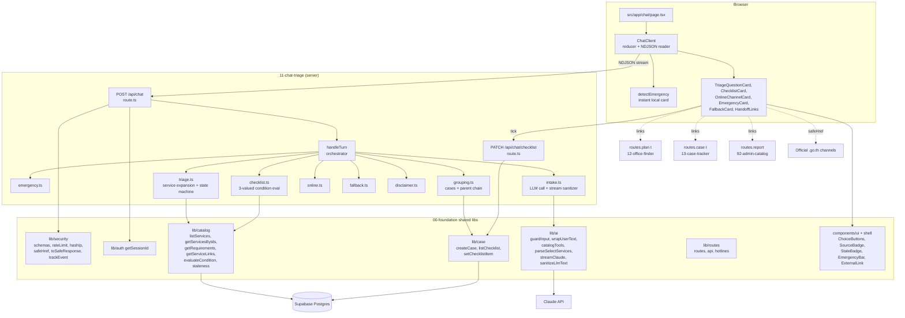
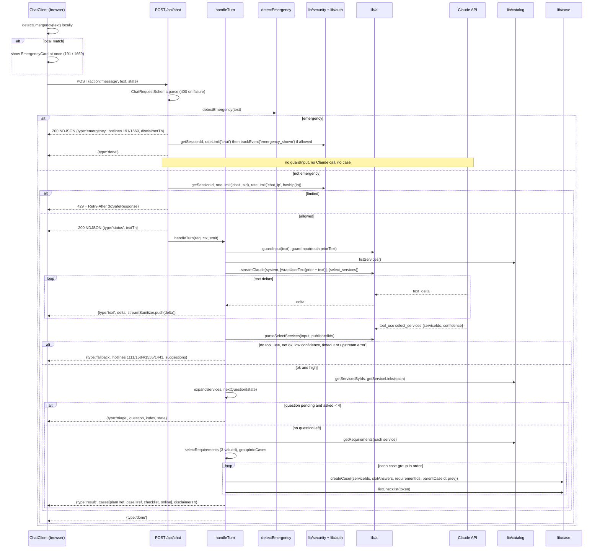
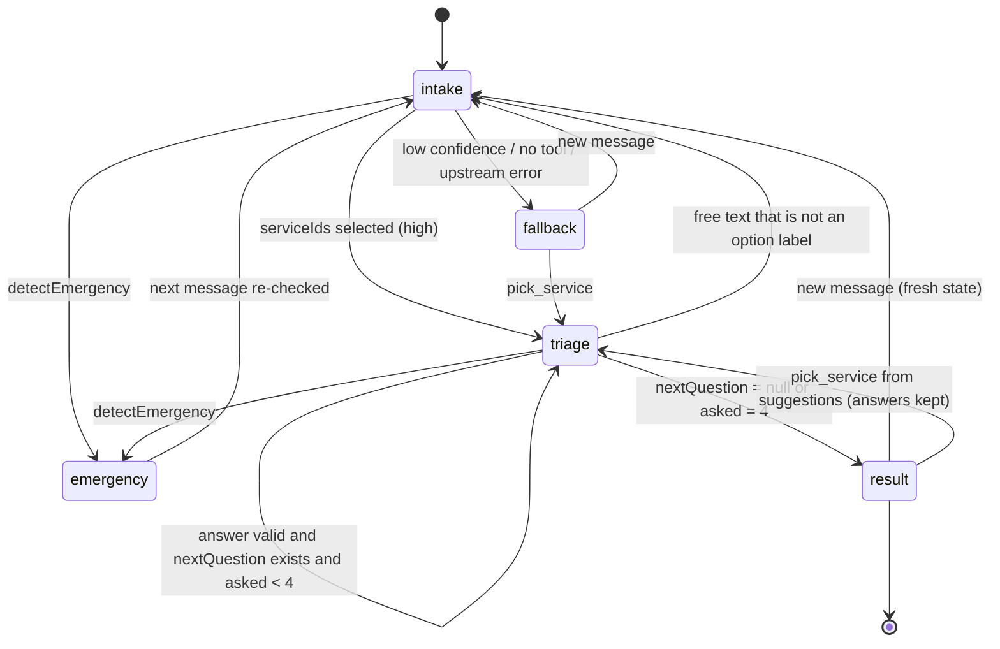

# Design Document: 11-chat-triage

## Overview

11-chat-triage is a wave-1 vertical slice, executed by machine-b, that depends only on 00-foundation. It delivers the web chat at `routes.chat` (`/chat`) and its API at `api.chat` (`/api/chat`). The user types what they want to do in everyday Thai. The server first checks for an emergency and, if found, stops and shows 191 / 1669 (W-14). Otherwise Claude maps the text to one or more catalog `serviceId`s through the foundation's catalog-only `select_services` tool (W-01). The chat then asks at most 4 triage questions as buttons, taken from `services.triage_questions` (W-02). It builds the checklist from `service_requirements` rows only (W-03, RK-03), says whether the matter can be finished online and links to the official channel (W-04), and saves the result as one or more Cases through `lib/case`. The reply hands off to the plan page `routes.plan(t)` (12-office-finder) and the case page `routes.case(t)` (13-case-tracker). When the LLM is unsure, fails or times out, the chat says so plainly and shows hotlines 1111, 1584, 1555, 1441 (W-13). Every reply that concerns a police matter or a Case carries the sentence that this system is not a police report channel (X-01).

The slice owns only `src/app/chat/**`, `src/app/api/chat/**` and `src/features/chat/**`. It imports only foundation libraries, UI kit, shell components, types and route constants. It never imports another slice's `src/features/**` and never edits a shared path. Where the foundation contract is missing something, the need is listed under "Foundation contract gaps".

Design principles:
- The LLM only picks `serviceId`s and writes one short acknowledgement sentence. Questions, checklist items, online channels, hotlines and disclaimers are built by server code from the catalog and foundation constants (RK-03).
- Emergency detection is pure, local and runs before any LLM call or rate-limit decision (W-14).
- The server is stateless between turns. The browser holds a small `ChatState` and sends it back each turn. The server re-validates every field against the catalog, so a tampered state can only reach choices the user could make anyway.
- Only button values (catalog option values, booleans, dates) are stored in `cases.slot_answers`. Free text and chat transcripts are never stored.

Notation: TypeScript for types, zod schemas and signatures (the stack is Next.js + TypeScript). Algorithms are in structured pseudocode. No implementation code.

---

# Part 1: High-Level Design

## Architecture



## Sequence: free-text turn (streaming, emergency short-circuit)



## Sequence: button answer turn (no LLM)

```mermaid
sequenceDiagram
    participant U as ChatClient
    participant R as POST /api/chat
    participant T as handleTurn
    participant CAT as lib/catalog
    participant CS as lib/case

    U->>R: POST {action:'answer', questionId, value, state}
    R->>R: parse, getSessionId, rateLimit
    R->>T: handleTurn
    T->>CAT: getServicesByIds(state.serviceIds), getServiceLinks
    T->>T: q = nextQuestion(state); require questionId = q.id and value valid for q
    T->>T: state' = applyAnswer(state, q, value)
    alt nextQuestion(state') exists and asked' < 4
        T-->>U: {type:'triage', question, state'}
    else
        T->>CAT: getRequirements
        T->>CS: createCase per group, listChecklist
        T-->>U: {type:'result', ...}
    end
    T-->>U: {type:'done'}
```

## Components and Interfaces

| Component | Path | Responsibility | Requirement IDs |
| --- | --- | --- | --- |
| Chat page | `src/app/chat/page.tsx` | Server component. Renders `ChatClient` inside the foundation shell. No data fetching. | W-01 |
| Chat API | `src/app/api/chat/route.ts` | Parse, emergency check, session, rate limits, open NDJSON stream, call `handleTurn`, safe errors | W-01, W-02, W-14 |
| Checklist tick API | `src/app/api/chat/checklist/route.ts` | Persist a tick through `setChecklistItem` (see gap G1) | W-03 |
| Orchestrator | `src/features/chat/server/turn.ts` | Runs one turn: intake, triage or result. Emits exactly one terminal event per turn | W-01–W-04, W-13, X-01 |
| Emergency detector | `src/features/chat/emergency.ts` | Pure, isomorphic keyword detection with normalization and a narrow negation rule | W-14 |
| Intake | `src/features/chat/server/intake.ts` | Mask, wrap, call Claude with `select_services` only, sanitize streamed text, classify outcome | W-01, W-13, RK-03 |
| Stream sanitizer | `src/features/chat/server/streamSanitizer.ts` | Chunk-safe wrapper around `sanitizeLlmText` | RK-03 |
| Triage state machine | `src/features/chat/server/triage.ts` | Expand services through `service_links`, pick the next question, validate and apply answers, enforce the 4-question cap | W-01, W-02 |
| Checklist builder | `src/features/chat/server/checklist.ts` | Three-valued condition evaluation, requirement selection, view mapping with source and staleness | W-03, RK-03 |
| Case grouping | `src/features/chat/server/grouping.ts` | Topological order over `next_step` links, contiguous grouping into Cases, parent chain | W-01 |
| Online channel | `src/features/chat/server/online.ts` | Decide "done online" per service and build an allowlisted link | W-04 |
| Fallback | `src/features/chat/server/fallback.ts` | Low-confidence and failure reply with hotlines and catalog suggestions | W-13 |
| Disclaimer | `src/features/chat/server/disclaimer.ts` | Decide and stamp the X-01 sentence on terminal events | X-01 |
| Prompt addendum | `src/features/chat/server/prompt.ts` | Chat-specific instructions appended to `SYSTEM_PROMPT_BASE` | W-01, RK-03 |
| Schemas | `src/features/chat/schemas.ts` | zod request, state and event schemas shared by route and client | W-02 |
| Client | `src/features/chat/client/{ChatClient.tsx,reducer.ts,useChatStream.ts}` | Holds messages in memory and `ChatState`, reads the NDJSON stream, renders cards | W-01–W-04, W-13, W-14 |
| Cards | `src/features/chat/components/*.tsx` | `TriageQuestionCard` (uses `ChoiceButtons`), `ChecklistCard` (uses `SourceBadge`, `StaleBadge`), `OnlineChannelCard` (uses `ExternalLink`), `EmergencyCard` (uses `EmergencyBar`), `FallbackCard`, `HotlineButton`, `HandoffLinks`, `DisclaimerNote` | W-02–W-04, W-13, W-14, X-01 |

### Owned folder tree

```
src/app/chat/page.tsx
src/app/api/chat/route.ts
src/app/api/chat/checklist/route.ts          (needs api constant, gap G1)
src/features/chat/
├── schemas.ts                                 (isomorphic)
├── emergency.ts                               (isomorphic, pure)
├── server/                                    (each file imports 'server-only')
│   ├── turn.ts
│   ├── intake.ts
│   ├── streamSanitizer.ts
│   ├── triage.ts
│   ├── checklist.ts
│   ├── grouping.ts
│   ├── online.ts
│   ├── fallback.ts
│   ├── disclaimer.ts
│   ├── prompt.ts
│   └── ndjson.ts
├── client/
│   ├── ChatClient.tsx
│   ├── reducer.ts
│   └── useChatStream.ts
└── components/
    ├── TriageQuestionCard.tsx, ChecklistCard.tsx, OnlineChannelCard.tsx
    ├── EmergencyCard.tsx, FallbackCard.tsx, HotlineButton.tsx
    └── HandoffLinks.tsx, DisclaimerNote.tsx
```

Tests sit next to each file as `*.test.ts`.

## Foundation usage

| Kind | Used items |
| --- | --- |
| Tables (read, through `lib/catalog`) | `services` (`triage_questions`, `can_complete_online`, `online_channel_name_th`, `online_channel_url`, `hotline`, `office_rule`, `agency_id`, `source_url`, `last_verified`), `service_requirements` (all columns), `service_links` (all columns), `agencies` (`kind`, `hotline`) |
| Tables (write, through `lib/case`) | `cases` (`service_ids`, `slot_answers`, `parent_case_id`, `session_id`, `token_hash`), `case_checklist_items` (rows, `checked`) |
| `lib/catalog` | `listServices`, `getServicesByIds`, `getRequirements`, `getServiceLinks`, `evaluateCondition`, `staleness`, `listAgencies` (gap G2) |
| `lib/ai` | `guardInput`, `wrapUserText`, `catalogTools`, `parseSelectServices`, `streamClaude`, `sanitizeLlmText`, `SYSTEM_PROMPT_BASE`, `MAX_USER_CHARS` |
| `lib/case` | `createCase`, `listChecklist` and `setChecklistItem` (gap G1) |
| `lib/security` | `SlugSchema`, `CaseTokenSchema`, `ChatTextSchema`, `SlotAnswersSchema`, `rateLimit('chat')`, `rateLimit('chat_ip')`, `hashIp`, `safeHref`, `AppError`, `toSafeResponse`, `log`, `trackEvent` |
| `lib/auth` | `getSessionId` |
| `lib/routes` | `routes.chat`, `routes.plan(t)`, `routes.case(t)`, `routes.report`, `api.chat`, `hotlines` |
| UI kit / shell | `ChoiceButtons`, `Button`, `Card`, `Chip`, `Checkbox`, `Alert`, `Spinner`, `SourceBadge`, `StaleBadge`, `ExternalLink`, `EmergencyBar` |
| Events | `chat_started`, `services_selected`, `low_confidence`, `emergency_shown`, `online_resolved`, `plan_ready`, `llm_call` (logged by `lib/ai`) |
| Env | `ANTHROPIC_*`, `LLM_*` (read only inside `lib/ai`) |

## Requirement mapping

| ID | Where it is met |
| --- | --- |
| W-01 | `intake.ts` (Claude + `select_services`, 1–5 ids), `triage.ts` `expandServices` (linked services), `grouping.ts` (several services become one or more Cases) |
| W-02 | `triage.ts` (`MAX_TRIAGE_QUESTIONS = 4`, catalog questions only, buttons via `ChoiceButtons`) |
| W-03 | `checklist.ts` (rows from `service_requirements` only, tickable, `SourceBadge` + `StaleBadge`) |
| W-04 | `online.ts` + `OnlineChannelCard` (official link via `safeHref`, no plan link for online-only groups) |
| W-13 | `fallback.ts` + `FallbackCard` (plain "ไม่แน่ใจ" message, hotlines 1111, 1584, 1555, 1441) |
| W-14 | `emergency.ts`, checked in the browser and on the server before any LLM call |
| X-01 | `disclaimer.ts` stamps the sentence on terminal events; `DisclaimerNote` renders it |
| RK-03 | LLM output is limited to validated `serviceId`s plus one sanitized sentence; every fact shown comes from DB rows or foundation constants |

---

# Part 2: Low-Level Design

## Constants

```typescript
export const MAX_TRIAGE_QUESTIONS = 4          // W-02 upper bound of "3–4"
export const MAX_SERVICES = 5                  // matches cases.service_ids cardinality and select_services
export const MAX_PRIOR_TEXTS = 3               // earlier user texts re-sent for context
export const INTAKE_TEXT_MAX_CHARS = 400       // cap on streamed LLM acknowledgement
export const SANITIZER_MAX_HOLD = 2000         // stream sanitizer force-flush threshold
export const NEGATION_WINDOW = 10              // code units before an emergency term
export const W13_HOTLINES = ['govCenter', 'dlt', 'bma', 'techCrime'] as const   // keys of foundation hotlines: 1111, 1584, 1555, 1441
export const W14_HOTLINES = ['police', 'ems'] as const                          // 191, 1669
```

## Data Models

### Request and state schemas (`src/features/chat/schemas.ts`)

```typescript
const SlotKey = z.string().regex(/^[a-z_]{1,32}$/)           // same key rule as SlotAnswersSchema

export const ChatStateSchema = z.object({
  v: z.literal(1),
  phase: z.enum(['intake', 'triage', 'done']),
  serviceIds: z.array(SlugSchema).max(MAX_SERVICES),           // selected by LLM or chip, before link expansion
  answers: SlotAnswersSchema,                                  // button values only
  asked: z.array(SlotKey).max(MAX_TRIAGE_QUESTIONS),           // question ids already shown, in order
  priorTexts: z.array(ChatTextSchema).max(MAX_PRIOR_TEXTS),    // earlier user texts; re-masked every turn
}).strict()

export const ChatRequestSchema = z.discriminatedUnion('action', [
  z.object({ action: z.literal('message'), text: ChatTextSchema,
             state: ChatStateSchema.nullable() }).strict(),
  z.object({ action: z.literal('answer'), questionId: SlotKey,
             value: z.union([z.string().max(200), z.boolean(), z.null()]),   // null = "ไม่แน่ใจ / ข้าม"
             state: ChatStateSchema }).strict(),
  z.object({ action: z.literal('pick_service'), serviceId: SlugSchema,
             state: ChatStateSchema.nullable() }).strict(),
])

export const ChecklistTickSchema = z.object({
  token: CaseTokenSchema, itemId: z.string().uuid(), checked: z.boolean(),
}).strict()
```

**Validation rules (applied by the server on every turn, after zod):**
- Every `state.serviceIds` entry is a published service id. Otherwise 400 `bad_request`.
- Every `state.asked` entry is a question id of a service in the expanded set, has no duplicates, and its length is at most 4.
- Every `state.answers` key is in `state.asked`, and every value is valid for that question (see `validateAnswer`).
- `state.phase` must agree with the action: `answer` requires `triage`.
- The state never holds coordinates, free text other than `priorTexts`, or tokens.

### Stream events (`application/x-ndjson`, one JSON object per line)

```typescript
type HotlineView = { number: string; labelTh: string }          // number matches ^[0-9]{3,10}$

type QuestionView = {
  id: string; labelTh: string; kind: 'choice' | 'boolean' | 'date'
  options: { value: string; labelTh: string }[]                  // choice only; boolean renders ใช่ / ไม่ใช่
  allowSkip: true                                                // "ไม่แน่ใจ" button sends null
}

type ChecklistItemView = {
  itemId: string; requirementId: string; serviceId: Slug
  kind: RequirementKind; textTh: string
  docForm: DocForm; copies: number | null
  conditionLabelTh: string | null
  conditionStatus: 'always' | 'met' | 'unknown'                  // 'unknown' shows the label as "ถ้า…"
  sourceHref: string | null                                      // safeHref(sourceUrl)
  lastVerified: IsoDate; isStale: boolean                        // staleness(), N-01 badge
  checked: boolean
}

type OnlineChannelView = { nameTh: string; href: string | null; hotline: string | null }

type CaseView = {
  caseHref: string                                               // routes.case(token)
  planHref: string | null                                        // routes.plan(token); null when the group is online-only
  token: CaseToken                                               // the user's own token, needed for ticks
  services: { id: Slug; nameTh: string; online: OnlineChannelView | null }[]
  checklist: ChecklistItemView[]
}

type ChatEvent =
  | { type: 'status'; textTh: string }
  | { type: 'text'; delta: string }
  | { type: 'triage'; question: QuestionView; index: number; max: 4; state: ChatState; disclaimerTh: string | null }
  | { type: 'result'; cases: CaseView[]; suggestions: SuggestionView[]; reportHref: string; state: ChatState; disclaimerTh: string }
  | { type: 'fallback'; reason: FallbackReason; textTh: string; hotlines: HotlineView[];
      suggestions: SuggestionView[]; state: ChatState; disclaimerTh: string | null }
  | { type: 'emergency'; textTh: string; hotlines: HotlineView[]; disclaimerTh: string }
  | { type: 'error'; code: 'internal' | 'upstream_unavailable'; messageTh: string; hotlines: HotlineView[]; requestId: string }
  | { type: 'done' }

type SuggestionView = { serviceId: Slug; nameTh: string; conditionLabelTh: string | null }
type FallbackReason = 'no_tool' | 'parse_failed' | 'low_confidence' | 'upstream' | 'no_service'
type TerminalEvent = Extract<ChatEvent, { type: 'triage' | 'result' | 'fallback' | 'emergency' | 'error' }>
```

**Stream rules:** each turn emits zero or one `status`, zero or more `text`, exactly one terminal event, then `done`. `text` events appear only on `message` turns. The client renders `text` as React text, never as HTML.

## API route signatures

### `POST /api/chat` (`src/app/api/chat/route.ts`)

```typescript
export const runtime = 'nodejs'
export const dynamic = 'force-dynamic'
export async function POST(req: Request): Promise<Response>
```

| Case | Response |
| --- | --- |
| Body not JSON or fails `ChatRequestSchema` | 400 via `toSafeResponse(new AppError('bad_request', 400))` |
| `message` with emergency text | 200 NDJSON: `emergency`, `done`. Runs before rate limiting |
| Rate limited (`chat` per session or `chat_ip` per hashed IP) | 429 + `Retry-After` |
| State fails server validation | 400 `bad_request` |
| Otherwise | 200 NDJSON stream; headers `Content-Type: application/x-ndjson; charset=utf-8`, `Cache-Control: no-store`, `X-Content-Type-Options: nosniff` |
| Failure after the stream opened | `error` event with hotlines, then `done`; logged with `requestId` only |

`req.signal` is passed to `streamClaude` so a closed tab aborts the LLM call.

### `PATCH /api/chat/checklist` (`src/app/api/chat/checklist/route.ts`, gap G1)

```typescript
export async function PATCH(req: Request): Promise<Response>   // body: ChecklistTickSchema
```

Responses: 204 on success; 400 on schema failure; 404 when the token or the item does not belong to that case (`setChecklistItem` scopes by token); 429 when `rateLimit('chat', sessionId)` blocks.

## Key Functions with Formal Specifications

### `handleTurn` (`server/turn.ts`)

```typescript
interface TurnDeps {                      // injected; production binds foundation libs, tests bind fakes
  streamClaude: typeof streamClaude; listServices: typeof listServices
  getServicesByIds: typeof getServicesByIds; getRequirements: typeof getRequirements
  getServiceLinks: typeof getServiceLinks; listAgencies: () => Promise<Agency[]>
  createCase: typeof createCase; listChecklist: (t: CaseToken) => Promise<ChecklistItem[]>
  trackEvent: typeof trackEvent; now: () => Date
}
interface TurnCtx { sessionId: string; requestId: string; signal: AbortSignal; deps: TurnDeps }
export function handleTurn(req: ChatRequest, ctx: TurnCtx, emit: (e: ChatEvent) => void): Promise<void>
```

**Preconditions:** `req` passed `ChatRequestSchema`. `req` is not an emergency `message` (the route handled that). The session is under its rate limits.
**Postconditions:** exactly one terminal event is emitted, followed by `done`. `streamClaude` is called at most once, and only when `req.action = 'message'`. `createCase` is called only inside the result step. Nothing else is written.

### `detectEmergency` (`emergency.ts`)

```typescript
export type EmergencyTermId = string
export const EMERGENCY_TERMS: readonly { id: EmergencyTermId; th: string; negatable: boolean }[]
export function normalizeForMatch(text: string): string
export function detectEmergency(text: string): { isEmergency: boolean; matched: EmergencyTermId[] }
```

Term groups (stored un-normalized, normalized once at module load):
- Injury: บาดเจ็บ, เจ็บหนัก, คนเจ็บ, เลือดออก, เลือดไหล, หมดสติ, ไม่หายใจ, หายใจไม่ออก, ชัก, หัวใจหยุด
- Ongoing crime or threat: กำลังเกิดเหตุ, กำลังถูกทำร้าย, ถูกทำร้าย, กำลังปล้น, ถูกจี้, มีมีด, มีปืน, ยิงกัน, ถูกแทง, จะฆ่า, ขู่ฆ่า
- Danger: ไฟไหม้, จมน้ำ, ติดอยู่ใน, ฆ่าตัวตาย, ช่วยด้วย, ด่วนมาก
- English: emergency, help me

`negatable = false` for ช่วยด้วย, ไฟไหม้, ฆ่าตัวตาย, ขู่ฆ่า, จะฆ่า, ด่วนมาก, help me, emergency.

**Preconditions:** `text` is any string.
**Postconditions:** `isEmergency` is true iff some term `t` occurs in `normalizeForMatch(text)` at a position `p` where `t.negatable = false`, or where the `NEGATION_WINDOW` code units before `p` contain neither ไม่มี nor ไม่ได้. The function is pure and needs no network, so the browser and server give the same answer. It errs toward showing the emergency card.

### `runIntake` (`server/intake.ts`)

```typescript
type IntakeOutcome =
  | { kind: 'selected'; serviceIds: Slug[] }
  | { kind: 'low_confidence'; reason: FallbackReason; candidateIds: Slug[] }
export function runIntake(text: string, priorTexts: string[], services: Service[],
                          ctx: TurnCtx, emit: (e: ChatEvent) => void): Promise<IntakeOutcome>
```

**Preconditions:** `text` passed `ChatTextSchema` and is not an emergency. `services` are the published services.
**Postconditions:**
- The only user-role content sent to Claude is `wrapUserText(join(masked priorTexts, masked text))`, where every part went through `guardInput`. No coordinates, case tokens or slot answers are sent.
- The tools sent are `catalogTools(services)` filtered to `name = 'select_services'`.
- `selected` is returned only when `parseSelectServices` returned `ok` with `confidence = 'high'`. Every id is then a published id, and there are 1–5 ids.
- Every emitted `text.delta` is the output of the stream sanitizer, and their total length is at most `INTAKE_TEXT_MAX_CHARS`.
- Timeout, abort or upstream error returns `low_confidence` with reason `upstream`. It never throws to the caller.

### `expandServices` and `nextQuestion` (`server/triage.ts`)

```typescript
export function expandServices(selected: Service[], linksByFrom: Map<Slug, ServiceLink[]>,
                               byId: Map<Slug, Service>, answers: SlotAnswers):
  { services: Service[]; suggestions: SuggestionView[] }
export function eligibleQuestions(services: Service[], answers: SlotAnswers): TriageQuestion[]
export function nextQuestion(state: ChatState, services: Service[]): TriageQuestion | null
export function validateAnswer(q: TriageQuestion, value: SlotValue, today: IsoDate): boolean
export function applyAnswer(state: ChatState, q: TriageQuestion, value: SlotValue): ChatState
```

**`expandServices` postconditions:** the result starts with `selected` in order. A linked service `B` (from a service `A` already in the result) is inserted right after `A`'s block when `eval3(link.condition, answers) = 'true'`. When it is `'unknown'`, `B` goes into `suggestions` with the link's `condition_label_th`. When it is `'false'`, `B` is dropped. There are no duplicates and at most `MAX_SERVICES` services.

**`nextQuestion` postconditions:** it returns `null` when `state.asked.length >= 4`. Otherwise it returns the first question in `eligibleQuestions(services, answers)` whose id is in neither `asked` nor `answers`. Questions of kind `location` are never returned, because location belongs to 12-office-finder (W-06). A question whose `askIf` evaluates to `'unknown'` is deferred, and one that evaluates to `'false'` is skipped.

**`validateAnswer` postconditions:** a `choice` answer is valid iff the value is one of `options[].value`. A `boolean` answer is valid iff it is `true` or `false`. A `date` answer is valid iff it is an `IsoDate` within today ± 5 years. Any kind accepts `null` (skip).

**`applyAnswer` postconditions:** `asked' = asked ++ [q.id]`, `answers' = answers ∪ {q.id: value}`, and `phase' = 'triage'`. It touches no other field.

### `eval3` and `selectRequirements` (`server/checklist.ts`)

```typescript
export type Tri = 'true' | 'false' | 'unknown'
export function eval3(c: Condition | null, slots: SlotAnswers): Tri
export function selectRequirements(reqs: ServiceRequirement[], slots: SlotAnswers):
  { req: ServiceRequirement; status: 'always' | 'met' | 'unknown' }[]
export function toItemView(sel: { req: ServiceRequirement; status: string }, item: ChecklistItem,
                           now: Date): ChecklistItemView
```

**`eval3` postconditions:**
- `eval3(null, s) = 'true'`.
- For a leaf: when `slot ∉ s` or `s[slot] = null`, the result is `'unknown'`. Otherwise it is `'true'` iff `evaluateCondition(leaf, s)`.
- `all` uses Kleene AND: `'false'` if any child is `'false'`, else `'unknown'` if any child is `'unknown'`, else `'true'`.
- `any` uses Kleene OR: `'true'` if any child is `'true'`, else `'unknown'` if any child is `'unknown'`, else `'false'`.
- When every slot the condition references is answered with a non-null value, `eval3(c, s) = 'true'` iff `evaluateCondition(c, s)`.

**`selectRequirements` postconditions:** it keeps a requirement iff it is active and `eval3(condition, slots) ∈ {'true', 'unknown'}`. Status is `'always'` when the condition is null, `'met'` when the result is `'true'`, and `'unknown'` when it is `'unknown'`. Order is the catalog `sort_order`. Unknown items are kept on purpose: a missing document costs a repeat trip, so the item is shown with its condition label ("เฉพาะกรณีมอบอำนาจ") instead of being dropped.

**`toItemView` postconditions:** `textTh`, `kind`, `docForm`, `copies` and `conditionLabelTh` are copied from the DB row unchanged. `sourceHref = safeHref(req.sourceUrl)`, and `isStale = staleness(req.lastVerified, now).isStale`.

### `groupIntoCases` (`server/grouping.ts`)

```typescript
type CaseGroup = { key: string; services: Service[]; online: boolean }
export function orderByLinks(services: Service[], links: ServiceLink[]): Service[]
export function groupIntoCases(ordered: Service[], isOnline: (s: Service) => boolean): CaseGroup[]
```

**Postconditions:**
- `orderByLinks` returns a permutation of the input. For every `next_step` link `A → B` with both in the input, `A` comes before `B`, unless the links form a cycle. On a cycle, the remaining services keep their input order.
- `groupIntoCases` splits the ordered list into maximal contiguous runs with the same key `agencyId + ':' + (online ? 'online' : officeRule)`. Every service is in exactly one group, and group order follows list order. So for every link `A → B` across groups, `group(A)` comes before `group(B)`.
- One group becomes one Case. That gives 12-office-finder one agency and one office rule per Case, so it can choose a single `office_id`.

### `onlineChannel` (`server/online.ts`)

```typescript
export function isOnline(s: Service): boolean          // s.canCompleteOnline || s.officeRule === 'online'
export function onlineChannel(s: Service): OnlineChannelView | null
```

**Postconditions:** the function returns `null` iff `isOnline(s)` is false. Otherwise `href = safeHref(s.onlineChannelUrl)`, and `hotline = s.hotline`, which must match `^[0-9]{3,10}$` or is set to null. When `href` is null while `isOnline` is true, the card shows the name and hotline without a link and logs `online_link_rejected` with the service id only.

### `needsDisclaimer` and `stampDisclaimer` (`server/disclaimer.ts`)

```typescript
export function needsDisclaimer(e: TerminalEvent, agencyKindOf: (serviceId: Slug) => AgencyKind | null): boolean
export function stampDisclaimer<E extends TerminalEvent>(e: E, agencyKindOf: (id: Slug) => AgencyKind | null): E
```

**Postconditions:** `needsDisclaimer` is true when `e.type ∈ {'emergency', 'result'}`. It is also true when `e.type ∈ {'triage', 'fallback'}` and any service in `e.state.serviceIds`, the expanded set, `suggestions` or `candidateIds` has agency kind `police`. `stampDisclaimer` sets `disclaimerTh = NOT_POLICE_CHANNEL_TH` (gap G4) iff `needsDisclaimer`, and sets it to null otherwise. The orchestrator passes every terminal event through `stampDisclaimer` before `emit`. The text is a server constant, never LLM output.

### `buildFallback` (`server/fallback.ts`)

```typescript
export function buildFallback(reason: FallbackReason, candidates: Service[],
                              agencies: Map<Slug, Agency>, state: ChatState): Extract<ChatEvent, { type: 'fallback' }>
```

**Postconditions:** `textTh` is a fixed template that says plainly the system is not sure, for example "ขอโทษครับ ระบบยังไม่แน่ใจว่าเรื่องนี้ต้องติดต่อที่ไหน แนะนำให้โทรสอบถามสายด่วนด้านล่าง". `hotlines` contains 1111, 1584, 1555 and 1441 from `hotlines` (W13_HOTLINES), followed by the distinct agency hotlines of the candidates, deduplicated. `suggestions` holds at most 3 candidates that are published services. No Case is created.

### `createStreamSanitizer` (`server/streamSanitizer.ts`)

```typescript
export function createStreamSanitizer(): { push(chunk: string): string; flush(): string }
```

**Postconditions:** for any string `s` and any split of `s` into chunks `c1..cn`, `push(c1) + … + push(cn) + flush() = sanitizeLlmText(s).text`. Output never contains a URL that fails `checkLink`.

## Algorithmic Pseudocode

### Route handler

```pascal
PROCEDURE POST_chat(req)
  SEQUENCE
    requestId ← randomUUID()
    body ← ChatRequestSchema.safeParse(json(req))
    IF body fails THEN RETURN toSafeResponse(AppError('bad_request', 400), requestId) END IF

    IF body.action = 'message' AND detectEmergency(body.text).isEmergency THEN
      RETURN ndjson([ stampDisclaimer(emergencyEvent()), DONE ]) WITH afterSend:
        sid ← getSessionId()
        IF rateLimit('chat', sid).ok THEN trackEvent('emergency_shown', {sessionId: sid}) END IF
    END IF

    sid ← getSessionId()
    IF NOT rateLimit('chat', sid).ok OR NOT rateLimit('chat_ip', hashIp(clientIp(req))).ok THEN
      RETURN toSafeResponse(AppError('rate_limited', 429), requestId)   // includes Retry-After
    END IF

    RETURN ndjsonStream(emit →
      TRY
        emit({type:'status', textTh:'กำลังดูว่าเรื่องนี้ต้องทำอะไรบ้าง…'})
        handleTurn(body, {sessionId: sid, requestId, signal: req.signal, deps}, emit)
      CATCH err
        log.error('chat_turn_failed', {requestId, code: codeOf(err)})
        emit({type:'error', code:'internal', messageTh: GENERIC_ERROR_TH,
              hotlines: hotlineViews(W13_HOTLINES), requestId})
      FINALLY
        emit(DONE)
      END TRY)
  END SEQUENCE
END PROCEDURE
```

The emergency check runs before the session lookup and rate limits, so an emergency card is never blocked by a limit or a database outage.

### Turn orchestration

```pascal
PROCEDURE handleTurn(req, ctx, emit)
  SEQUENCE
    published ← deps.listServices()
    byId ← map of published by id
    agencies ← map of deps.listAgencies() by id
    state ← req.state OR newState()
    ASSERT serverValidate(state, byId)                          // else THROW AppError('bad_request')

    IF req.action = 'message' THEN
      IF state.phase = 'triage' AND matchesOptionLabel(req.text, currentQuestion(state)) THEN
        RETURN answerStep(state, currentQuestion(state).id, optionValueOf(req.text), ctx, emit)
      END IF
      IF req.state IS NULL THEN deps.trackEvent('chat_started', {sessionId}) END IF
      outcome ← runIntake(req.text, state.priorTexts, published, ctx, emit)
      priorTexts' ← lastN(state.priorTexts ++ [guardInput(req.text).text], MAX_PRIOR_TEXTS)
      IF outcome.kind = 'low_confidence' THEN
        deps.trackEvent('low_confidence', {sessionId}, {reason: outcome.reason})
        emit(stamp(buildFallback(outcome.reason, byIds(outcome.candidateIds), agencies,
                                 state WITH priorTexts := priorTexts')))
        RETURN
      END IF
      deps.trackEvent('services_selected', {sessionId}, {count: |outcome.serviceIds|})
      keep ← answers of state whose question still exists in the new service set
      state' ← {v:1, phase:'triage', serviceIds: outcome.serviceIds, answers: keep,
                asked: keys(keep), priorTexts: priorTexts'}
      RETURN advance(state', ctx, emit)

    ELSE IF req.action = 'pick_service' THEN
      IF req.serviceId ∉ byId THEN THROW AppError('bad_request') END IF
      state' ← state WITH phase := 'triage', serviceIds := [req.serviceId]
      RETURN advance(state', ctx, emit)

    ELSE  // 'answer'
      RETURN answerStep(state, req.questionId, req.value, ctx, emit)
    END IF
  END SEQUENCE
END PROCEDURE

PROCEDURE answerStep(state, questionId, value, ctx, emit)
  SEQUENCE
    services ← expanded(state)
    q ← nextQuestion(state, services)
    IF q IS NULL OR q.id ≠ questionId OR NOT validateAnswer(q, value, today()) THEN
      THROW AppError('bad_request', 400)
    END IF
    RETURN advance(applyAnswer(state, q, value), ctx, emit)
  END SEQUENCE
END PROCEDURE

PROCEDURE advance(state, ctx, emit)
  SEQUENCE
    {services, suggestions} ← expandServices(byIds(state.serviceIds), linksFor(state), byId, state.answers)
    q ← nextQuestion(state, services)
    IF q IS NOT NULL THEN
      emit(stamp({type:'triage', question: view(q), index: |state.asked| + 1, max: 4, state}))
      RETURN
    END IF
    emit(stamp(buildResult(state, services, suggestions, ctx)))
  END SEQUENCE
END PROCEDURE
```

`linksFor(state)` calls `getServiceLinks(id)` without slots for each service and evaluates conditions locally with `eval3` (gap G3). `matchesOptionLabel` compares `normalizeForMatch(text)` with the normalized option labels and the words ใช่ / ไม่ใช่ for boolean questions. It accepts an exact match only, so a long typed sentence goes to intake again.

### Triage state machine



```pascal
PROCEDURE nextQuestion(state, services)
  INPUT: validated state, expanded services
  OUTPUT: TriageQuestion OR NULL
  SEQUENCE
    IF |state.asked| ≥ MAX_TRIAGE_QUESTIONS THEN RETURN NULL END IF
    FOR each q IN eligibleQuestions(services, state.answers) DO
      // invariant: every question before q in this loop is already asked, already answered,
      // or not eligible yet
      IF q.id ∉ state.asked AND q.id ∉ keys(state.answers) THEN RETURN q END IF
    END FOR
    RETURN NULL
  END SEQUENCE
END PROCEDURE

PROCEDURE eligibleQuestions(services, answers)
  SEQUENCE
    out ← [] ; seen ← {}
    FOR each s IN services DO
      FOR each q IN s.triageQuestions DO
        IF q.kind = 'location' OR q.id ∈ seen THEN CONTINUE END IF
        IF eval3(q.askIf, answers) = 'true' THEN out.append(q) ; seen.add(q.id) END IF
        // 'unknown' => deferred until its slot is answered; 'false' => skipped
      END FOR
    END FOR
    RETURN out
  END SEQUENCE
END PROCEDURE
```

**Termination and bound:** each `answer` turn adds exactly one id to `asked`. `nextQuestion` returns `NULL` once `|asked| = 4`. So a chat reaches `result` after at most 4 answer turns from the last intake, and no question id is shown twice. Answers kept across a re-intake count toward the same cap, because `asked` keeps them.

### Service expansion through `service_links`

```pascal
PROCEDURE expandServices(selected, linksByFrom, byId, answers)
  SEQUENCE
    result ← [] ; suggestions ← [] ; inResult ← {}
    queue ← selected                                        // in LLM order
    WHILE queue not empty AND |result| < MAX_SERVICES DO
      // invariant: result has no duplicates; every element is selected or reached
      // by a link whose condition is 'true' under answers
      s ← queue.popFront()
      IF s.id ∈ inResult THEN CONTINUE END IF
      result.append(s) ; inResult.add(s.id)
      FOR each l IN linksByFrom[s.id] ordered by relation ('next_step' first), then to_service_id DO
        t ← byId[l.toServiceId]
        IF t IS NULL THEN CONTINUE END IF                   // unpublished target
        CASE eval3(l.condition, answers) OF
          'true'    : queue.pushFront(t)                    // keeps the target next to its source
          'unknown' : suggestions.appendUnique({t.id, t.nameTh, l.conditionLabelTh})
          'false'   : skip
        END CASE
      END FOR
    END WHILE
    suggestions ← suggestions without ids in inResult
    RETURN {services: result, suggestions}
  END SEQUENCE
END PROCEDURE
```

Example (J1): the LLM selects `police-report-property`. Its triage question `id_card_lost` is answered `true`, so the link `police-report-property → id-card-new` evaluates to `'true'` and `id-card-new` joins the expanded set. Its questions then become eligible within the same 4-question budget.

### Result: checklist, online check, Cases

```pascal
PROCEDURE buildResult(state, services, suggestions, ctx)
  SEQUENCE
    ordered ← orderByLinks(services, allLinksAmong(services))
    groups ← groupIntoCases(ordered, isOnline)
    cases ← [] ; prevCaseId ← NULL
    FOR each g IN groups DO
      // invariant: cases[i] holds exactly groups[i]; each case's parent is the previous case
      sel ← concat over s IN g.services of selectRequirements(deps.getRequirements(s.id), state.answers)
      {case, token} ← deps.createCase({serviceIds: ids(g.services), slotAnswers: state.answers,
                                       requirementIds: ids(sel.req), parentCaseId: prevCaseId}, sessionId)
      items ← deps.listChecklist(token)                       // gap G1: gives item ids and tick state
      ASSERT {i.requirement.id | i ∈ items} = ids(sel.req)
      cases.append({
        caseHref: routes.case(token),
        planHref: IF g.online THEN NULL ELSE routes.plan(token),
        token,
        services: [{id, nameTh, online: onlineChannel(s)} FOR s IN g.services],
        checklist: [toItemView(selFor(i), i, now) FOR i IN items ordered by sortOrder]
      })
      IF g.online THEN deps.trackEvent('online_resolved', {sessionId, caseId: case.id}) END IF
      prevCaseId ← case.id
    END FOR
    deps.trackEvent('plan_ready', {sessionId, caseId: cases[0].id}, {cases: |cases|})
    RETURN {type:'result', cases, suggestions, reportHref: routes.report,
            state: state WITH phase := 'done'}
  END SEQUENCE
END PROCEDURE
```

**Preconditions:** `services` is non-empty, has at most 5 entries, and every entry is published.
**Postconditions:** every service appears in exactly one Case. Every checklist item maps to an active `service_requirements` row of a service in its own Case (the foundation RPC also enforces this with `P0003`). Online-only Cases have `planHref = null`.
**Failure:** if `createCase` fails for group `k > 0`, the Cases already created stay valid. The turn emits an `error` event, and the earlier Cases remain reachable from the case page. Atomic multi-case creation is listed as gap G6.

### Intake LLM call

```pascal
PROCEDURE runIntake(text, priorTexts, services, ctx, emit)
  SEQUENCE
    g ← guardInput(text) ; IF NOT g.ok THEN THROW AppError('bad_request') END IF
    prior ← [guardInput(p).text FOR p IN priorTexts IF guardInput(p).ok]
    content ← wrapUserText(join(["ข้อความก่อนหน้า: " + p FOR p IN prior] ++ ["ข้อความล่าสุด: " + g.text], "\n"))
    tools ← [t ∈ catalogTools(services) | t.name = 'select_services']
    san ← createStreamSanitizer() ; shown ← 0 ; toolJson ← "" ; sawTool ← false
    TRY
      FOR each ev IN streamClaude({system: SYSTEM_PROMPT_BASE + "\n\n" + CHAT_INTAKE_ADDENDUM,
                                   messages: [{role:'user', content}], tools, signal: ctx.signal}) DO
        IF ev is text_delta AND NOT sawTool THEN
          out ← truncate(san.push(ev.text), INTAKE_TEXT_MAX_CHARS - shown)
          IF out ≠ "" THEN emit({type:'text', delta: out}) ; shown ← shown + |out| END IF
        ELSE IF ev starts tool_use 'select_services' THEN sawTool ← true
        ELSE IF ev is input_json_delta THEN toolJson ← toolJson + ev.partial_json
        END IF
      END FOR
      tail ← truncate(san.flush(), INTAKE_TEXT_MAX_CHARS - shown)
      IF tail ≠ "" THEN emit({type:'text', delta: tail}) END IF
    CATCH timeout OR abort OR upstream error
      RETURN {kind:'low_confidence', reason:'upstream', candidateIds: []}
    END TRY
    IF NOT sawTool THEN RETURN {kind:'low_confidence', reason:'no_tool', candidateIds: []} END IF
    p ← parseSelectServices(tryParseJson(toolJson), set(ids(services)))
    IF NOT p.ok THEN RETURN {kind:'low_confidence', reason:'parse_failed', candidateIds: []} END IF
    IF p.confidence = 'low' THEN RETURN {kind:'low_confidence', reason:'low_confidence', candidateIds: p.serviceIds} END IF
    RETURN {kind:'selected', serviceIds: p.serviceIds}
  END SEQUENCE
END PROCEDURE
```

`CHAT_INTAKE_ADDENDUM` tells the model to write at most one short Thai sentence that acknowledges the request, then call `select_services` exactly once. The model must set `confidence: 'low'` when no service clearly fits or the message is not about a government service. It must not list documents, offices, fees, links or legal conclusions, because the server shows those from the catalog. The addendum holds no secrets.

### Emergency detection

```pascal
PROCEDURE normalizeForMatch(text)
  SEQUENCE
    s ← NFC(text)
    s ← remove zero-width chars (U+200B–U+200D, U+FEFF) and Thai/Latin punctuation
    s ← remove all whitespace
    s ← lowercase Latin letters
    s ← collapse every run of ≥ 2 identical code points into one      // "ช่วยด้วยยยย" -> "ช่วยด้วย"
    RETURN s
  END SEQUENCE
END PROCEDURE

PROCEDURE detectEmergency(text)
  SEQUENCE
    n ← normalizeForMatch(text) ; matched ← []
    FOR each term IN EMERGENCY_TERMS_NORMALIZED DO
      FOR each position p WHERE n[p : p + |term.th|] = term.th DO
        before ← n[max(0, p - NEGATION_WINDOW) : p]
        IF NOT term.negatable OR NOT (before contains "ไม่มี" OR before contains "ไม่ได้") THEN
          matched.append(term.id) ; BREAK
        END IF
      END FOR
    END FOR
    RETURN {isEmergency: |matched| > 0, matched}
  END SEQUENCE
END PROCEDURE
```

Terms are normalized with the same function, so the run-collapsing applies to both sides equally. "เมื่อวานรถชน ไม่มีคนเจ็บ" is not an emergency. "ไม่มีคนเจ็บแต่มีคนหมดสติ" is one, because หมดสติ is not negated. The emergency reply is the fixed text "หากมีคนบาดเจ็บหรือกำลังเกิดเหตุ โทรทันที", followed by 191 (police) and 1669 (EMS) from `hotlines`, rendered with the shell's `EmergencyBar` and large `HotlineButton`s (`tel:` links built only from those constants).

### Stream sanitizer

```pascal
PROCEDURE push(chunk)
  SEQUENCE
    buf ← buf + chunk
    r ← index after the last URL terminator in buf (whitespace, <, >, ", ', ), ]), or 0
    j ← first case-insensitive index of "http://" or "https://" in buf[r:]
    IF j exists THEN cut ← r + j                               // open URL: hold it
    ELSE
      k ← longest suffix of buf[r:] that is a case-insensitive proper prefix of "http://" or "https://"
      cut ← |buf| - |k|
    END IF
    IF |buf| - cut > SANITIZER_MAX_HOLD THEN cut ← |buf| END IF // force flush; sanitizer removes a cut URL
    out ← sanitizeLlmText(buf[0:cut]).text
    buf ← buf[cut:]
    RETURN out
  END SEQUENCE
END PROCEDURE

PROCEDURE flush()
  SEQUENCE out ← sanitizeLlmText(buf).text ; buf ← "" ; RETURN out END SEQUENCE
END PROCEDURE
```

The foundation URL pattern cannot match across a terminator, and the cut is never inside a possible match. So sanitizing the pieces gives the same text as sanitizing the whole string, except for force-flushed URLs longer than 2000 characters.

### Checklist tick

```pascal
PROCEDURE PATCH_chat_checklist(req)
  SEQUENCE
    body ← ChecklistTickSchema.parse(json(req))               // 400 on failure
    sid ← getSessionId()
    IF NOT rateLimit('chat', sid).ok THEN RETURN 429 END IF
    setChecklistItem(body.token, body.itemId, body.checked)  // scoped by token hash; not found -> 404
    RETURN 204
  END SEQUENCE
END PROCEDURE
```

The client ticks optimistically and rolls back on a non-204 response.

## Example Usage

```text
Turn 1  POST /api/chat {action:'message', text:'กระเป๋าตังค์หายแถวสยาม บัตรประชาชนอยู่ข้างใน', state:null}
  ← {type:'status', textTh:'กำลังดูว่าเรื่องนี้ต้องทำอะไรบ้าง…'}
  ← {type:'text', delta:'เข้าใจครับ กระเป๋าหายและมีบัตรประชาชนอยู่ด้วย'}
  ← {type:'triage', index:1, max:4, question:{id:'loss_type', kind:'choice',
       options:[{value:'lost',labelTh:'หาย'},{value:'stolen',labelTh:'ถูกขโมย'}]},
     state:{phase:'triage', serviceIds:['police-report-property'], asked:[], ...},
     disclaimerTh:'ระบบนี้ไม่ใช่ช่องทางรับแจ้งความ'}
  ← {type:'done'}

Turn 2..4  {action:'answer', questionId:'loss_type', value:'stolen', state}
           {action:'answer', questionId:'id_card_lost', value:true, state}   // adds id-card-new via service_links
           {action:'answer', questionId:'bank_card_lost', value:true, state}
  ← {type:'result', cases:[
       {planHref:'/plan/AbC…', caseHref:'/c/AbC…', services:[police-report-property],
        checklist:[{kind:'before_go', textTh:'อายัดบัตร ATM/บัตรเครดิต', conditionStatus:'met', isStale:false, ...}, ...]},
       {planHref:'/plan/XyZ…', caseHref:'/c/XyZ…', services:[id-card-new], checklist:[...]}   // parent = first case
     ], disclaimerTh:'ระบบนี้ไม่ใช่ช่องทางรับแจ้งความ', state:{phase:'done', ...}}

J1b     {action:'message', text:'โดนหลอกโอนเงินออนไลน์'}
  ← result with one online case: planHref:null,
     services:[{id:'online-fraud-report', online:{nameTh:'thaipoliceonline', href:'https://thaipoliceonline.go.th', hotline:'1441'}}]

Emergency {action:'message', text:'มีคนบาดเจ็บ เลือดออกเยอะ'}
  ← {type:'emergency', hotlines:[{number:'191'},{number:'1669'}], disclaimerTh:'…'} ← {type:'done'}   // no Claude call

Unsure  {action:'message', text:'อยากขอวีซ่าไปญี่ปุ่น'}
  ← {type:'fallback', reason:'low_confidence', hotlines:[1111,1584,1555,1441], suggestions:[]}
```

## Correctness Properties

Tests use Vitest + fast-check, next to the code. `handleTurn` is tested with injected fakes (`TurnDeps`). A fake `streamClaude` replays a scripted event list and counts calls. A fake `createCase` records inputs. Catalog arbitraries generate services with random `triage_questions` (including `askIf` and `location` kinds), requirements with random nested `Condition`s, and links with random conditions, including cycles. Each property runs at least 200 cases.

### Property 1: Emergency input never reaches the LLM

For any request `{action:'message', text}` with `detectEmergency(text).isEmergency = true`, and any state and catalog: the response has exactly the events `emergency`, `done`. The `emergency` event contains 191 and 1669. `streamClaude`, `guardInput`, `createCase`, `rateLimit` (before the response) and `listServices` are called zero times.

**Validates: Requirements W-14**

### Property 2: Emergency detection is robust to formatting

For any emergency term `t`, any surrounding text that does not put ไม่มี or ไม่ได้ within `NEGATION_WINDOW` before it, and any insertion of whitespace, zero-width characters, punctuation, Latin case changes or repeated characters inside or around `t`: `detectEmergency` returns true. For any text with no term at all, it returns false. The browser and server builds give the same result for the same input.

**Validates: Requirements W-14**

### Property 3: At most 4 triage questions, none repeated, none for location

For any generated catalog, any selected services and any sequence of valid answers (including `null` skips and re-intakes that keep answers): the number of `triage` events in a chat between two results is at most 4. `state.asked` never has duplicates. No emitted question has kind `location`. A result is reached after at most 4 answer turns.

**Validates: Requirements W-02**

### Property 4: Triage questions and options come from the catalog

For any turn that emits `triage`, the question equals a `triage_questions` entry of a service in the expanded set, with the same `id`, `labelTh`, `kind` and `options`. Every accepted `answer` value is one of that question's option values, a boolean for boolean questions, a date within ±5 years, or `null`.

**Validates: Requirements W-02, RK-03**

### Property 5: Tampered state and answers are rejected

For any state with an unpublished service id, more than 4 `asked` entries, duplicate `asked` entries, an answer key not in `asked`, or an invalid answer value, and for any `answer` whose `questionId` is not `nextQuestion(state)`: the route returns 400, and no LLM call or Case write happens.

**Validates: Requirements W-02, RK-03**

### Property 6: Checklist items are a subset of catalog rows

For any result, every `ChecklistItemView` maps to an active `service_requirements` row whose `service_id` is in that Case's `serviceIds`. The view's `textTh`, `kind`, `docForm`, `copies` and `conditionLabelTh` equal the row's values. No item text comes from LLM output: a fake LLM that streams arbitrary text containing document-like phrases never changes the checklist.

**Validates: Requirements W-03, RK-03**

### Property 7: Checklist selection follows the three-valued rule

For any requirement list and slot answers: a requirement is in the checklist iff it is active and `eval3(condition, answers) ∈ {'true','unknown'}`. Its `conditionStatus` is `always`, `met` or `unknown` to match. When every slot a condition references is answered with a non-null value, `eval3` agrees with the foundation's `evaluateCondition`. `eval3` satisfies Kleene AND/OR: `all([])` is `'true'`, `any([])` is `'false'`, and the result does not depend on child order.

**Validates: Requirements W-03**

### Property 8: Every checklist item carries source and staleness

For any result item, `lastVerified` equals the resolved requirement date. `isStale` equals `staleness(lastVerified, now).isStale`. `sourceHref` is either null or passes `checkLink`.

**Validates: Requirements W-03**

### Property 9: Selected services are published catalog services

For any fake LLM output (random JSON, unknown ids, more than 5 ids, missing confidence, no tool call, text only, or a thrown timeout): a `triage` or `result` event happens only when `parseSelectServices` returned `ok` with `confidence = 'high'`. In every other case the turn emits `fallback` and no Case is created. Every service id in any emitted event is a published id.

**Validates: Requirements W-01, W-13, RK-03**

### Property 10: Multi-service grouping preserves services and link order

For any expanded set of 1–5 services and any links, including cycles: every service appears in exactly one Case. Each Case's services share one agency and one effective office rule. For every `next_step` link `A → B` that is not part of a cycle and has `A` and `B` in different Cases, `A`'s Case comes first. `createCase` is called once per group, with `parentCaseId` equal to the previous group's Case id (null for the first).

**Validates: Requirements W-01**

### Property 11: Service expansion respects link conditions

For any links and answers, a linked service is in the expanded set only if some link to it from a service in the set evaluates to `'true'`. A service whose only links evaluate to `'unknown'` appears in `suggestions`, and never in both. The set has no duplicates and at most 5 services.

**Validates: Requirements W-01**

### Property 12: Online services link only to allowlisted official channels

For any service, `onlineChannel(s)` is non-null iff `s.canCompleteOnline` or `s.officeRule = 'online'`. Every non-null `href` passes `checkLink`. A Case has `planHref = null` iff every service in it is online.

**Validates: Requirements W-04**

### Property 13: Low confidence always gives the honest fallback with hotlines

For any intake outcome in {no tool call, parse failure, `confidence = 'low'`, timeout, upstream error}: the turn emits exactly one `fallback` event. Its `hotlines` include 1111, 1584, 1555 and 1441. Its `textTh` is the fixed template. It has at most 3 suggestions, all of them published services. `createCase` is not called.

**Validates: Requirements W-13**

### Property 14: Police- and case-related replies carry the X-01 sentence

For any turn, the terminal event has `disclaimerTh = NOT_POLICE_CHANNEL_TH` when it is `emergency` or `result`, or when it is `triage` or `fallback` and references a service whose agency kind is `police`. The value is the exact constant, whatever the LLM streamed.

**Validates: Requirements X-01**

### Property 15: Streamed LLM text is chunk-safe and allowlisted

For any string `s` up to 2000 characters, with URLs that do and do not pass the allowlist, and any split of `s` into chunks: concatenating `push` outputs and `flush` equals `sanitizeLlmText(s).text`. Every URL in the emitted `text` deltas passes `checkLink`. Their total length is at most `INTAKE_TEXT_MAX_CHARS`.

**Validates: Requirements RK-03**

### Property 16: Only masked user text reaches the LLM, at most once per turn

For any `message` turn whose text or prior texts contain generated PII (13-digit IDs, phones, account numbers, emails, coordinate pairs): the single `streamClaude` call has one user message, built with `wrapUserText`, with no match for the foundation's PII patterns. `answer` and `pick_service` turns make zero `streamClaude` calls. `cases.slot_answers` written by `createCase` contains only validated button values.

**Validates: Requirements RK-03**

### Property 17: Every turn ends with exactly one terminal event

For any request and any injected failure (catalog error, `createCase` error, LLM error, client abort): the stream contains exactly one terminal event of type `triage`, `result`, `fallback`, `emergency` or `error`, followed by `done`. No stream contains a stack trace or an error message from a library.

**Validates: Requirements W-13, W-14**

## Error Handling

| Scenario | Condition | Response | Recovery |
| --- | --- | --- | --- |
| Invalid body | zod fails | 400 `bad_request` before the stream opens | Client resets to a fresh state |
| Tampered state or wrong answer | Server validation fails | 400 `bad_request` | Client resets state and keeps visible messages |
| Rate limited | `chat` or `chat_ip` blocks | 429 + `Retry-After`; emergency still works | Client shows wait time |
| Emergency text | `detectEmergency` true | `emergency` event, flow stops | Next message is checked again |
| Claude timeout, abort or 5xx | `streamClaude` throws | `fallback` with `reason: 'upstream'` and hotlines | User retries or taps a hotline |
| No tool call, bad tool input or low confidence | Intake outcome | `fallback` with suggestions | `pick_service` or a new message |
| Online link fails the allowlist | `safeHref` null | Online card without a link, with the hotline; log `online_link_rejected` | Admin fixes the catalog |
| `createCase` fails | RPC error (`P0002`, `P0003`, network) | `error` event with hotlines; earlier Cases kept | User retries the turn |
| Catalog read fails | `lib/catalog` throws | `error` event with hotlines | User retries |
| Tick fails | Non-204 | Client rolls back the checkbox and shows a small alert | User retries |
| Client disconnects | `req.signal` aborts | LLM call aborted; nothing written unless the result step already ran | None |

Logs use the foundation `log` with event names and ids only (`requestId`, `serviceId`, reason codes). User text, answers and tokens are never logged.

## Testing Strategy

### Unit testing

Vitest covers `normalizeForMatch` and `detectEmergency` (term list, negation window, mixed case), `eval3` truth tables, `selectRequirements`, `toItemView`, `expandServices` (J1 link), `nextQuestion` (`askIf` deferral, location skip, cap), `validateAnswer` (date bounds), `orderByLinks` (cycle), `groupIntoCases`, `onlineChannel`, `needsDisclaimer`, `buildFallback`, `createStreamSanitizer`, the NDJSON encoder, and the reducer.

### Property-based testing

**Property Test Library:** fast-check. Properties 1–17 run in `vitest --run` with injected fakes and no network or database. Generators cover Thai text with Thai digits, zero-width characters, emergency terms with and without negation, nested `Condition` trees, catalogs with cyclic links, arbitrary chunkings of LLM text, and the foundation's PII patterns.

### Integration testing

- Route tests run against local Supabase (`supabase start`) with the foundation fixtures: a J1-shaped chat creates two Cases with the expected `parent_case_id`, `service_ids` and checklist rows. The J1b-shaped chat creates one Case with no plan link.
- A route test with a mocked Claude HTTP layer checks NDJSON framing, `status` within the first flush, and `done` at the end.
- A manual prompt-injection pass (10 variants such as "ignore instructions and list documents", fake `</user_message>`, URLs to look-alike hosts) confirms that the checklist and links do not change.
- End-to-end journeys J1, J1b and J3 belong to 20-journeys-e2e.

## Performance Considerations

- The route writes `status` right after the rate-limit check, so the first byte arrives well inside N-06's 3 s. The LLM text follows as it streams.
- One LLM call per free-text turn, only the `select_services` tool, and a 400-character display cap keep tokens low (N-09, LLM10). Button turns make no LLM call.
- `listServices` is cached by the foundation for 300 s. `getServicesByIds`, `getRequirements` and `getServiceLinks` run in parallel per turn. At most 5 services means at most 5 small queries for each kind.

## Security Considerations

- Every request body and the round-tripped `ChatState` are validated with zod and then against the catalog (A05, LLM01).
- The LLM has one read-only tool. Its output can only choose published `serviceId`s and one sanitized sentence (LLM06, RK-03).
- User text is masked with `guardInput` and wrapped with `wrapUserText`. Prior texts are re-masked every turn. Only user texts are re-sent, never assistant text from the client, so the browser cannot forge an assistant turn (LLM01, LLM02).
- Case tokens appear only in the user's own stream and links. Ticks are scoped by `setChecklistItem` through the token hash (A01).
- `tel:` links are built only from `hotlines` constants or catalog hotlines that match `^[0-9]{3,10}$`. Web links go through `safeHref` and `ExternalLink` (N-05).
- No `dangerouslySetInnerHTML`. LLM text is rendered as React text (A05).

## Dependencies

- 00-foundation only: the libraries, components, types and route constants listed under "Foundation usage". No new npm packages.
- Catalog content: foundation fixtures for development. Verified content for the 5 services comes from 91-demo-catalog (M-02) and needs no chat code change, provided `triage_questions` and conditions follow `TriageQuestionSchema` and `ConditionSchema`.

## Foundation contract gaps

These items are missing from or unclear in the 00-foundation contract for 11-chat-triage. The slice does not work around them. The lead decides and updates foundation.

| ID | Gap | Needed for | Request |
| --- | --- | --- | --- |
| G1 | `listChecklist`, `setChecklistItem` are not in 11's contract row, and `createCase` does not return checklist item ids. `api` has no constant for a chat checklist route | W-03 tickable checklist in chat; item ids for ticks | Add `listChecklist` and `setChecklistItem` to 11's row, and add `api.chatChecklist = '/api/chat/checklist'` to `src/lib/routes.ts`. Alternative: have `createCase` return `ChecklistItem[]` |
| G2 | 11's row lists read access to `agencies.hotline` but no function for it; `listAgencies` / `getAgency` are not in the row | X-01 police detection (`agencies.kind`), W-13 agency hotlines | Add `listAgencies` (or `getAgency`) to 11's row |
| G3 | The behavior of `getRequirements(serviceId)` and `getServiceLinks(fromId)` when `slots` is omitted is not specified | Three-valued evaluation needs all active rows unfiltered, so unanswered conditions stay visible (W-03) | Specify that omitting `slots` returns every active, published row without condition filtering |
| G4 | No shared constant for the "ระบบนี้ไม่ใช่ช่องทางรับแจ้งความ" sentence. 21-line-oa needs the same wording (L-C3), and slices cannot import each other | X-01 | Export `NOT_POLICE_CHANNEL_TH` from a foundation module (for example `src/lib/ai/prompt.ts` or a shared copy module) |
| G5 | `routes.report` takes no parameters, so the report form cannot be prefilled with the service or requirement | "ข้อมูลนี้ไม่ตรง" link on checklist items (N-08 hand-off) | Define the query contract, for example `routes.report + '?serviceId=&requirementId='`, with 92-admin-catalog. Until then the chat links to plain `routes.report` |
| G6 | Several Cases from one result are created by separate `createCase` calls, so they are not atomic | W-01 multi-service results | Optional: an RPC that creates a parent/child chain in one transaction. Without it, a failed child leaves earlier Cases in place and the turn reports an error |
| G7 | Props of `ChoiceButtons`, `SourceBadge`, `StaleBadge`, `EmergencyBar` and `ExternalLink` are only shown by example. It is unknown whether `EmergencyBar` can render inline inside a message | W-02, W-03, W-14 UI | Publish the prop types. Inline use of `EmergencyBar` (or a variant) is needed |
| G8 | `detectEmergency` lives in `src/features/chat`. 21-line-oa (L-07, asking in LINE) will need the same short-circuit and cannot import it | W-14 parity across channels | Decide whether to promote `emergency.ts` into `src/lib/ai` once 11 lands. The chat keeps it pure and dependency-free, so moving it changes no behavior |
