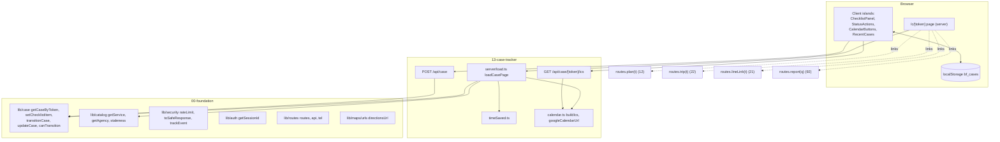
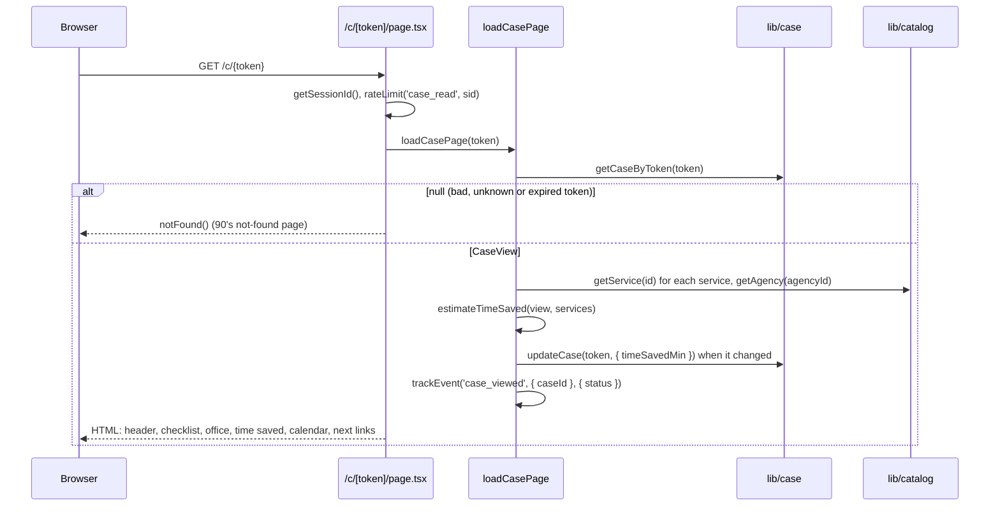
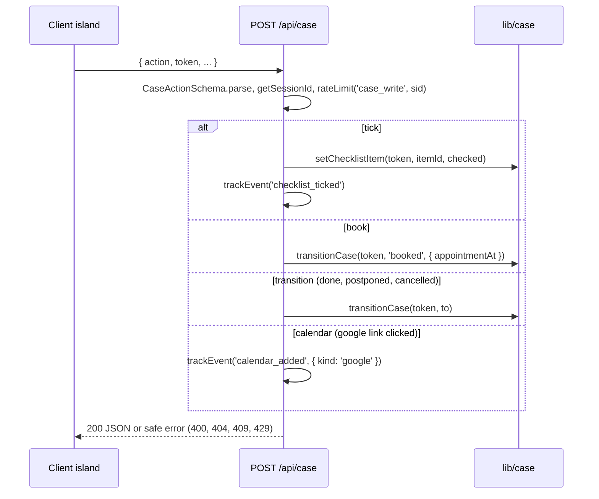

# Design Document: 13-case-tracker

Spec 13-case-tracker · Wave 1 · executor machine-a · Jira KAN-5 · depends on 00-foundation

## Overview

13-case-tracker owns the anonymous case page `routes.case(t)` (`/c/[token]`), its write API `api.case` (`/api/case`) and the calendar file `api.caseIcs(t)` (`/api/case/[token]/ics`). A user opens the link they got from the chat and sees the case status, the checklist they can tick, the chosen office, the leave-home time (computed by 22), an estimate of the time this plan saves (W-10), buttons to add the appointment to Google Calendar or download an `.ics` file with a 1-day alarm (W-17), and links onward to the plan page, the trip page and "ส่งเข้า LINE". No sign-up is needed: the 128-bit token in the URL is the access key, and the browser keeps a local list of the cases it has opened (W-12).

Scope rules:
- Reads and writes go only through `lib/case`, `lib/catalog`, `lib/security` and `lib/auth`. No direct table access.
- Owns `src/app/c/**`, `src/app/api/case/**`, `src/features/case-tracker/**` only.
- Demo quality. No automated tests (no requirement asks for them).

## Architecture



### Page load



### Writes



## Components and Interfaces

### Owned files

```
src/app/c/[token]/page.tsx                    server page (replaces the placeholder)
src/app/api/case/route.ts                     POST: tick | book | transition | calendar
src/app/api/case/[token]/ics/route.ts         GET: text/calendar
src/features/case-tracker/
├── schemas.ts                                isomorphic zod: CaseActionSchema
├── timeSaved.ts                              isomorphic, pure
├── calendar.ts                               isomorphic, pure: buildIcs, googleCalendarUrl
├── labels.ts                                 Thai labels for requirement kinds and actions
├── server/
│   ├── index.ts                              re-exports (the placeholder module, now filled)
│   └── load.ts                               loadCasePage
└── components/
    ├── CaseHeader.tsx                        title, status Chip, appointment, leave-home time
    ├── ChecklistPanel.tsx                    'use client': grouped Checkbox list, optimistic tick
    ├── OfficePanel.tsx                       office name, address, phone, station, hours, directions
    ├── OnlinePanel.tsx                       online-only cases: official channel + hotline
    ├── TimeSavedCard.tsx                     W-10
    ├── StatusActions.tsx                     'use client': book form + done/postpone/cancel
    ├── CalendarButtons.tsx                   'use client': Google link + .ics download
    ├── NextLinks.tsx                         plan, trip, ส่งเข้า LINE, copy/share link
    └── RecentCases.tsx                       'use client': localStorage list of opened cases
```

### Foundation usage

| Kind | Items |
| --- | --- |
| `lib/case` | `getCaseByToken`, `setChecklistItem`, `transitionCase`, `updateCase`, `canTransition` |
| `lib/catalog` | `getService` (for `durationMin`, `feeThb`), `getAgency` (police check); staleness through `StaleBadge` |
| `lib/auth` | `getSessionId` |
| `lib/security` | `CaseTokenSchema`, `UuidSchema`, `IsoDateTimeSchema`, `rateLimit('case_read' / 'case_write')`, `AppError`, `toSafeResponse`, `trackEvent`, `safeHref` |
| `lib/maps/urls` | `directionsUrl` |
| `lib/ai/disclaimers` | `NOT_POLICE_CHANNEL_TH`, `NOT_GOV_SITE_TH` |
| `lib/routes` | `routes.case`, `routes.plan`, `routes.trip`, `routes.lineLink`, `routes.report`, `routes.chat`, `api.case`, `api.caseIcs`, `tel` |
| `lib/contracts` | `CaseView`, `CaseStatus`, `CASE_TRANSITIONS`, `CASE_STATUS_LABEL_TH`, `ChecklistItem`, `Service`, `RequirementKind` |
| UI kit | `Card`, `Chip`, `Button`, `LinkButton`, `Checkbox`, `Alert`, `SourceBadge`, `StaleBadge`, `ExternalLink`, `HotlineLink`, `Spinner` |
| Events | `case_viewed`, `checklist_ticked`, `calendar_added` |
| Env | `NEXT_PUBLIC_SITE_URL` (absolute case link inside calendar entries) |

### Page layout (`/c/[token]`, mobile-first, one `h1`)

1. `CaseHeader`: `h1` = service names joined by " + "; status `Chip` with `CASE_STATUS_LABEL_TH`; appointment date in Thai (Buddhist year) when set; "ควรออกจากบ้าน HH:MM" when `departAt` is set (value from 22).
2. Police notice: when any service's agency kind is `police`, an `Alert tone="info"` with `NOT_POLICE_CHANNEL_TH`.
3. `OnlinePanel` (when `onlineOnly`): "เรื่องนี้ทำออนไลน์จบได้ ไม่ต้องเดินทาง", `ExternalLink` to each `onlineChannelUrl`, `HotlineLink` for each `hotline`.
4. `ChecklistPanel`: items grouped by kind in this order with headings: `before_go` "ทำก่อนไป", `document` "เอกสารที่ต้องเตรียม", `step` "ขั้นตอน", `remember` "ข้อมูลที่ต้องจำ". Items with `conditionStatus = 'unknown'` show their `conditionLabelTh` as "ถ้า…". Each service block ends with one `SourceBadge` and `StaleBadge` (items of one service share its source and date) and a small "ข้อมูลนี้ไม่ตรง" link to `routes.report({ serviceId, requirementId })` per item. A progress line "เตรียมแล้ว 3/5".
5. `OfficePanel` (when `office`): name, address, `tel:` link for `phone`, `nearestStationTh`, today's opening hours, `ExternalLink` "นำทางใน Google Maps" to `directionsUrl({ destination: office.googlePlaceId ? { placeId, name } : office.location, travelMode: 'TRANSIT' })`.
6. `TimeSavedCard` (W-10).
7. `StatusActions`: only transitions in `CASE_TRANSITIONS[status]` that pass `canTransition(status, to, onlineOnly)`, minus `due` (the retention cron sets it). `booked` shows a `datetime-local` input "วันเวลาที่จองได้" plus "บันทึกวันนัด". Cancel asks for a second tap.
8. `CalendarButtons` (W-17): enabled when `appointmentAt` is set; otherwise a hint "ใส่วันนัดก่อน แล้วเพิ่มลงปฏิทินได้".
9. `NextLinks`: "เลือกสำนักงาน / จุดเกิดเหตุ" → `routes.plan(t)` (not for online-only); "ดูเส้นทางและเวลาออกจากบ้าน" → `routes.trip(t)` (when `officeId`); "ส่งเข้า LINE" → `routes.lineLink(t)` (hidden and replaced by "ผูก LINE แล้ว" when `lineUserId` is set); "คัดลอกลิงก์" and `navigator.share` with "เก็บลิงก์นี้ไว้เพื่อเปิดดูภายหลัง (ไม่ต้องสมัคร)".
10. `RecentCases` (W-12): "Case ที่เปิดในเครื่องนี้".

`export const metadata = { robots: { index: false, follow: false } }` and `dynamic = 'force-dynamic'`.

## Data Models

No new tables or columns. The slice reads `CaseView` and writes `case_checklist_items.checked`, `cases.status`, `cases.appointment_at`, `cases.time_saved_min` through `lib/case`.

### `CaseActionSchema` (`schemas.ts`)

```typescript
export const CaseActionSchema = z.discriminatedUnion('action', [
  z.object({ action: z.literal('tick'), token: CaseTokenSchema, itemId: UuidSchema, checked: z.boolean() }).strict(),
  z.object({ action: z.literal('book'), token: CaseTokenSchema, appointmentAt: IsoDateTimeSchema }).strict(),
  z.object({ action: z.literal('transition'), token: CaseTokenSchema,
             to: z.enum(['done', 'postponed', 'cancelled']) }).strict(),
  z.object({ action: z.literal('calendar'), token: CaseTokenSchema, kind: z.literal('google') }).strict(),
])
export type CaseAction = z.infer<typeof CaseActionSchema>
```

`book` also checks on the server that `appointmentAt` is in the future and less than 365 days ahead (400 otherwise). The client converts the `datetime-local` value to ISO with `+07:00`.

### Responses

| Action | 200 body | Errors |
| --- | --- | --- |
| `tick` | `{ item: ChecklistItem }` | 404 when `setChecklistItem` returns null |
| `book`, `transition` | `{ status: CaseStatus, appointmentAt: IsoDateTime \| null }` | 404 `not_found`; 409 `conflict` for `invalid_transition`; 400 for `missing_appointment` |
| `calendar` | `{}` | 404 when the token is unknown |

The client calls `router.refresh()` after `book` and `transition` so the server page re-renders with the new status and actions.

### Local case list (`RecentCases`)

`localStorage['bf_cases']` = JSON array, newest first, max 10: `{ token: CaseToken, titleTh: string, status: CaseStatus, savedAt: IsoDateTime }`. Written on every visit by a client effect. Entries are validated with `isCaseToken` on read; invalid ones are dropped. The list renders links to `routes.case(token)` except the current one, plus "ลบออกจากรายการ". Nothing about it reaches the server.

Why local: `listCasesForSession` returns `CaseSummary` without tokens (tokens are stored only as hashes), so a server-side list cannot link to other cases.

## Algorithms

### `estimateTimeSaved` (`timeSaved.ts`, W-10)

```typescript
export const DEFAULT_ONE_WAY_MIN = 45
export const DEFAULT_SERVICE_MIN = 60
export type TimeSaved = { minutes: number; basisTh: string }
export function estimateTimeSaved(c: Pick<CaseView, 'onlineOnly' | 'appointmentAt' | 'departAt'>,
                                  services: readonly Pick<Service, 'durationMin'>[]): TimeSaved
```

- `oneWay` = minutes from `departAt` to `appointmentAt` when both are set and the gap is 5–240 minutes, else `DEFAULT_ONE_WAY_MIN`.
- `wait` = max of `services[].durationMin`, else `DEFAULT_SERVICE_MIN`.
- `minutes` = `2 × oneWay + wait`, rounded to 5.
- `basisTh`: online-only → "ไม่ต้องเดินทางไปสำนักงาน (ไป-กลับ + เวลารอ)"; otherwise → "เลี่ยงการไปซ้ำ 1 เที่ยวเพราะเตรียมเอกสารครบ (ไป-กลับ + เวลารอ)".
- The card shows "ประหยัดได้ประมาณ X ชม. Y นาที" and the basis line, and says it is an estimate.
- `loadCasePage` calls `updateCase(token, { timeSavedMin: minutes })` only when the stored value differs, so 92 can report it.

### `buildIcs` and `googleCalendarUrl` (`calendar.ts`, W-17)

```typescript
export type CalendarInput = { caseId: Uuid; titleTh: string; appointmentAt: IsoDateTime; departAt: IsoDateTime | null;
  durationMin: number; office: Pick<Office, 'nameTh' | 'addressTh'> | null; directionsHref: string | null;
  checklist: readonly Pick<ChecklistItem, 'textTh' | 'checked'>[]; caseHref: string }
export function buildIcs(e: CalendarInput, now: Date): string
export function googleCalendarUrl(e: CalendarInput): string
```

- Event start = `departAt ?? appointmentAt` (the user leaves home at this time); end = `appointmentAt + durationMin`.
- `SUMMARY` = `titleTh`; `LOCATION` = office name and address; `DESCRIPTION` lines: "นัด HH:MM", "ควรออกจากบ้าน HH:MM" (when set), "นำทาง: {directionsHref}", "Checklist:" then "☐ / ☑ {text}" per item, "ดูแผน: {caseHref}", `NOT_GOV_SITE_TH`.
- `.ics`: `BEGIN:VCALENDAR`, `VERSION:2.0`, `PRODID:-//Bangkok Flow//TH`, `CALSCALE:GREGORIAN`, one `VEVENT` with `UID:{caseId}@bangkok-flow`, `DTSTAMP`, `DTSTART`/`DTEND` in UTC (`YYYYMMDDTHHMMSSZ`), and `BEGIN:VALARM` `ACTION:DISPLAY` `TRIGGER:-P1D`. Text values escape `\`, `;`, `,` and newlines; lines are folded at 75 octets; line endings are CRLF.
- Google link: `https://calendar.google.com/calendar/render?action=TEMPLATE&text=…&dates={start}/{end}&details=…&location=…`. `details` is cut to 1,500 characters (checklist truncated with "…"). Google Calendar sets its own default reminder; the 1-day alarm is only guaranteed in the `.ics`.
- `caseHref` = `NEXT_PUBLIC_SITE_URL + routes.case(token)`. The token appears in the user's own calendar only.

### `GET /api/case/[token]/ics`

1. `getCaseByToken(token)`; null → 404.
2. No `appointmentAt` → 409 `conflict`.
3. `getService` for durations, `buildIcs`.
4. `trackEvent('calendar_added', { caseId }, { kind: 'ics' })`.
5. Respond `200`, `Content-Type: text/calendar; charset=utf-8`, `Content-Disposition: attachment; filename="bangkok-flow-case.ics"`, `Cache-Control: no-store`.

## Error Handling

| Case | Behaviour |
| --- | --- |
| Malformed, unknown or expired token | Page `notFound()`; API 404 |
| Rate limited | Page shows `Alert` "เปิดบ่อยเกินไป ลองใหม่ในอีกสักครู่"; API 429 with `Retry-After` |
| Invalid transition (stale tab) | 409; client shows "สถานะเปลี่ยนไปแล้ว" and refreshes |
| Tick fails | Checkbox reverts and shows a short error |
| Calendar before booking | Buttons disabled with the hint; `.ics` route returns 409 |
| Any other error | `toSafeResponse` generic Thai message |

## Security and Privacy

- The token is the only key; every write is scoped by `lib/case` to the token's case (A01). No case UUID is accepted from the client.
- The page never shows the origin point (only `hasOrigin`), and the calendar entry has no origin (T-C3).
- Only allowlisted links render (`ExternalLink`, `safeHref`). Calendar links use `calendar.google.com`, which is on the allowlist.
- `robots` noindex on token pages; no token in logs or events.

## Testing Strategy

No automated tests. Manual checks with the demo tokens after `npm run db:reset`: `/c/demoPlanned0000000000A` (tick, book), `/c/demoBooked00000000000A` (calendar, `.ics` with `VALARM`), `/c/demoOnline00000000000A` (online panel, time saved), `/c/demoDone0000000000000A` (no actions), `/c/xxx` (404).

## Foundation Gaps

None block this slice. Notes for the lead:
- `CaseSummary` from `listCasesForSession` has no token, so a server-side "Case ของฉัน" list cannot link to cases. This slice uses a browser-local list instead.
